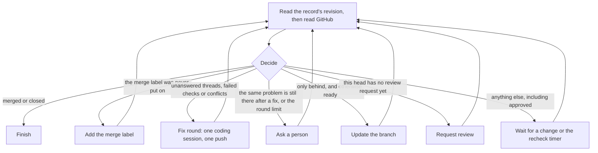

# Example: following our own pull request

The author workflow of the three in `example-pr-flows.md`. It follows a pull request that one of our own agents opened: it answers review comments, fixes failing checks, resolves conflicts, updates a branch that is behind and requests review. It does not merge. The merge workflow does (`example-pr-merge.md`).

It is a sketch against the library proposed in `plan.md` section 7. Nothing here compiles or has run. It is not a port: jobcity has no flow like this.

The review workflow and the merge workflow can be open on the same pull request at once, beside any number of people. "What stops ping-pong" below is about how they avoid working against each other.

## The flow



Once the pull request is approved and nothing is left to fix, this workflow waits. The merge workflow or a person merges it, and the next read finishes the ticket.

## What it does about a merge blocker

The merge workflow tells the author when a pull request cannot merge until the author acts (`example-pr-merge.md`, "Who must act on a blocker"). For one of our own pull requests no comment is posted. This workflow reads the same state from GitHub and acts on it. It watches the base branch as the merge workflow does, so the push that puts the pull request behind or in conflict wakes it too.

| Merge blocker | What this workflow does |
|---|---|
| Conflicts with the base | A fix round. The session resolves the conflicts and pushes |
| A check failed | A fix round |
| Behind the base | Updates the branch, once nothing else is missing |
| An approval is for an earlier head | Requests review of the current head, once |

Each of them makes a new head or a new request, and the review workflow reviews it. The merge workflow waits for that review.

## What stops ping-pong

| Risk | Rule |
|---|---|
| A workflow wakes on its own write and acts again | Nothing is decided from an event. After its own write the workflow reads GitHub, and `Decide` finds nothing new to do |
| The author fixes, the same check fails, it fixes again, without end | An action is tried at most `MaxAttemptsPerProblem` times for the same problem. The problem's key does not contain the head, so a new push does not reset the count. After that a person is asked |
| Reviewer and author trade rounds without end | Each side has its own round limit and asks a person at the limit. The reviewer's later rounds are delta reviews, and its prompt says not to raise new minor points on code that did not change |
| Every fix push triggers a review of a half-finished head | The reviewer only reviews on a request. The author requests review once per head, and only when no problem is left and checks are not failing |
| The author pushes while a review of the old head is running | The reviewer cancels that round and waits for the new request. One fix round handles every open problem in one push, so there are few heads |
| A branch update makes a new head, which needs a new approval, while the base moves again | The branch is updated only when nothing else is missing. This still costs one review per update. A merge queue on the repository removes the problem, and is the better answer where it is available |
| A person pushes to the branch during a fix | The fix round is cancelled. Events carry their actor, so the workflow can tell its own push from someone else's |
| Two workflows try to merge | Only the merge workflow merges |
| A person takes the merge label off and the workflow puts it back | The label is added once and recorded on the ticket. It is never added again |
| Several workflows ask a person about the same pull request | Questions name the pull request as their subject. The attention list groups them |

## Types

```proto
// Ticket fields for kind pr_author. One ticket follows one pull request of ours.
message PRAuthor {
  string repo = 1;
  int32 pr = 2;
  string branch = 3;
  string base = 4;                      // the base branch, watched for pushes
  string issue = 5;                     // Linear key, may be empty
  string image = 6;
  repeated string reviewers = 7;        // who is asked to review
  string merge_label = 8;               // the label that asks for a merge. Empty: do not ask
  bool merge_label_added = 9;           // this workflow has put the merge label on once
  int32 fix_rounds = 10;                // fix rounds that finished
  int32 extra_rounds = 11;              // rounds a person allowed beyond MaxFixRounds
  map<string, int32> attempts = 12;     // problem key to times a fix was tried
  repeated string requested_heads = 13; // heads review was requested for
  repeated string cleared = 14;         // problem keys a person said to try again
}

// What the coding session submits at the end of a fix round.
message FixReport {
  FixOutcome outcome = 1;           // PUSHED, NOTHING_TO_DO or NEEDS_PERSON
  string head = 2;                  // the commit it pushed, with PUSHED
  repeated ThreadReply replies = 3; // thread, body, and whether to resolve it
  string summary = 4;
  string question = 5;              // with NEEDS_PERSON: what it needs to know
}

// The result stored on the pr_author ticket when the workflow finishes.
message Result {
  Outcome outcome = 1; // MERGED, CLOSED or STOPPED
}
```

`Decide` reads this from the `github` package. `Thread`, `Check` and `Mergeable` are in `example-pr-flows.md`.

```go
// In package github.

// AuthorState is what GitHub says about one of our own pull requests now.
type AuthorState struct {
	Open   bool
	Merged bool
	Draft  bool
	Head   string
	Base   string
	// UnansweredThreads are unresolved threads whose last comment is not ours.
	UnansweredThreads []Thread
	// ChangesRequestedBy lists reviewers whose change request stands.
	ChangesRequestedBy []string
	// FailedChecks are finished checks on the head that did not pass.
	FailedChecks  []Check
	ChecksPending bool
	Mergeable     Mergeable
	// PendingReviewers have been asked for a review of this head and have not given one.
	PendingReviewers []string
	// ApprovedBy lists everyone who approved the current head. An approval of
	// an earlier head is not in it, whatever the repository's rules say.
	ApprovedBy []string
}
```

## The workflow

```go
// Package prauthor follows pull requests that our own agents opened.
package prauthor

import (
	"errors"
	"fmt"
	"slices"
	"strings"
	"time"

	p7 "github.com/gfx-labs/protocol7"
	"go.temporal.io/sdk/workflow"

	authorv1 "example.com/gfx/gen/author/v1"
	"example.com/gfx/github"
	"example.com/gfx/prflow"
	"example.com/gfx/prompts"
)

const (
	// MaxFixRounds is the number of fix rounds a pull request may get before a person is asked.
	MaxFixRounds = 6
	// MaxAttemptsPerProblem is the number of times a fix is tried for the same problem.
	MaxAttemptsPerProblem = 2
	// WorkDirectory is where the coding session finds its clone.
	WorkDirectory = "/work"
	// FixLimit is the shared limit every fix session counts against.
	FixLimit = "author:fix"
)

// Config is everything that differs between installations.
type Config struct {
	// AuthorLogin is the GitHub login our agents open pull requests as.
	AuthorLogin string
	// Coder is the ordered model list of a fix session.
	Coder    []string
	Guidance []p7.Input
	// Owners are asked the questions and told when something is overdue.
	Owners []p7.Recipient
	// ReviewOverdue says who is told, and when, if a requested review does not arrive.
	ReviewOverdue []p7.EscalationStep
	// QuestionOverdue is the same for a question nobody has answered.
	QuestionOverdue []p7.EscalationStep
	// Recheck is how often a waiting workflow reads GitHub when no event arrives.
	Recheck time.Duration
}

// Repo is one repository whose pull requests of ours are followed. Intake
// copies it to the ticket.
type Repo struct {
	// Image is the image a fix session runs in.
	Image string
	// Reviewers are asked to review each head.
	Reviewers []string
	// RequestMerge puts the repository's merge label on each pull request of
	// ours, so the merge workflow follows it.
	RequestMerge bool
}

// Workflows holds the configuration that the workflows read.
type Workflows struct {
	config Config
}

// Register adds the author workflow to a worker.
func Register(worker *p7.Worker, config Config) {
	workflows := &Workflows{config: config}
	p7.Register(worker, "pr_author", workflows.Follow)
}

// Follow follows one of our own pull requests until it is merged or closed.
func (w *Workflows) Follow(
	ctx workflow.Context,
	ticket p7.Ticket[*authorv1.PRAuthor],
) (*authorv1.Result, error) {
	pull := ticket.Fields
	if pull.Attempts == nil {
		pull.Attempts = map[string]int32{}
	}
	pullRequestRef := github.PullRequest(pull.Repo, pull.Pr)

	for {
		// Move to a new build, or shorten a long history, before deciding
		// anything. Between passes no fix round is running and all state is on
		// the ticket.
		info := workflow.GetInfo(ctx)
		if info.GetContinueAsNewSuggested() || info.GetTargetWorkerDeploymentVersionChanged() {
			return nil, p7.ContinueAsNew(ctx, ticket)
		}

		// Read both revisions before reading GitHub, so a change that lands
		// between the reads and the wait still wakes the workflow.
		object, err := p7.GetObject(ctx, pullRequestRef)
		if err != nil {
			return nil, fmt.Errorf("read pull request object: %w", err)
		}
		baseRef := github.Branch(pull.Repo, pull.Base)
		base, err := p7.GetObject(ctx, baseRef)
		if err != nil {
			return nil, fmt.Errorf("read base branch object: %w", err)
		}
		state, err := github.GetAuthorState(ctx, pull.Repo, pull.Pr)
		if err != nil {
			return nil, fmt.Errorf("read pull request: %w", err)
		}
		if state.Open && state.Base != pull.Base {
			// The pull request was retargeted. Watch the new base from the next pass.
			pull.Base = state.Base
			if err := p7.UpdateFields(ctx, ticket, pull); err != nil {
				return nil, fmt.Errorf("record base branch: %w", err)
			}
			continue
		}
		// A push to the base branch can put this pull request behind or in
		// conflict, and GitHub sends no pull request event for that.
		pullRequestChanges := p7.Since{Record: pullRequestRef, Revision: object.Revision, Kinds: github.AuthorRelevantEvents}
		watched := []p7.Since{pullRequestChanges, {Record: baseRef, Revision: base.Revision}}

		action := Decide(state, pull)
		workflow.SetCurrentDetails(ctx, action.Reason)
		if err := p7.SetEscalation(ctx, ticket, w.escalationFor(ticket.ID, state, action)); err != nil {
			return nil, fmt.Errorf("set escalation: %w", err)
		}

		switch action.Kind {
		case ActionFinish:
			return &authorv1.Result{Outcome: action.Outcome}, nil

		case ActionRequestMerge:
			if err := github.AddLabel(ctx, pull.Repo, pull.Pr, pull.MergeLabel); err != nil {
				return nil, fmt.Errorf("add merge label: %w", err)
			}
			// Recorded, so the label is never added a second time. A person
			// who takes it off has decided, and this workflow leaves it off.
			pull.MergeLabelAdded = true
			if err := p7.UpdateFields(ctx, ticket, pull); err != nil {
				return nil, fmt.Errorf("record merge label: %w", err)
			}
			continue

		case ActionFix:
			// Count the attempt before it runs, so a fix that fails halfway
			// still counts against its problems.
			for _, problem := range action.Problems {
				pull.Attempts[problem.Key]++
			}
			if err := p7.UpdateFields(ctx, ticket, pull); err != nil {
				return nil, fmt.Errorf("record fix attempt: %w", err)
			}
			interrupted, err := w.fixRound(ctx, ticket.ID, pull, state, action.Problems, pullRequestChanges)
			if err != nil {
				return nil, err
			}
			if !interrupted {
				pull.FixRounds++
				if err := p7.UpdateFields(ctx, ticket, pull); err != nil {
					return nil, fmt.Errorf("record fix round: %w", err)
				}
			}
			continue

		case ActionAsk:
			stop, err := w.askAndApply(ctx, ticket, pull, state, action, watched)
			if err != nil {
				return nil, err
			}
			if stop {
				return &authorv1.Result{Outcome: authorv1.Outcome_STOPPED}, nil
			}
			continue

		case ActionUpdateBranch:
			// No agent. GitHub merges the base into the branch, or refuses.
			err := github.UpdateBranch(ctx, pull.Repo, pull.Pr, state.Head)
			if err != nil && !errors.Is(err, github.ErrHeadMoved) {
				return nil, fmt.Errorf("update branch: %w", err)
			}

		case ActionRequestReview:
			if err := github.RequestReview(ctx, pull.Repo, pull.Pr, pull.Reviewers); err != nil {
				return nil, fmt.Errorf("request review: %w", err)
			}
			pull.RequestedHeads = append(pull.RequestedHeads, state.Head)
			if err := p7.UpdateFields(ctx, ticket, pull); err != nil {
				return nil, fmt.Errorf("record review request: %w", err)
			}
			continue

		case ActionWait:
		}

		if err := prflow.WaitForChange(ctx, w.config.Recheck, watched...); err != nil {
			return nil, err
		}
	}
}

// escalationFor returns the escalation that should run while a requested
// review has not arrived, or nil. The head is in the key, so a new head
// starts a new clock.
func (w *Workflows) escalationFor(ticketID string, state github.AuthorState, action Action) *p7.Escalation {
	if !action.ReviewOverdue {
		return nil
	}
	return &p7.Escalation{
		Key:     ticketID + ":review:" + state.Head,
		Subject: action.Reason,
		Steps:   w.config.ReviewOverdue,
	}
}

// fixRound runs one coding session on every open problem and posts its
// replies. It reports interrupted when someone else pushed to the branch
// first. Then nothing was posted, and the next pass starts from their head.
func (w *Workflows) fixRound(
	ctx workflow.Context,
	ticketID string,
	pull *authorv1.PRAuthor,
	state github.AuthorState,
	problems []Problem,
	pullRequestChanges p7.Since,
) (interrupted bool, err error) {
	roundCtx, cancelRound := workflow.WithCancel(ctx)
	defer cancelRound()

	// Cancel the round when anyone but this workflow's own login moves the
	// head. The session's own push arrives here too, and is ignored.
	since := pullRequestChanges
	since.Kinds = github.SupersedingEvents
	workflow.Go(roundCtx, func(watchCtx workflow.Context) {
		for {
			var events []p7.Event
			if err := p7.Watch(watchCtx, since).Get(watchCtx, &events); err != nil {
				return
			}
			for _, event := range events {
				if event.Actor != w.config.AuthorLogin && github.Supersedes(event, state.Head) {
					cancelRound()
					return
				}
				since.Revision = event.Revision
			}
		}
	})

	// The clone is writable. The session may push to this branch and nowhere else.
	clone := p7.GitClone{Repository: pull.Repo, Ref: state.Head, Branch: pull.Branch}
	report, err := p7.Agent[*authorv1.FixReport](roundCtx, p7.AgentSpec{
		Models:   w.config.Coder,
		Image:    pull.Image,
		Prompt:   prompts.Fix(pull, state, problems),
		Inputs:   slices.Concat([]p7.Input{{Source: clone, Destination: WorkDirectory}}, w.config.Guidance),
		Egress:   []p7.EgressRef{github.PushBranch(pull.Repo, pull.Branch)},
		Limits:   []string{FixLimit, "repo:" + pull.Repo},
		Priority: p7.PriorityNormal,
		Timeout:  2 * time.Hour,
	})
	if err != nil {
		if roundCtx.Err() != nil && ctx.Err() == nil {
			return true, nil
		}
		return false, fmt.Errorf("fix round: %w", err)
	}

	// The workflow posts the replies, each under its own key. The session
	// cannot comment. A thread is resolved only when the reply says so.
	for _, reply := range report.Replies {
		err := github.ReplyToThread(ctx, github.ThreadReply{
			Repo:         pull.Repo,
			PullRequest:  pull.Pr,
			Thread:       reply.Thread,
			Body:         reply.Body,
			Resolve:      reply.Resolve,
			OperationKey: fmt.Sprintf("reply:%s:%s:%d", ticketID, reply.Thread, pull.FixRounds),
		})
		if err != nil {
			return false, fmt.Errorf("reply on thread %s: %w", reply.Thread, err)
		}
	}
	if report.Outcome == authorv1.FixOutcome_NEEDS_PERSON {
		// Mark every problem as out of attempts. The next pass asks a person,
		// with the session's question in the ticket's history.
		for _, problem := range problems {
			pull.Attempts[problem.Key] = MaxAttemptsPerProblem
		}
	}
	return false, nil
}
```

Left out: `askAndApply`. It asks the owners with `p7.Ask` the way `askAboutRoundLimit` does in the review workflow, and applies the answer: try again, which adds the problem's key to `cleared`, allow more rounds, or stop following, for which it returns true.

## Deciding

```go
// Problem is one thing wrong with the pull request that a coding session can fix.
type Problem struct {
	// Key names the problem without naming the head, so it stays the same
	// across pushes. Attempts are counted against it.
	Key  string
	Text string
}

// ActionKind is the one thing the Follow workflow does on a pass.
type ActionKind int

const (
	// ActionWait waits for the pull request to change.
	ActionWait ActionKind = iota
	// ActionRequestMerge puts the merge label on the pull request.
	ActionRequestMerge
	// ActionFix runs one coding session on every open problem.
	ActionFix
	// ActionAsk asks a person what to do about a problem a fix did not clear.
	ActionAsk
	// ActionUpdateBranch merges the base branch into the pull request's branch.
	ActionUpdateBranch
	// ActionRequestReview asks the reviewers to review the current head.
	ActionRequestReview
	// ActionFinish ends the workflow.
	ActionFinish
)

// Action is what Decide returns.
type Action struct {
	Kind     ActionKind
	Outcome  authorv1.Outcome
	Reason   string
	Problems []Problem
	// ReviewOverdue is set while a requested review has not arrived.
	ReviewOverdue bool
}

// Decide returns what to do for one of our own pull requests.
func Decide(state github.AuthorState, pull *authorv1.PRAuthor) Action {
	switch {
	case state.Merged:
		return Action{Kind: ActionFinish, Outcome: authorv1.Outcome_MERGED, Reason: "merged"}
	case !state.Open:
		return Action{Kind: ActionFinish, Outcome: authorv1.Outcome_CLOSED, Reason: "closed"}
	case state.Draft:
		return Action{Kind: ActionWait, Reason: "waiting: draft"}
	case pull.MergeLabel != "" && !pull.MergeLabelAdded:
		return Action{Kind: ActionRequestMerge, Reason: "asking for a merge with the label " + pull.MergeLabel}
	}

	if problems := Problems(state); len(problems) > 0 {
		exhausted := func(problem Problem) bool {
			return pull.Attempts[problem.Key] >= MaxAttemptsPerProblem && !slices.Contains(pull.Cleared, problem.Key)
		}
		switch {
		case slices.ContainsFunc(problems, exhausted):
			return Action{Kind: ActionAsk, Reason: "asking a person: a fix did not clear the problem", Problems: problems}
		case pull.FixRounds >= MaxFixRounds+pull.ExtraRounds:
			return Action{Kind: ActionAsk, Reason: "asking a person: fix round limit reached", Problems: problems}
		}
		return Action{Kind: ActionFix, Reason: fmt.Sprintf("fixing %d problems", len(problems)), Problems: problems}
	}

	approved := func(reviewer string) bool { return slices.Contains(state.ApprovedBy, reviewer) }
	switch {
	case state.ChecksPending:
		return Action{Kind: ActionWait, Reason: "waiting: checks running"}
	case len(state.PendingReviewers) > 0:
		return Action{Kind: ActionWait, Reason: "waiting: review requested", ReviewOverdue: true}
	case len(state.ChangesRequestedBy) > 0:
		// Every thread is answered and the change request still stands, so
		// the reviewer has to look again.
		return requestReviewOnce(state, pull, "waiting: changes requested, replies posted")
	case !slices.ContainsFunc(pull.Reviewers, approved):
		return requestReviewOnce(state, pull, "waiting: no approval for this head")
	case state.Mergeable == github.MergeableBehind:
		// Only now, when nothing else is missing. An update makes a new head,
		// and the next pass requests review of it.
		return Action{Kind: ActionUpdateBranch, Reason: "updating the branch"}
	}
	// Approved and nothing left to fix. Merging is not this workflow's write.
	return Action{Kind: ActionWait, Reason: "waiting: approved, the merge workflow or a person merges it"}
}

// requestReviewOnce asks for review of a head the first time and waits after that.
func requestReviewOnce(state github.AuthorState, pull *authorv1.PRAuthor, waiting string) Action {
	if slices.Contains(pull.RequestedHeads, state.Head) {
		return Action{Kind: ActionWait, Reason: waiting, ReviewOverdue: true}
	}
	return Action{Kind: ActionRequestReview, Reason: "requesting review of " + state.Head}
}

// Problems lists what a coding session should fix, in one round.
func Problems(state github.AuthorState) []Problem {
	var problems []Problem
	for _, thread := range state.UnansweredThreads {
		last := thread.Comments[len(thread.Comments)-1]
		problems = append(problems, Problem{
			// The last comment is in the key, so a new reply from the reviewer
			// on the same thread is a new problem.
			Key:  fmt.Sprintf("thread:%s:%d", thread.ID, last.ID),
			Text: fmt.Sprintf("%s:%d: %s", thread.Path, thread.Line, last.Body),
		})
	}
	if len(state.FailedChecks) > 0 {
		names := make([]string, 0, len(state.FailedChecks))
		for _, check := range state.FailedChecks {
			names = append(names, check.Name)
		}
		slices.Sort(names)
		problems = append(problems, Problem{
			Key:  "checks:" + strings.Join(names, ","),
			Text: "failed checks: " + strings.Join(names, ", "),
		})
	}
	if state.Mergeable == github.MergeableConflicts {
		problems = append(problems, Problem{Key: "conflicts", Text: "the branch conflicts with its base"})
	}
	return problems
}
```

## What this needs from the library

Everything `example-pr-review.md` lists, and three more:

1. **The actor on every event.** `fixRound` tells its own push from a person's by `event.Actor`. Without it the workflow cancels its own fix round when its own push arrives.
2. **A branch on a `p7.GitClone` input.** The clone is checked out on a named branch, so the session can commit and push without setting anything up.
3. **A push grant limited to one branch.** `github.PushBranch` is this repo's egress reference. PDP cannot limit a push to a branch today, because the refs a push updates are in the request body (plan section 9). The first thing to test is a GitHub ruleset that keeps the author identity to an agent branch prefix.

## Open

- **How the pull request is opened.** The workflow that writes the change opens it as the author login. Intake then files this ticket because of who the author is (`example-pr-flows.md`). The opening workflow is not shown.
- **The first failed check is treated like any other.** A flaky check costs a coding session. Rerunning a failed check once before fixing would be cheaper. A failed check that the repository does not require is fixed too, though it does not block the merge.
- **The reviewer sees every head the author requests review for.** With a reviewer that takes twenty minutes a round, six fix rounds is two hours of reviews. The limits on both sides bound it, but nothing makes the two sides converge faster.
- **Review is requested for every head, whatever the merge criteria say.** `ApprovedBy` counts approvals of the current head only. Where a repository's criteria accept an approval of an earlier head, a branch update still costs a review here.
- **Two agents can agree with each other and be wrong.** Our author and our reviewer are both ours. A person among the required approvers in the merge criteria is the gate that puts a person in the loop.
- **The merge label is added before the first review.** That asks for a merge of whatever is approved later. The merge criteria decide when, so nothing merges early, but the label says nothing about whether the work is finished.
- None of this has run. Every `p7`, `github`, `prflow` and `prompts` call is proposed.
