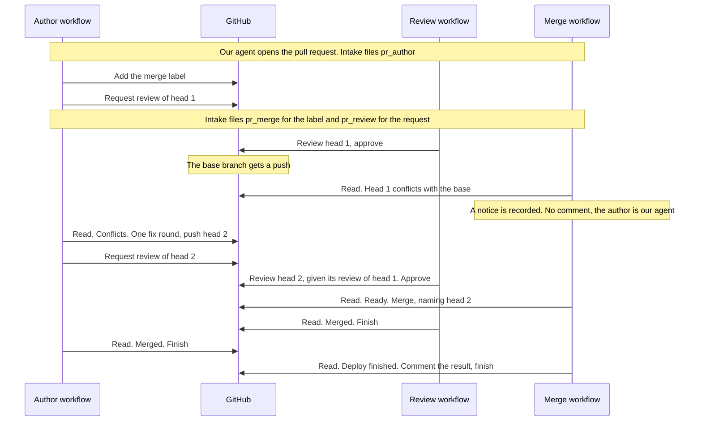

# Example: three workflows on one pull request

Three workflows can follow the same pull request. Each has its own file. This file has what they share: who writes what, what starts each one, the labels, the GitHub identities, the `github` package, intake, and the binaries.

| Workflow | Ticket kind | File | Follows | Agent sessions |
|---|---|---|---|---|
| `prreview.Review` | `pr_review` | `example-pr-review.md` | A pull request our review was requested on | One per review round, and one per capture |
| `prauthor.Follow` | `pr_author` | `example-pr-author.md` | A pull request one of our agents opened | One per fix round |
| `prmerge.Merge` | `pr_merge` | `example-pr-merge.md` | A pull request that carries the merge label | None |

All four files are sketches against the library proposed in `plan.md` section 7. Nothing compiles or has run. Where something was read from GitHub, the file says so.

The three workflows run the same loop. An event only wakes a workflow. It then reads the pull request from GitHub, one pure `Decide` function returns one action, the workflow does it, and it reads again.

No workflow signals another. Each one acts on what it reads from GitHub, so a person who does the same thing by hand has the same effect as a workflow doing it.

## One pull request from start to finish

A pull request that one of our agents opened, in a repository where all three workflows run, and whose base branch moves once:



For a pull request a person wrote, there is no author workflow. The person requests the review and adds the merge label. On a conflict the merge workflow comments on the pull request and mentions them. They fix it and request review again, and the merge workflow waits for that review.

## Who writes what

Each kind of write to a pull request has one owner. A workflow never does another owner's write, and never undoes one.

| Write | Owner |
|---|---|
| Commits on the branch, branch updates | The author workflow |
| Replies on review threads, and resolving a thread it answered | The author workflow |
| Requesting review | The author workflow |
| Putting the merge label on a pull request of ours, once | The author workflow, where the repository sets `RequestMerge` |
| Reviews: approve, request changes, comment | The review workflow |
| Opening review threads, and the eyes reaction on a request | The review workflow |
| Merging | The merge workflow |
| Comments that report a merge blocker or a deploy result | The merge workflow |
| Anything at all | A person. Every workflow reads the result and carries on |

The review workflow and the author workflow never merge (user, 2026-11-13). The reviewer may not be the last reviewer, so an approval is not a decision to merge.

## What starts each workflow

Intake files one ticket per pull request and workflow. A `Once` key refuses a second one.

| Ticket | Filed when | `Once` key |
|---|---|---|
| `pr_review` | Our review was requested: a review request to the reviewer login, a comment that mentions it from someone with write access, or the review label. The pull request is not a draft and its author has write access | `review:<repo>#<pr>` |
| `pr_author` | The author of the pull request is our author login | `author:<repo>#<pr>` |
| `pr_merge` | The merge label is on the pull request, and whoever put it there has write access | `merge:<repo>#<pr>` |

The repository must also be configured for that workflow. After filing, the workflow sees every later change itself. A new head, a new request or a removed label files nothing.

## Labels

The names are settings. These are the ones the example uses.

| Label | Who applies it | What it does |
|---|---|---|
| `review:elee-agent` | A person | Requests a review. One of the three ways to request one |
| `automerge` | A person with write access, or the author workflow for a pull request of ours | The merge workflow follows the pull request and merges it once the repository's criteria hold. While the label is off, the workflow waits and merges nothing |
| `do not merge` | Anyone who can label | Holds the merge while it is on |

Read on 2026-11-13, with read-only API calls:

- `oku-trade/trade`, `oku-trade/retail` and `oku-trade/account` all have `review:elee-agent`, which jobcity uses today.
- `oku-trade/trade` and `oku-trade/account` have a label named `ready-to-merge`. No open pull request carried it. `oku-trade/trade` has `do not merge`.
- GitHub's documentation gives label rights to anyone with triage access, which is less than write access. That is why the merge label only counts when the person who applied it has write access.

## GitHub identities

Three GitHub Apps, so that a write shows who made it and PDP can limit each one.

| Identity | Writes | GraphQL mutations PDP allows it |
|---|---|---|
| Reviewer | Reviews with their threads, the eyes reaction | `addPullRequestReview`, `addReaction` |
| Author | Pushes from a coding session, branch updates, thread replies, review requests, the merge label | `updatePullRequestBranch`, `addPullRequestReviewThreadReply`, `resolveReviewThread`, `requestReviews`, `addLabelsToLabelable` |
| Merger | The merge, and comments that report a blocker or a deploy | `mergePullRequest`, `addComment` |

- Each mutation is in GitHub's published GraphQL schema. None was called.
- GitHub does not accept an approval from a pull request's author, so the reviewer and the author must differ. GitHub counts an approval toward required reviews only from a reviewer with write access (plan section 10).
- The merger is on no ruleset's bypass list, so GitHub's own rules apply to its merges. No session is given the merger or the reviewer. A coding session gets the author's push grant for its own branch (plan section 9).
- The App permissions each identity needs were not worked out, except that GitHub documents "Contents" write for a merge.
- Every identity reads the pull requests it works on. Intake reads with the reviewer identity.
- As drafted, all three workflows register on one worker. PDP sees one caller, which policy grants three bindings, and the `github` package picks the binding by the function called. The separation is then this repo's code. Running each workflow's GitHub activities in its own worker deployment gives each binding its own caller. That is open (plan section 9).

## The `github` package

This repo's code. protocol7 has no GitHub types. A function called with a workflow context runs one activity that calls GitHub through PDP, and turns a known refusal into a Go error such as `github.ErrHeadMoved`. `github.Client` has the same reads for code outside a workflow.

`github.PullRequest(repo, number)` and `github.Branch(repo, name)` build the provider-neutral `p7.ObjectRef` of a pull request and of a branch.

### Shared types

```go
// In package github.

// Mergeable is GitHub's answer to "can this pull request be merged now". It
// covers the repository's rulesets: required reviews, required checks,
// conflicts and a branch that must be current.
type Mergeable int

const (
	// MergeableUnknown means GitHub has not computed it yet. Read again soon.
	MergeableUnknown Mergeable = iota
	MergeableClean
	// MergeableBehind means the base branch has commits this branch must include first.
	MergeableBehind
	MergeableConflicts
	// MergeableBlocked means a rule of the repository is not met.
	MergeableBlocked
)

// Thread is one review thread on a pull request.
type Thread struct {
	ID       string
	Path     string
	Line     int
	Resolved bool
	// Outdated is set when the line the thread is on has changed since.
	Outdated bool
	Comments []ThreadComment // oldest first
}

// ThreadComment is one comment in a review thread.
type ThreadComment struct {
	ID     int64
	Author string
	Body   string
}

// Check is one check on a commit.
type Check struct {
	Name string
	// Required is set when the repository requires the check before a merge.
	Required bool
}

// Summary is what intake reads about one open pull request.
type Summary struct {
	Number int32
	Title  string
	Draft  bool
	Author string
	// AuthorCanWrite is set when the author has write access to the repository.
	AuthorCanWrite bool
	Branch         string
	Base           string
	// Issue is the Linear key in the title or the branch name. It may be empty.
	Issue string
	// ReviewRequested is set when a review by the reviewer login is requested:
	// a review request, a comment that mentions it from someone with write
	// access, or the review label.
	ReviewRequested bool
	// MergeRequested is set when the merge label is on the pull request and
	// whoever put it there has write access.
	MergeRequested bool
}

// Requests names the login and the labels that make a request in one repository.
type Requests struct {
	ReviewerLogin string
	ReviewLabel   string
	// MergeLabel is empty in a repository the merge workflow does not run in.
	MergeLabel string
}
```

`Mergeable` is built from two fields of GitHub's GraphQL `PullRequest`. The values are from the published schema.

| `Mergeable` | GitHub |
|---|---|
| `MergeableClean` | `mergeStateStatus` is `CLEAN`, `HAS_HOOKS` or `UNSTABLE`. `UNSTABLE` means mergeable with a check that did not pass, so that check is not a required one |
| `MergeableBehind` | `BEHIND` |
| `MergeableConflicts` | `DIRTY`, or `mergeable` is `CONFLICTING` |
| `MergeableBlocked` | `BLOCKED` |
| `MergeableUnknown` | `UNKNOWN`, or `mergeable` is `UNKNOWN` |

Each workflow reads its own state value in one activity: `ReviewState`, `AuthorState` and `MergeState`. Each is defined in the file of the workflow that reads it.

### Writes

GitHub treats the writes differently, so each activity says what it checks itself.

| Function | Identity | What GitHub does | What the activity does |
|---|---|---|---|
| `PostReview` | Reviewer | Accepts a review for any commit of the pull request. No idempotency key | Reads the head and refuses if it moved. Finds its own earlier review by a marker. See `example-pr-review.md` |
| `ReactToComment`, `ReactToPullRequest` | Reviewer | Not checked | A failure is logged and ignored |
| `ReplyToThread` | Author | No idempotency key | Finds its own earlier reply by a marker. Resolves the thread when the reply says so |
| `RequestReview` | Author | The mutation takes `union`, which keeps the existing requests | Sets `union` |
| `UpdateBranch` | Author | Takes the expected head | Passes the head. Returns `ErrHeadMoved` on a refusal |
| `AddLabel` | Author | Not checked | Nothing more |
| `Merge` | Merger | Takes the expected head | Passes the head. Returns success if the pull request is already merged at that head, `ErrHeadMoved` or `ErrNotMergeable` on a refusal |
| `Comment` | Merger | No idempotency key | Finds its own earlier comment by a marker |

A coding session pushes with git, under the author's push grant. That is the only write to GitHub a session makes.

### Timeline events

Intake writes these kinds to the timeline of a pull request. A workflow's wait names the kinds that can change what its `Decide` returns, so other kinds do not wake it.

| Kind | From GitHub's webhook | `ReviewRelevantEvents` | `AuthorRelevantEvents` | `MergeRelevantEvents` |
|---|---|---|---|---|
| `head_changed` | `pull_request` synchronize | Yes | Yes | Yes |
| `closed`, `merged`, `reopened` | `pull_request` closed, reopened | Yes | Yes | Yes |
| `draft_changed` | `pull_request` converted to draft, ready for review | Yes | Yes | Yes |
| `review_requested` | `pull_request` review requested, review request removed. `issue_comment` that mentions the reviewer | Yes | Yes | Yes |
| `labels_changed` | `pull_request` labeled, unlabeled | Yes | Yes | Yes |
| `review_submitted`, `review_dismissed` | `pull_request_review` | No | Yes | Yes |
| `thread_changed` | `pull_request_review_comment`, `pull_request_review_thread` | No | Yes | Yes |
| `checks_changed` | `check_suite`, `check_run`, `status` | No | Yes | Yes |
| `base_changed` | `pull_request` edited, with a changed base | No | No | Yes |
| `deploy_changed` | `deployment_status`, for the pull request's merge commit | No | No | Yes |

`github.SupersedingEvents` is `head_changed`, `closed` and `merged`. A round that is running is cancelled on one of them.

A `push` webhook writes `pushed` to the timeline of the branch. The merge workflow watches the base branch of its pull request, because a push there can put the pull request behind or in conflict, and GitHub's `pull_request` webhook has no action for that.

Every webhook named here is in GitHub's published REST description. A check result and a deployment status name a commit and not a pull request, so intake looks up the open pull requests that have it as their head or merge commit.

## Intake

`webhookd` receives GitHub's deliveries and publishes them to a JetStream stream (plan section 10). This repo runs one consumer of that stream. No delivery becomes a workflow.

For each delivery the consumer writes what changed to the timeline, which is what wakes a waiting workflow, and files any ticket the pull request should now have. A scheduled scan files the same tickets from a list of open pull requests, so a lost delivery delays a pull request and does not lose it.

```go
// Package intake files the tickets of the three pull request workflows.
package intake

import (
	"context"
	"fmt"
	"time"

	p7 "github.com/gfx-labs/protocol7"
	"github.com/nats-io/nats.go/jetstream"
	"go.temporal.io/api/enums/v1"
	"go.temporal.io/sdk/temporal"
	"go.temporal.io/sdk/workflow"

	authorv1 "example.com/gfx/gen/author/v1"
	mergev1 "example.com/gfx/gen/merge/v1"
	reviewv1 "example.com/gfx/gen/review/v1"
	"example.com/gfx/github"
	"example.com/gfx/prauthor"
	"example.com/gfx/prmerge"
	"example.com/gfx/prreview"
)

// ScanWorkflow is the registered name of Scan.
const ScanWorkflow = "intake.Scan"

// Repo is one repository and the workflows that run on its pull requests. A
// nil setting means that workflow does not run there.
type Repo struct {
	Name   string
	Review *prreview.Repo
	Author *prauthor.Repo
	Merge  *prmerge.Criteria
}

// Config is what intake needs to decide which tickets a pull request gets.
type Config struct {
	Repos []Repo
	// ReviewerLogin is the GitHub login reviews are requested from and posted as.
	ReviewerLogin string
	// AuthorLogin is the GitHub login our agents open pull requests as.
	AuthorLogin string
	// ReviewLabel requests a review when it is put on a pull request.
	ReviewLabel string
}

// repo returns the settings of one repository.
func (c Config) repo(name string) (Repo, bool) {
	for _, repo := range c.Repos {
		if repo.Name == name {
			return repo, true
		}
	}
	return Repo{}, false
}

// requestsFor names what counts as a request in one repository.
func (c Config) requestsFor(repo Repo) github.Requests {
	requests := github.Requests{ReviewerLogin: c.ReviewerLogin, ReviewLabel: c.ReviewLabel}
	if repo.Merge != nil {
		requests.MergeLabel = repo.Merge.Label
	}
	return requests
}

// Tickets returns every ticket an open pull request should have now. Filing a
// Once key that exists returns the existing ticket, so a caller files all of
// them every time and a pull request that is already followed is left alone.
func Tickets(config Config, repo Repo, pull github.Summary) []p7.NewTicket {
	pullRequestRef := github.PullRequest(repo.Name, pull.Number)
	var tickets []p7.NewTicket

	if repo.Review != nil && pull.ReviewRequested && pull.AuthorCanWrite && !pull.Draft {
		tickets = append(tickets, p7.NewTicket{
			Kind:    "pr_review",
			Once:    fmt.Sprintf("review:%s#%d", repo.Name, pull.Number),
			Title:   "Review: " + pull.Title,
			Objects: []p7.ObjectRef{pullRequestRef},
			Fields: &reviewv1.PRReview{
				Repo:     repo.Name,
				Pr:       pull.Number,
				Issue:    pull.Issue,
				Evidence: repo.Review.Evidence,
				Image:    repo.Review.Image,
			},
		})
	}

	if repo.Author != nil && pull.Author == config.AuthorLogin {
		fields := &authorv1.PRAuthor{
			Repo:      repo.Name,
			Pr:        pull.Number,
			Branch:    pull.Branch,
			Issue:     pull.Issue,
			Image:     repo.Author.Image,
			Reviewers: repo.Author.Reviewers,
		}
		if repo.Author.RequestMerge && repo.Merge != nil {
			// The author workflow puts this label on the pull request once.
			fields.MergeLabel = repo.Merge.Label
		}
		tickets = append(tickets, p7.NewTicket{
			Kind:    "pr_author",
			Once:    fmt.Sprintf("author:%s#%d", repo.Name, pull.Number),
			Title:   "Follow: " + pull.Title,
			Objects: []p7.ObjectRef{pullRequestRef},
			Fields:  fields,
		})
	}

	if repo.Merge != nil && pull.MergeRequested {
		tickets = append(tickets, p7.NewTicket{
			Kind:  "pr_merge",
			Once:  fmt.Sprintf("merge:%s#%d", repo.Name, pull.Number),
			Title: "Merge: " + pull.Title,
			// The base branch is linked too, so its record exists before the first wait.
			Objects: []p7.ObjectRef{pullRequestRef, github.Branch(repo.Name, pull.Base)},
			Fields:  &mergev1.PRMerge{Repo: repo.Name, Pr: pull.Number, Base: pull.Base},
		})
	}
	return tickets
}

// Consumer handles the webhook deliveries that webhookd published.
type Consumer struct {
	config  Config
	tickets *p7.Client
	github  *github.Client
}

// NewConsumer returns a consumer that writes through the given clients.
func NewConsumer(config Config, tickets *p7.Client, githubClient *github.Client) *Consumer {
	return &Consumer{config: config, tickets: tickets, github: githubClient}
}

// Handle records what one delivery says changed, and files any ticket that is
// now due. Every step is keyed, so a delivery that arrives twice, or is
// handled again after a crash, changes nothing the second time.
func (c *Consumer) Handle(ctx context.Context, message jetstream.Msg) error {
	delivery, err := p7.DecodeWebhook(message.Subject(), message.Headers(), message.Data())
	if err != nil {
		return fmt.Errorf("decode webhook message: %w", err)
	}
	// Changes returns nothing for an event this repo does not use. It returns
	// several for a delivery that concerns several pull requests.
	changes, err := c.github.Changes(ctx, delivery.Event, delivery.Body)
	if err != nil {
		return fmt.Errorf("read delivery %s: %w", delivery.ID, err)
	}
	for index, change := range changes {
		repo, configured := c.config.repo(change.Repo)
		if !configured {
			continue
		}
		err := c.tickets.RecordEvent(ctx, p7.ObjectEvent{
			Object: change.Object,
			Key:    fmt.Sprintf("%s/%d", delivery.ID, index),
			Kind:   change.Kind,
			Actor:  change.Actor,
			At:     change.At,
			Fields: change.Fields,
		})
		if err != nil {
			return fmt.Errorf("record %s from delivery %s: %w", change.Kind, delivery.ID, err)
		}
		// Only a few kinds can make a pull request newly followed: opened,
		// review requested, labels changed, ready for review.
		if change.PullRequest == 0 || !github.CanStartWork(change.Kind) {
			continue
		}
		if err := c.fileFor(ctx, repo, change.PullRequest); err != nil {
			return err
		}
	}
	return nil
}

// fileFor reads one pull request and files the tickets it should have.
func (c *Consumer) fileFor(ctx context.Context, repo Repo, number int32) error {
	pull, open, err := c.github.GetSummary(ctx, repo.Name, number, c.config.requestsFor(repo))
	if err != nil {
		return fmt.Errorf("read %s#%d: %w", repo.Name, number, err)
	}
	if !open {
		return nil
	}
	for _, ticket := range Tickets(c.config, repo, pull) {
		if _, err := c.tickets.File(ctx, ticket); err != nil {
			return fmt.Errorf("file %s for %s#%d: %w", ticket.Kind, repo.Name, number, err)
		}
	}
	return nil
}

// Workflows holds the configuration that Scan reads.
type Workflows struct {
	config Config
}

// Scan files tickets for every open pull request of one repository. A
// Temporal Schedule starts it. It has no ticket of its own.
func (w *Workflows) Scan(ctx workflow.Context, repoName string) error {
	repo, configured := w.config.repo(repoName)
	if !configured {
		return temporal.NewNonRetryableApplicationError("repository is not configured: "+repoName, "UnknownRepo", nil)
	}
	pulls, err := github.ListOpen(ctx, repo.Name, w.config.requestsFor(repo))
	if err != nil {
		return fmt.Errorf("list open pull requests of %s: %w", repo.Name, err)
	}
	for _, pull := range pulls {
		for _, ticket := range Tickets(w.config, repo, pull) {
			if _, err := p7.File(ctx, ticket); err != nil {
				return fmt.Errorf("file %s for %s#%d: %w", ticket.Kind, repo.Name, pull.Number, err)
			}
		}
	}
	return nil
}

// Register adds Scan to a worker and schedules it for every repository.
func Register(worker *p7.Worker, config Config, interval time.Duration) error {
	workflows := &Workflows{config: config}
	worker.RegisterWorkflowWithOptions(workflows.Scan, workflow.RegisterOptions{Name: ScanWorkflow})
	for _, repo := range config.Repos {
		err := p7.Every(worker, p7.Schedule{
			ID:       "pr-scan/" + repo.Name,
			Interval: interval,
			// A scan that is still running when the next is due is not started twice.
			Overlap:  enums.SCHEDULE_OVERLAP_POLICY_SKIP,
			Workflow: ScanWorkflow,
			Input:    repo.Name,
		})
		if err != nil {
			return fmt.Errorf("schedule scan of %s: %w", repo.Name, err)
		}
	}
	return nil
}
```

Left out: `github.Client.Changes`, `github.CanStartWork`, `github.Client.GetSummary` and `github.ListOpen`. `Changes` maps a delivery to the timeline entries in the table above. `GetSummary` and `ListOpen` read who requested a review and who applied the merge label, and whether that person has write access.

## Waiting

All three workflows wait the same way.

```go
// Package prflow holds what the three pull request workflows share.
package prflow

import (
	"time"

	p7 "github.com/gfx-labs/protocol7"
	"go.temporal.io/sdk/workflow"
)

// WaitForChange returns when a watched record changes or the recheck timer
// fires, whichever comes first. It does not say which. The caller reads GitHub
// either way. A change that was already read once only costs one more read.
func WaitForChange(ctx workflow.Context, recheck time.Duration, watched ...p7.Since) error {
	waitCtx, cancelWait := workflow.WithCancel(ctx)
	defer cancelWait()

	watchFailed := false
	selector := workflow.NewSelector(ctx)
	selector.AddFuture(p7.Watch(waitCtx, watched...), func(change workflow.Future) {
		if err := change.Get(ctx, nil); err != nil {
			watchFailed = true
			workflow.GetLogger(ctx).Warn("event watch failed, waiting for the recheck timer", "error", err)
		}
	})
	selector.AddFuture(workflow.NewTimer(waitCtx, recheck), func(timer workflow.Future) {})

	selector.Select(ctx)
	if watchFailed && ctx.Err() == nil {
		// ticketd could not serve the watch. Only the timer is left.
		selector.Select(ctx)
	}
	return ctx.Err()
}
```

Each workflow reads the record's revision with `p7.GetObject` before it reads GitHub, and waits for changes after that revision. A change that lands between the read and the wait still wakes it.

## The binaries

Two binaries from this repo run the pull request workflows. `example-pr-review.md` adds a third, the device worker, for captures. Image names, account names, queue names, logins, labels and time limits are placeholders.

Neither binary holds an upstream credential. Their GitHub calls go through PDP.

```go
// Package config is this installation's settings. Both binaries read it.
package config

import (
	"time"

	p7 "github.com/gfx-labs/protocol7"

	reviewv1 "example.com/gfx/gen/review/v1"
	"example.com/gfx/github"
	"example.com/gfx/intake"
	"example.com/gfx/prauthor"
	"example.com/gfx/prmerge"
	"example.com/gfx/prreview"
)

const (
	ReviewerLogin = "elee-agent[bot]"
	AuthorLogin   = "elee-author[bot]"
	ReviewLabel   = "review:elee-agent"
	MergeLabel    = "automerge"
	HoldLabel     = "do not merge"
)

// Settings is the configuration of intake and of the three workflows.
type Settings struct {
	Intake intake.Config
	Review prreview.Config
	Author prauthor.Config
	Merge  prmerge.Config
}

// PullRequests returns the settings of the pull request workflows.
func PullRequests() Settings {
	owners := []p7.Recipient{p7.Group("gfx-maintainers")}
	guidance := []p7.Input{
		{
			Source:      p7.GitTree{Repository: "elee1766/jobcity", Ref: "guidance-v1", Path: "docs/policy"},
			Destination: "/guidance/policy",
			ReadOnly:    true,
		},
		{
			Source:      p7.GitTree{Repository: "elee1766/jobcity", Ref: "guidance-v1", Path: "dot-agents/skills"},
			Destination: "/guidance/skills",
			ReadOnly:    true,
		},
	}

	repos := []intake.Repo{
		{
			Name:   "oku-trade/retail",
			Review: &prreview.Repo{Image: "review-retail@sha256:...", Evidence: reviewv1.Evidence_ANDROID},
			Merge: &prmerge.Criteria{
				Label:      MergeLabel,
				HoldLabels: []string{HoldLabel},
				// The ruleset there sets the required approval count to 0, so
				// the criteria ask for the approval.
				RequiredApprovers:  []string{ReviewerLogin},
				ApprovalsOnHead:    true,
				NoPendingReviewers: true,
				ThreadsResolved:    true,
				Method:             github.Squash,
				FollowDeploy:       true,
			},
		},
		{
			Name:   "oku-trade/trade",
			Review: &prreview.Repo{Image: "review-trade@sha256:...", Evidence: reviewv1.Evidence_BROWSER},
			Author: &prauthor.Repo{
				Image:        "code-trade@sha256:...",
				Reviewers:    []string{ReviewerLogin},
				RequestMerge: true,
			},
			Merge: &prmerge.Criteria{
				Label:      MergeLabel,
				HoldLabels: []string{HoldLabel},
				// A person approves as well as our reviewer.
				RequiredApprovers:  []string{ReviewerLogin, "elee1766"},
				ApprovalsOnHead:    true,
				NoPendingReviewers: true,
				Method:             github.Squash,
			},
		},
		// Reviewed here and merged by people.
		{Name: "oku-trade/account", Review: &prreview.Repo{Image: "review-account@sha256:..."}},
		// The other five repos with reviews enabled are left out here.
	}

	criteria := map[string]prmerge.Criteria{}
	for _, repo := range repos {
		if repo.Merge != nil {
			criteria[repo.Name] = *repo.Merge
		}
	}

	return Settings{
		Intake: intake.Config{
			Repos:         repos,
			ReviewerLogin: ReviewerLogin,
			AuthorLogin:   AuthorLogin,
			ReviewLabel:   ReviewLabel,
		},
		Review: prreview.Config{
			AgentLogin:      ReviewerLogin,
			Owners:          owners,
			ReviewOverdue:   []p7.EscalationStep{{After: time.Hour, Notify: owners}},
			QuestionOverdue: []p7.EscalationStep{{After: 4 * time.Hour, Notify: owners}},
			// A model list is ordered. Each entry is provider:account/model#effort,
			// the form towa takes. A later entry is used when an earlier one is
			// rate limited.
			HighRiskReviewer: []string{"codex:gfx/gpt-6.1-sol#high"},
			LowRiskReviewer:  []string{"codex:gfx/gpt-6.1-terra#high"},
			CaptureAgent: []string{
				"claude:gfx-ant/claude-sonnet-5-5#medium",
				"claude:gfx-ant-2/claude-sonnet-5-5#medium",
			},
			CaptureImage:     "review-capture@sha256:...",
			CaptureTools:     []string{"qa_authenticator_code"},
			DeviceQueue:      "gfx-devices",
			DeviceWait:       2 * time.Hour,
			Guidance:         guidance,
			SessionIdleLimit: 30 * time.Minute,
			CaptureHold:      3 * time.Hour,
			Recheck:          10 * time.Minute,
			PushSettle:       2 * time.Minute,
		},
		Author: prauthor.Config{
			AuthorLogin:     AuthorLogin,
			Coder:           []string{"codex:gfx/gpt-6.1-sol#high"},
			Guidance:        guidance,
			Owners:          owners,
			ReviewOverdue:   []p7.EscalationStep{{After: 2 * time.Hour, Notify: owners}},
			QuestionOverdue: []p7.EscalationStep{{After: 4 * time.Hour, Notify: owners}},
			Recheck:         10 * time.Minute,
		},
		Merge: prmerge.Config{
			Criteria:            criteria,
			Owners:              owners,
			MergeOverdue:        []p7.EscalationStep{{After: 24 * time.Hour, Notify: owners}},
			DeployOverdue:       []p7.EscalationStep{{After: 2 * time.Hour, Notify: owners}},
			Recheck:             10 * time.Minute,
			MergeabilityRecheck: 30 * time.Second,
		},
	}
}
```

The workflow worker:

```go
// cmd/gfx-workflows

// buildID is set at link time. Worker Versioning pins each run to the build that started it.
var buildID string

func main() {
	worker, err := p7.NewWorker(p7.WorkerConfig{
		TaskQueue:         "gfx",
		Deployment:        "gfx-workflows",
		BuildID:           buildID,
		TemporalAddress:   os.Getenv("TEMPORAL_ADDRESS"),
		TemporalNamespace: os.Getenv("TEMPORAL_NAMESPACE"),
		TicketdURL:        os.Getenv("P7_TICKETD_URL"),
	})
	if err != nil {
		log.Fatalf("create worker: %v", err)
	}

	settings := config.PullRequests()
	prreview.Register(worker, settings.Review)
	prauthor.Register(worker, settings.Author)
	prmerge.Register(worker, settings.Merge)
	if err := intake.Register(worker, settings.Intake, 15*time.Minute); err != nil {
		log.Fatalf("register intake: %v", err)
	}

	// A notice addressed to a GitHub login becomes a comment that mentions it.
	// Our own agents get no comment. Their workflows read GitHub themselves.
	p7.Notifier(worker, github.CommentNotifier{
		Skip: []string{config.ReviewerLogin, config.AuthorLogin},
	})

	if err := worker.Run(); err != nil {
		log.Fatalf("run worker: %v", err)
	}
}
```

The stream consumer is a plain process, not a Temporal worker:

```go
// cmd/gfx-intake

func main() {
	ctx, stop := signal.NotifyContext(context.Background(), syscall.SIGINT, syscall.SIGTERM)
	defer stop()

	connection, err := nats.Connect(os.Getenv("NATS_URL"))
	if err != nil {
		log.Fatalf("connect to NATS: %v", err)
	}
	defer connection.Close()
	streams, err := jetstream.New(connection)
	if err != nil {
		log.Fatalf("open JetStream: %v", err)
	}

	// A durable consumer keeps its place across restarts. AckWait has to be
	// longer than the slowest Handle call, or a delivery is handed out again
	// while the first attempt is still running.
	deliveries, err := streams.CreateOrUpdateConsumer(ctx, "p7-webhooks", jetstream.ConsumerConfig{
		Durable:       "gfx-intake",
		FilterSubject: "p7.webhook.github.>",
		AckPolicy:     jetstream.AckExplicitPolicy,
		AckWait:       2 * time.Minute,
	})
	if err != nil {
		log.Fatalf("create stream consumer: %v", err)
	}

	tickets, err := p7.NewClient(p7.ClientConfig{TicketdURL: os.Getenv("P7_TICKETD_URL")})
	if err != nil {
		log.Fatalf("create ticketd client: %v", err)
	}
	consumer := intake.NewConsumer(config.PullRequests().Intake, tickets, github.NewClient(config.ReviewerLogin))

	consuming, err := deliveries.Consume(func(message jetstream.Msg) {
		if err := consumer.Handle(ctx, message); err != nil {
			// Not acknowledged, so JetStream delivers it again.
			log.Printf("delivery not handled: %v", err)
			if err := message.NakWithDelay(30 * time.Second); err != nil {
				log.Printf("delay redelivery: %v", err)
			}
			return
		}
		if err := message.Ack(); err != nil {
			log.Printf("acknowledge delivery: %v", err)
		}
	})
	if err != nil {
		log.Fatalf("consume deliveries: %v", err)
	}
	defer consuming.Stop()

	<-ctx.Done()
}
```

The JetStream calls are the real `nats.go` API. The stream name and subject follow plan section 10.

## Shared limits

A limit is a name and a number in the deployment's configuration (plan section 7). A session names the limits it counts against and a priority. The names are the consumer's own. These name the kind of work and not a model, because a model list can span several accounts.

| Limit | Value | Counted by | Replaces |
|---|---|---|---|
| `review:high-risk` | 4 | A review session on the high-risk list | jobcity's `sol_review_sessions` pool |
| `review:low-risk` | 6 | A review session on the low-risk list | The Terra pool |
| `author:fix` | 3 | A fix session | Nothing |
| `repo:oku-trade/retail` | 3 | Every session for that repository | Nothing. Retail could take every reviewer before |
| `repo:*` | 2 | Every session for any other repository | The cap of 10 open runs |

The values are placeholders. Both reviewer lists and the coder list are on the one Codex login, so these limits also bound how hard that login is used. The deployment-wide limit of 20 sessions applies on top.

## What the shared parts need from the library

Each workflow's file lists what that workflow needs. Intake and the binaries add:

1. **A Go client for code that is not a workflow.** `p7.NewClient`, with `File` and `RecordEvent`. Plan section 6 says a Go client is published. These two calls give it a shape: `File` takes the same `p7.NewTicket` as in a workflow, and `RecordEvent` appends one keyed entry to an external object's timeline and creates the object if it is new.
2. **`p7.DecodeWebhook`.** Plan section 10 lists what a `webhookd` message carries: source, delivery ID, event type, receive time and the raw body. It does not say where each sits in the message, so the consumer should not have to know.
3. **`p7.Every` with this shape:** an ID, an interval, an overlap policy, a registered workflow name and its input.
4. **`p7.Notifier`.** Plan section 7 says a consumer registers a notifier activity for delivery outside the attention list. This is that registration.
5. **`Models` on a session and on an agent,** an ordered list of entries in the harness's own form. Plan section 8 has the list. The examples used one `p7.Model` before.

## Open across the three

- **One worker holds three GitHub identities.** See "GitHub identities".
- **A workflow per pull request and kind.** A pull request of ours with a review request and the merge label has three workflows. Each waits most of the time. The label keeps the merge workflows to the pull requests somebody wants merged.
- **A reopened pull request is not followed again.** The `Once` keys have no episode in them. It needs a reopen command or an episode number in the key.
- **Check events are written one per delivery.** The plan asks for one entry per change of the combined check state of a head (section 7), so a burst of check events wakes a workflow once. Not sketched.
- **Who applied a label is read at intake and at every read of the merge state.** The read was not worked out in GraphQL. GitHub's timeline has a labeled event with an actor.
- **The label names are placeholders.** `ready-to-merge` already exists on two of the repositories. Whether to use it was not decided.
- **Intake reads GitHub once per delivery that can start work.** At the stated volume that is a small share of deliveries, because check events are the bulk and start nothing. Not measured.
- None of this has run. The Temporal and NATS calls are real API. Every `p7`, `github`, `prflow` and `intake` call is proposed.
