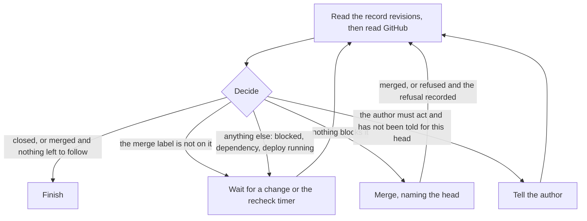

# Example: merging pull requests that are ready

The merge workflow of the three in `example-pr-flows.md`. It follows a pull request that carries the merge label, merges it once the repository's own criteria hold, and tells the author when it cannot merge until they act. After the merge it can follow the deploy of the merge commit.

Decided 2026-11-13 (user): the reviewer does not merge, because it may not be the last reviewer. A separate flow watches merge readiness, with criteria that can differ per repository, and merges if it can. A label decides which pull requests it follows.

It is a sketch against the library proposed in `plan.md` section 7. Nothing here compiles or has run. It has no agent session, so it uses no model and does not count against the session limit.

## The flow



While a pull request is blocked, one escalation clock runs for the first blocker. After the merge, one runs for the deploy.

This workflow writes three things: the merge, notices, and a comment with the deploy result. It never pushes to a branch, requests a review, posts a review or changes a label.

## Which pull requests it follows

Intake files a `pr_merge` ticket when the merge label is on a pull request in a repository that has criteria, and whoever applied it has write access (`example-pr-flows.md`). Without the label a pull request has no merge workflow.

The label is read again on every pass. While it is off, the workflow waits and merges nothing. The ticket stays open, so putting the label back needs no new ticket.

## Why GitHub's own answer is not enough

GitHub computes a merge state for every pull request from the repository's rulesets. The table was read on 2026-11-13 from three repositories the review example names, through GitHub's API with read-only calls. Counts are of open pull requests at that time: 36, 49 and 15.

| Read | What it means here |
|---|---|
| `oku-trade/trade`: 4 of the 9 pull requests with review decision `APPROVED` have a requested reviewer who has not answered | GitHub's approval does not wait for the last reviewer. This is the case the decision names |
| `oku-trade/retail`: the ruleset sets the required approval count to 0 and requires a code owner review only for files that have a code owner. 8 pull requests are in merge state `CLEAN`, and 5 of them have no approving review. 4 of those 5 are drafts | GitHub reports a pull request there as mergeable with no approval |
| `oku-trade/trade` and `oku-trade/account`: the ruleset does not dismiss approvals on a push and does not require approval of the last push | By GitHub's description of those two settings, an approval stands after a later push. A conflict fix would merge on the approval of an earlier head |
| `oku-trade/account`: required checks are strict, and 9 of 15 pull requests are `BEHIND` | Falling behind is the usual state there, not an exception |
| All three: auto-merge is off in the repository settings | GitHub's own auto-merge is not in use |
| All three: an App is on the ruleset's bypass list, in mode `always` on `oku-trade/retail` and `pull_request` on the other two | An identity on that list can bypass the ruleset |

So a pull request is ready when GitHub says it can merge and the repository's own criteria hold. The criteria only add to GitHub's rules. The identity this workflow merges as is kept off every bypass list, so GitHub refuses a merge its rulesets do not allow, whatever the criteria say.

GitHub's auto-merge and merge queue are the alternatives. Auto-merge waits for the required reviews and checks. Those are the ruleset's, so it has the gaps in the table. A merge queue removes the cost of a branch that is behind. GitHub's documentation offers it for public repositories of an organization and for private ones on Enterprise Cloud, and the API reports the plan of `oku-trade` as `enterprise`. Neither was enabled or tried.

## Who must act on a blocker

| Blocker | Who acts | What this workflow does |
|---|---|---|
| Conflicts with the base | The author | Tells the author, once per head |
| Behind the base, where the repository requires a current branch | The author, who owns the branch | Tells the author, once per head |
| A check that counts has failed | The author | Tells the author, once per head |
| An approval was given for an earlier head, where the criteria count approvals per head | The author, who must request review again | Tells the author, once per head |
| Changes requested, or an unresolved thread | The author | Waits. The review already told them |
| A requested reviewer has not answered, or a required approver has not approved | That reviewer | Waits. The escalation clock tells the owners when it is overdue |
| A pull request this one depends on is not merged, or not deployed | Whoever owns that one | Waits, and watches the other pull request |
| Checks running, mergeability not computed, a hold label, a draft | Nobody yet | Waits |
| GitHub blocks the merge and no criterion explains why | Unknown | Waits. The escalation clock tells the owners |

A notice goes through `p7.Notify` with the pull request as its subject, so it is in the attention list. The notifier registered in `example-pr-flows.md` delivers it to a person as a comment that mentions them. It posts nothing for the login of one of our own agents: that pull request has an author workflow, which is woken by the same push or check result, reads the same conflicts and failed checks from GitHub and fixes them. Either way the author then requests review of the new head, and this workflow waits for it.

## Types

```proto
// Ticket fields for kind pr_merge. One ticket follows one pull request.
message PRMerge {
  string repo = 1;
  int32 pr = 2;
  string base = 3;                // the base branch, watched for pushes
  repeated string told = 4;       // keys of the notices already sent to the author
  bool merged_here = 5;           // this workflow merged the pull request
  MergeRefusal merge_refusal = 6; // the last merge GitHub refused
}

// A merge GitHub refused, and the state it was refused in.
message MergeRefusal {
  string fingerprint = 1; // of the merge-relevant state at the time
  string message = 2;     // what GitHub said
}

// The result stored on the pr_merge ticket when the workflow finishes.
message Result {
  Outcome outcome = 1; // MERGED, MERGED_ELSEWHERE, DEPLOYED, DEPLOY_FAILED or CLOSED
}
```

`Decide` reads this from the `github` package. `Mergeable` and `Check` are in `example-pr-flows.md`.

```go
// In package github.

// MergeState is what GitHub says about a pull request now, as far as a merge
// depends on it. GetMergeState reads all of it in one activity.
type MergeState struct {
	Open   bool
	Merged bool
	Draft  bool
	Head   string
	Base   string
	Author string
	Labels []string
	// MergeRequested is set when the merge label is on the pull request and
	// whoever put it there has write access.
	MergeRequested bool
	// Mergeable is GitHub's own answer. It covers the repository's rulesets.
	Mergeable Mergeable
	// Approvals are the approving reviews that stand, each with the commit it was given for.
	Approvals []Approval
	// ChangesRequestedBy lists reviewers whose change request stands.
	ChangesRequestedBy []string
	// PendingReviewers were asked for a review and have not given one since.
	PendingReviewers []string
	// UnresolvedThreads counts review threads that are not resolved.
	UnresolvedThreads int
	// FailedChecks are the finished checks on the head that did not pass.
	FailedChecks []Check
	// PendingChecks are the checks on the head that have not finished.
	PendingChecks []Check
	// Dependencies are the pull requests this one says it waits for, each read
	// live. They come from "Depends on" lines in the description.
	Dependencies []Dependency
	// MergeCommit is set once the pull request is merged.
	MergeCommit string
	// Deploy is the state of the deployment of MergeCommit.
	Deploy DeployState
}

// Approval is one approving review that has not been dismissed.
type Approval struct {
	Login string
	// Head is the commit the review was submitted for.
	Head string
}

// Dependency is one thing a pull request waits for before it may merge.
type Dependency struct {
	// Object is the other pull request, as a p7 external object.
	Object p7.ObjectRef
	// Revision is the object's revision when Satisfied was read, so a wait can start from it.
	Revision int64
	// NeedsDeploy is set when the other pull request must be deployed, not only merged.
	NeedsDeploy bool
	Satisfied   bool
}

// DeployState is the state of the deployment of one commit.
type DeployState int

const (
	DeployNone DeployState = iota
	DeployPending
	DeploySucceeded
	DeployFailed
)
```

## The criteria

One value per repository, in the worker's Go configuration. `example-pr-flows.md` has the values this installation uses.

```go
// Package prmerge merges pull requests that meet their repository's criteria.
package prmerge

import (
	"errors"
	"fmt"
	"slices"
	"time"

	"github.com/gfx-labs/protocol7/pkg/p7"
	"go.temporal.io/sdk/temporal"
	"go.temporal.io/sdk/workflow"

	mergev1 "example.com/gfx/gen/merge/v1"
	"example.com/gfx/github"
	"example.com/gfx/prflow"
)

// Criteria says what must hold before a pull request of one repository is
// merged. GitHub's own rules apply as well.
type Criteria struct {
	// Label is the label that asks for a merge. Only a pull request that
	// carries it is followed and merged.
	Label string
	// HoldLabels stop a merge while any of them is on the pull request.
	HoldLabels []string
	// RequiredApprovers must each have an approval that stands.
	RequiredApprovers []string
	// ApprovalsOnHead counts an approval only when it was given for the current head.
	ApprovalsOnHead bool
	// NoPendingReviewers waits until nobody who was asked for a review still owes one.
	NoPendingReviewers bool
	// ThreadsResolved waits until every review thread is resolved.
	ThreadsResolved bool
	// AllChecks also waits for checks the repository does not require.
	AllChecks bool
	// Method is how the pull request is merged.
	Method github.MergeMethod
	// FollowDeploy keeps the workflow open after the merge until the deploy
	// of the merge commit finishes, and comments the result on the pull request.
	FollowDeploy bool
	// Also returns blockers for rules the fields above cannot express. It must
	// be a pure function of the state, because Decide calls it.
	Also func(state github.MergeState) []Blocker
}

// Config is everything that differs between installations.
type Config struct {
	// Criteria holds the criteria of each repository, by its name.
	Criteria map[string]Criteria
	// Owners are told when a blocked pull request is overdue or a deploy fails.
	Owners []p7.Recipient
	// MergeOverdue says who is told, and when, if a pull request stays blocked.
	MergeOverdue []p7.EscalationStep
	// DeployOverdue is the same for a merged pull request whose deploy does not finish.
	DeployOverdue []p7.EscalationStep
	// Recheck is how often a waiting workflow reads GitHub when no event arrives.
	Recheck time.Duration
	// MergeabilityRecheck is the shorter interval used while GitHub has not
	// computed whether the pull request can merge. No event says when it has.
	MergeabilityRecheck time.Duration
}

// Workflows holds the configuration that the workflows read.
type Workflows struct {
	config Config
}

// Register adds the merge workflow to a worker.
func Register(worker *p7.Worker, config Config) {
	workflows := &Workflows{config: config}
	p7.Register(worker, "pr_merge", workflows.Merge)
}
```

## Deciding

Plain Go with no library calls. `Blockers` and `Decide` hold every rule, so they can be tested with a table of states and no Temporal.

```go
// BlockerKind names one reason a pull request is not merged yet.
type BlockerKind string

const (
	BlockerDraft            BlockerKind = "draft"
	BlockerHoldLabel        BlockerKind = "hold_label"
	BlockerDependency       BlockerKind = "dependency"
	BlockerChecksPending    BlockerKind = "checks_pending"
	BlockerChecksFailed     BlockerKind = "checks_failed"
	BlockerConflicts        BlockerKind = "conflicts"
	BlockerBehind           BlockerKind = "behind"
	BlockerChangesRequested BlockerKind = "changes_requested"
	BlockerThreads          BlockerKind = "threads"
	BlockerPendingReviewers BlockerKind = "pending_reviewers"
	BlockerApprovalMissing  BlockerKind = "approval_missing"
	BlockerApprovalStale    BlockerKind = "approval_stale"
	BlockerUnknown          BlockerKind = "mergeability_unknown"
	BlockerGitHub           BlockerKind = "github"
)

// Blocker is one reason a pull request is not merged, and who has to act on it.
type Blocker struct {
	Kind BlockerKind
	Text string
	// Next is set when the author has to act and nothing else has told them.
	// It says what to do. The workflow sends it once per head.
	Next string
}

// Blockers returns everything that stops a merge of the current head. An
// empty result means the pull request is ready.
func Blockers(state github.MergeState, criteria Criteria) []Blocker {
	var blockers []Blocker
	if state.Draft {
		blockers = append(blockers, Blocker{Kind: BlockerDraft, Text: "it is a draft"})
	}
	for _, label := range criteria.HoldLabels {
		if slices.Contains(state.Labels, label) {
			blockers = append(blockers, Blocker{Kind: BlockerHoldLabel, Text: "it has the label " + label})
		}
	}
	unmet := func(dependency github.Dependency) bool { return !dependency.Satisfied }
	if slices.ContainsFunc(state.Dependencies, unmet) {
		blockers = append(blockers, Blocker{Kind: BlockerDependency, Text: "a pull request it depends on is not done"})
	}
	if failed := counted(state.FailedChecks, criteria); len(failed) > 0 {
		blockers = append(blockers, Blocker{
			Kind: BlockerChecksFailed,
			Text: fmt.Sprintf("%d checks failed", len(failed)),
			Next: "Fix the failing checks, then request review of the new head.",
		})
	}
	if len(counted(state.PendingChecks, criteria)) > 0 {
		blockers = append(blockers, Blocker{Kind: BlockerChecksPending, Text: "checks are running"})
	}
	if len(state.ChangesRequestedBy) > 0 {
		blockers = append(blockers, Blocker{Kind: BlockerChangesRequested, Text: "changes are requested"})
	}
	if criteria.ThreadsResolved && state.UnresolvedThreads > 0 {
		blockers = append(blockers, Blocker{
			Kind: BlockerThreads,
			Text: fmt.Sprintf("%d review threads are not resolved", state.UnresolvedThreads),
		})
	}
	if criteria.NoPendingReviewers && len(state.PendingReviewers) > 0 {
		blockers = append(blockers, Blocker{
			Kind: BlockerPendingReviewers,
			Text: fmt.Sprintf("%d requested reviewers have not answered", len(state.PendingReviewers)),
		})
	}
	for _, approver := range criteria.RequiredApprovers {
		approved := func(approval github.Approval) bool { return approval.Login == approver }
		if !slices.ContainsFunc(state.Approvals, approved) {
			blockers = append(blockers, Blocker{Kind: BlockerApprovalMissing, Text: approver + " has not approved"})
		}
	}
	if criteria.ApprovalsOnHead {
		for _, approval := range state.Approvals {
			// A reviewer who was asked again is already counted as pending.
			if approval.Head != state.Head && !slices.Contains(state.PendingReviewers, approval.Login) {
				blockers = append(blockers, Blocker{
					Kind: BlockerApprovalStale,
					Text: approval.Login + " approved an earlier head",
					Next: "Request review of the current head.",
				})
			}
		}
	}
	if criteria.Also != nil {
		blockers = append(blockers, criteria.Also(state)...)
	}

	// GitHub's own answer comes last, so that a block which the criteria
	// already explain is not reported twice.
	switch state.Mergeable {
	case github.MergeableConflicts:
		blockers = append(blockers, Blocker{
			Kind: BlockerConflicts,
			Text: "the branch conflicts with " + state.Base,
			Next: "Resolve the conflicts, then request review of the new head.",
		})
	case github.MergeableBehind:
		blockers = append(blockers, Blocker{
			Kind: BlockerBehind,
			Text: "the branch is behind " + state.Base,
			Next: "Update the branch from " + state.Base + ", then request review of the new head.",
		})
	case github.MergeableUnknown:
		blockers = append(blockers, Blocker{Kind: BlockerUnknown, Text: "GitHub has not computed whether it can merge"})
	case github.MergeableBlocked:
		if len(blockers) == 0 {
			blockers = append(blockers, Blocker{Kind: BlockerGitHub, Text: "GitHub blocks the merge and no criterion here explains why"})
		}
	}
	return blockers
}

// counted returns the checks the criteria wait for: every check with
// AllChecks, and only the ones the repository requires without it.
func counted(checks []github.Check, criteria Criteria) []github.Check {
	if criteria.AllChecks {
		return checks
	}
	var required []github.Check
	for _, check := range checks {
		if check.Required {
			required = append(required, check)
		}
	}
	return required
}

// ActionKind is the one thing the Merge workflow does on a pass.
type ActionKind int

const (
	// ActionWait waits for the pull request, its base branch or a dependency to change.
	ActionWait ActionKind = iota
	// ActionMerge merges the current head.
	ActionMerge
	// ActionTell sends the author one notice.
	ActionTell
	// ActionFinish ends the workflow.
	ActionFinish
)

// Overdue names the escalation clock that runs while an action is in effect.
type Overdue int

const (
	NothingOverdue Overdue = iota
	// OverdueMerge runs while a pull request that asked for a merge cannot be merged.
	OverdueMerge
	// OverdueDeploy runs from the merge until the deploy finishes.
	OverdueDeploy
)

// Action is what Decide returns.
type Action struct {
	Kind ActionKind
	// Outcome is set with ActionFinish.
	Outcome mergev1.Outcome
	// Reason says why, for the Temporal UI, the ticket and the escalation.
	Reason string
	// Report is commented on the pull request before the workflow finishes.
	Report string
	// Blocker and NoticeKey are set with ActionTell.
	Blocker   Blocker
	NoticeKey string
	// Overdue and OverdueKey pick the escalation clock. The key changes when
	// the blocker or the head changes, which starts a new clock.
	Overdue    Overdue
	OverdueKey string
	// RecheckSoon is set when GitHub is about to have a newer answer and no
	// event will say so.
	RecheckSoon bool
}

// Decide returns what to do for a pull request, given what GitHub says now,
// the repository's criteria and what this workflow has already done.
func Decide(state github.MergeState, criteria Criteria, merge *mergev1.PRMerge) Action {
	switch {
	case state.Merged:
		return afterMerge(state, criteria, merge)
	case !state.Open:
		return Action{Kind: ActionFinish, Outcome: mergev1.Outcome_CLOSED, Reason: "closed"}
	case merge.MergedHere:
		return Action{Kind: ActionWait, Reason: "waiting: merged, GitHub does not show it yet", RecheckSoon: true}
	case !state.MergeRequested:
		return Action{Kind: ActionWait, Reason: "waiting: the merge label is not on the pull request"}
	}

	blockers := Blockers(state, criteria)
	if len(blockers) == 0 {
		refusal := merge.MergeRefusal
		if refusal != nil && refusal.Fingerprint == github.MergeFingerprint(state) {
			// Nothing GitHub bases a merge on has changed since it refused.
			return Action{
				Kind:       ActionWait,
				Reason:     "waiting to merge: GitHub refused: " + refusal.Message,
				Overdue:    OverdueMerge,
				OverdueKey: "refused:" + state.Head,
			}
		}
		return Action{Kind: ActionMerge, Reason: "merging " + state.Head}
	}

	first := blockers[0]
	overdueKey := fmt.Sprintf("%s:%s", first.Kind, state.Head)
	for _, blocker := range blockers {
		// The head is in the key, so the author is told once per head and
		// told again if the same thing blocks a later head.
		key := fmt.Sprintf("%s:%s", blocker.Kind, state.Head)
		if blocker.Next != "" && !slices.Contains(merge.Told, key) {
			return Action{
				Kind:      ActionTell,
				Reason:    "telling the author: " + blocker.Text,
				Blocker:   blocker,
				NoticeKey: key,
				// Telling the author does not restart the clock of the first blocker.
				Overdue:    OverdueMerge,
				OverdueKey: overdueKey,
			}
		}
	}
	return Action{
		Kind:        ActionWait,
		Reason:      "waiting to merge: " + first.Text,
		Overdue:     OverdueMerge,
		OverdueKey:  overdueKey,
		RecheckSoon: first.Kind == BlockerUnknown,
	}
}

// afterMerge returns what to do once the pull request is merged: finish, or
// follow the deploy of the merge commit and report how it went.
func afterMerge(state github.MergeState, criteria Criteria, merge *mergev1.PRMerge) Action {
	if !criteria.FollowDeploy {
		if merge.MergedHere {
			return Action{Kind: ActionFinish, Outcome: mergev1.Outcome_MERGED, Reason: "merged"}
		}
		return Action{Kind: ActionFinish, Outcome: mergev1.Outcome_MERGED_ELSEWHERE, Reason: "merged by someone else"}
	}
	switch state.Deploy {
	case github.DeploySucceeded:
		return Action{
			Kind:    ActionFinish,
			Outcome: mergev1.Outcome_DEPLOYED,
			Reason:  "deployed",
			Report:  "Deployed in " + state.MergeCommit + ".",
		}
	case github.DeployFailed:
		return Action{
			Kind:    ActionFinish,
			Outcome: mergev1.Outcome_DEPLOY_FAILED,
			Reason:  "deploy failed",
			Report:  "The deploy of " + state.MergeCommit + " failed.",
		}
	default:
		return Action{
			Kind:       ActionWait,
			Reason:     "waiting: merged, deploy of " + state.MergeCommit + " not finished",
			Overdue:    OverdueDeploy,
			OverdueKey: "deploy:" + state.MergeCommit,
		}
	}
}
```

## The workflow

```go
// Merge follows one pull request until it is merged or closed, and until its
// deploy finishes where the repository follows deploys.
func (w *Workflows) Merge(
	ctx workflow.Context,
	ticket p7.Ticket[*mergev1.PRMerge],
) (*mergev1.Result, error) {
	merge := ticket.Fields
	criteria, configured := w.config.Criteria[merge.Repo]
	if !configured {
		return nil, temporal.NewNonRetryableApplicationError("no merge criteria for "+merge.Repo, "NoCriteria", nil)
	}
	pullRequestRef := github.PullRequest(merge.Repo, merge.Pr)

	for {
		// Move to a new build, or shorten a long history, before deciding
		// anything. The criteria are part of the build, so a pull request is
		// never merged under criteria that have since been replaced. Between
		// passes nothing is running and all state is on the ticket.
		info := workflow.GetInfo(ctx)
		if info.GetContinueAsNewSuggested() || info.GetTargetWorkerDeploymentVersionChanged() {
			return nil, p7.ContinueAsNew(ctx, ticket)
		}

		// Read both revisions before reading GitHub, so a change that lands
		// between the reads and the wait still wakes the workflow.
		object, err := p7.GetObject(ctx, pullRequestRef)
		if err != nil {
			return nil, fmt.Errorf("read pull request object: %w", err)
		}
		baseRef := github.Branch(merge.Repo, merge.Base)
		base, err := p7.GetObject(ctx, baseRef)
		if err != nil {
			return nil, fmt.Errorf("read base branch object: %w", err)
		}
		state, err := github.GetMergeState(ctx, merge.Repo, merge.Pr, criteria.Label)
		if err != nil {
			return nil, fmt.Errorf("read pull request: %w", err)
		}
		if state.Open && state.Base != merge.Base {
			// The pull request was retargeted. Watch the new base from the next pass.
			merge.Base = state.Base
			if err := p7.UpdateFields(ctx, ticket, merge); err != nil {
				return nil, fmt.Errorf("record base branch: %w", err)
			}
			continue
		}

		// Everything that can change what Decide returns. A push to the base
		// branch can make this pull request conflict or fall behind, and
		// GitHub sends no pull request event for that.
		watched := []p7.Since{
			{Record: pullRequestRef, Revision: object.Revision, Kinds: github.MergeRelevantEvents},
			{Record: baseRef, Revision: base.Revision},
		}
		for _, dependency := range state.Dependencies {
			watched = append(watched, p7.Since{Record: dependency.Object, Revision: dependency.Revision})
		}

		action := Decide(state, criteria, merge)
		// Shown in the Temporal UI, so a waiting workflow says what it waits for.
		workflow.SetCurrentDetails(ctx, action.Reason)
		// A ticket has one escalation at a time. The same key keeps its clock
		// running, a new key replaces it, and nil ends it.
		if err := p7.SetEscalation(ctx, ticket, w.escalationFor(ticket.ID, action)); err != nil {
			return nil, fmt.Errorf("set escalation: %w", err)
		}

		switch action.Kind {
		case ActionFinish:
			if err := w.report(ctx, ticket.ID, merge, action); err != nil {
				return nil, err
			}
			return &mergev1.Result{Outcome: action.Outcome}, nil

		case ActionMerge:
			err := github.Merge(ctx, github.MergeRequest{
				Repo:         merge.Repo,
				PullRequest:  merge.Pr,
				Method:       criteria.Method,
				MatchHead:    state.Head,
				OperationKey: fmt.Sprintf("merge:%s:%s", ticket.ID, state.Head),
			})
			switch {
			case err == nil:
				merge.MergedHere = true
				merge.MergeRefusal = nil
			case errors.Is(err, github.ErrHeadMoved), errors.Is(err, github.ErrNotMergeable):
				// GitHub refused for a reason the state did not show. The refusal
				// is saved with a fingerprint of the state it was refused in, and
				// Decide does not merge again until that state changes.
				workflow.GetLogger(ctx).Info("merge refused", "head", state.Head, "error", err)
				merge.MergeRefusal = &mergev1.MergeRefusal{
					Fingerprint: github.MergeFingerprint(state),
					Message:     err.Error(),
				}
			default:
				return nil, fmt.Errorf("merge pull request: %w", err)
			}
			if err := p7.UpdateFields(ctx, ticket, merge); err != nil {
				return nil, fmt.Errorf("record merge: %w", err)
			}
			// Read again. A merged pull request may still have a deploy to follow.
			continue

		case ActionTell:
			err := p7.Notify(ctx, p7.Notice{
				Key:     ticket.ID + ":" + action.NoticeKey,
				To:      []p7.Recipient{github.Recipient(state.Author)},
				Subject: pullRequestRef,
				Title:   fmt.Sprintf("%s#%d cannot merge: %s", merge.Repo, merge.Pr, action.Blocker.Text),
				Body:    action.Blocker.Next,
			})
			if err != nil {
				return nil, fmt.Errorf("tell the author: %w", err)
			}
			merge.Told = append(merge.Told, action.NoticeKey)
			if err := p7.UpdateFields(ctx, ticket, merge); err != nil {
				return nil, fmt.Errorf("record notice: %w", err)
			}
			continue

		case ActionWait:
		}

		recheck := w.config.Recheck
		if action.RecheckSoon {
			recheck = w.config.MergeabilityRecheck
		}
		if err := prflow.WaitForChange(ctx, recheck, watched...); err != nil {
			return nil, err
		}
	}
}

// escalationFor returns the one escalation that should be running for an
// action, or nil. Its key names what is overdue, so the clock keeps running
// across passes and across Continue-As-New while the same thing is waited on.
func (w *Workflows) escalationFor(ticketID string, action Action) *p7.Escalation {
	var steps []p7.EscalationStep
	switch action.Overdue {
	case OverdueMerge:
		steps = w.config.MergeOverdue
	case OverdueDeploy:
		steps = w.config.DeployOverdue
	default:
		return nil
	}
	return &p7.Escalation{Key: ticketID + ":" + action.OverdueKey, Subject: action.Reason, Steps: steps}
}

// report comments the outcome on the pull request when the action has
// something to report, and tells the owners about a failed deploy.
func (w *Workflows) report(ctx workflow.Context, ticketID string, merge *mergev1.PRMerge, action Action) error {
	if action.Report == "" {
		return nil
	}
	key := fmt.Sprintf("report:%s:%s", ticketID, action.Outcome)
	err := github.Comment(ctx, github.IssueComment{
		Repo:         merge.Repo,
		PullRequest:  merge.Pr,
		Body:         action.Report,
		OperationKey: key,
	})
	if err != nil {
		return fmt.Errorf("post report: %w", err)
	}
	if action.Outcome != mergev1.Outcome_DEPLOY_FAILED {
		return nil
	}
	return p7.Notify(ctx, p7.Notice{
		Key:     key,
		To:      w.config.Owners,
		Subject: github.PullRequest(merge.Repo, merge.Pr),
		Title:   action.Reason,
		Body:    action.Report,
	})
}
```

Left out:

- `github.GetMergeState`. It reads the pull request, its labels and who applied the merge label, its reviews with the commit of each, the requested reviewers, threads, checks, mergeable state, declared dependencies and deployment status.
- `github.MergeFingerprint(state)`, a hash of the fields a merge depends on: head, mergeable state, checks, approvals and blocking reviews.
- `github.Recipient(login)`, which builds the `p7.Recipient` for a GitHub login.
- `github.Merge`, `github.Comment` and `github.MergeRelevantEvents`, described in `example-pr-flows.md`.

## What this needs from the library

Everything `example-pr-review.md` lists that is not about sessions, and:

1. **A notice addressed to the author of an external object.** `github.Recipient` returns a `p7.Recipient` for a provider login, and the consumer registers the notifier that delivers it. Plan section 7 has recipients as people or named groups.
2. **An external object for a branch,** with a timeline entry per push, so a wait can watch it. Linking the branch to the ticket at filing creates the record.
3. **A GitHub identity that only merges and comments** (`example-pr-flows.md`, "GitHub identities").

## Open

- **An approval per head costs a review per branch update.** With `ApprovalsOnHead`, updating a branch that is behind needs a new approval, and the base can move again meanwhile. `oku-trade/account` shows how common that is. A merge queue is the better answer where it can be used. An approval of an earlier head could also count when only merges from the base came after it. Neither is sketched.
- **A person's pull request that is behind or conflicts has no automatic fix.** The author is told. This workflow could update the branch itself, but that is a push to someone else's branch, and it is not proposed.
- **The author is told once per head.** If they do nothing, only the escalation clock follows up, and it tells the owners and not the author.
- **`told` grows with every head that is blocked.** It is cleared by nothing. A long-lived pull request with many pushes makes the ticket's fields long.
- **A dependency that is closed without merging holds the merge for good.** The escalation clock tells the owners. Dependencies are read from "Depends on" lines in the description, which is a convention this repo would have to adopt.
- **Deploy state comes from GitHub deployment statuses.** A repository that deploys some other way needs its own read, and its own events on the timeline.
- **A change to the criteria is a new build.** A waiting workflow moves to it at its next wake, before it decides. A stricter criterion then holds a pull request that was about to merge, which is intended. A looser one merges it at the next wake or recheck, without anyone touching the pull request.
- **GitHub behaviour was read and not exercised.** The merge states, the review decision and the commit of each review are fields of GitHub's published GraphQL schema. GitHub's REST description lists the actions of the pull request webhook, and none of them is a push to the base branch. No merge was attempted and no notice was sent.
- None of this has run. Every `p7`, `github`, `prflow` and `mergev1` call is proposed.
