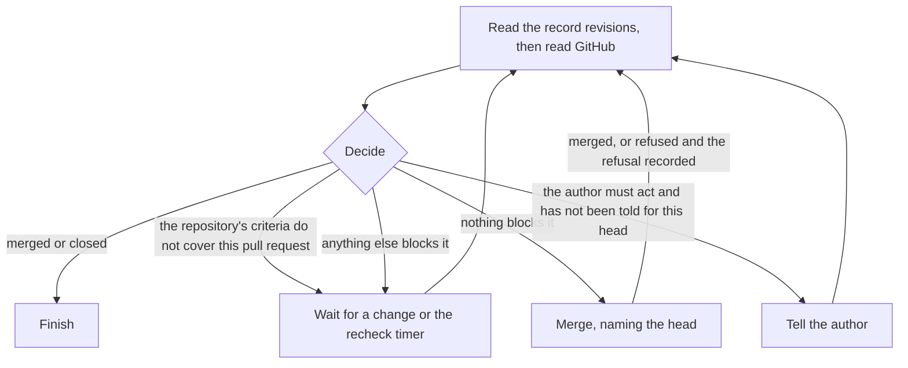

# Example: merging pull requests that are ready

The third pull request workflow, beside `example-pr-review.md` and `example-pr-author.md`. It merges a pull request once the repository's own criteria hold, and tells the author when the pull request cannot merge until they act.

Decided 2026-11-13 (user): the reviewer does not merge, because it may not be the last reviewer. A separate flow watches merge readiness, with criteria that can differ per repository, and merges if it can. This file replaces the merge code in the other two examples. They have not been rewritten yet.

It is a sketch against the library proposed in `plan.md` section 7. Nothing here compiles or has run. It has no agent session, so it uses no model and does not count against the session limit.

## The flow



The loop is the one the other two workflows run. An event only wakes it, every decision comes from a fresh read of GitHub, and `Decide` is one pure function. While a pull request is blocked, one escalation clock runs for the first blocker.

This workflow writes two things: the merge, and notices. It never pushes to a branch, requests a review or posts a review.

## Why GitHub's own answer is not enough

GitHub computes a merge state for every pull request from the repository's rulesets. The table was read on 2026-11-13 from the three repositories the review example names, through GitHub's API with read-only calls. Counts are of open pull requests at that time: 36, 49 and 15.

| Read | What it means here |
|---|---|
| `oku-trade/trade`: 4 of the 9 pull requests with review decision `APPROVED` have a requested reviewer who has not answered | GitHub's approval does not wait for the last reviewer. This is the case the decision names |
| `oku-trade/retail`: the ruleset sets the required approval count to 0 and requires a code owner review only for files that have a code owner. 8 pull requests are in merge state `CLEAN`, and 5 of them have no approving review. 4 of those 5 are drafts | GitHub reports a pull request there as mergeable with no approval |
| `oku-trade/trade` and `oku-trade/account`: the ruleset does not dismiss approvals on a push and does not require approval of the last push | By GitHub's description of those two settings, an approval stands after a later push. A conflict fix would merge on the approval of an earlier head |
| `oku-trade/account`: required checks are strict, and 9 of 15 pull requests are `BEHIND` | Falling behind is the usual state there, not an exception |
| All three: auto-merge is off in the repository settings | GitHub's own auto-merge is not in use |
| All three: an App is on the ruleset's bypass list, in mode `always` on `oku-trade/retail` and `pull_request` on the other two | An identity on that list can bypass the ruleset |

So a pull request is ready when GitHub says it can merge and the repository's own criteria hold. The criteria only add to GitHub's rules. The identity this workflow merges as is kept off every bypass list, so GitHub refuses a merge its rulesets do not allow, whatever the criteria say.

GitHub's auto-merge and merge queue are the alternatives. Auto-merge waits for the required reviews and checks. Those are the ruleset's, so it has the gaps in the table. A merge queue removes the cost of a branch that is behind. GitHub's documentation offers it for public repositories of an organization and for private ones on Enterprise Cloud, and the API reports the plan of `oku-trade` as `enterprise`. Neither was enabled or tried.

## Who must act on a blocker

| Blocker | Who acts | What this workflow does |
|---|---|---|
| Conflicts with the base | The author | Tells the author, once per head |
| Behind the base, where the repository requires a current branch | The author, who owns the branch | Tells the author, once per head |
| A check failed | The author | Tells the author, once per head |
| An approval was given for an earlier head, where the criteria count approvals per head | The author, who must request review again | Tells the author, once per head |
| Changes requested, or an unresolved thread | The author | Waits. The review already told them |
| A requested reviewer has not answered, or a required approver has not approved | That reviewer | Waits. The escalation clock tells the owners when it is overdue |
| Checks running, mergeability not computed, a hold label, a draft | Nobody yet | Waits |
| GitHub blocks the merge and no criterion explains why | Unknown | Waits. The escalation clock tells the owners |

A notice goes through `p7.Notify` with the pull request as its subject, so it is in the attention list. The consumer's notifier delivers it to a person as a comment that mentions them. It delivers nothing to the login of one of our own agents: that pull request has an author workflow, which reads the same conflicts and failed checks from GitHub and fixes them. The author workflow then requests review of the new head, and this workflow waits for it.

## Types

```proto
// Ticket fields for kind pr_merge. One ticket follows one pull request.
message PRMerge {
  string repo = 1;
  int32 pr = 2;
  string base = 3;                // the base branch, watched for pushes
  repeated string told = 4;       // keys of the notices already sent to the author
  bool merged_here = 5;           // this workflow merged the pull request
  MergeRefusal merge_refusal = 6; // the last merge GitHub refused
}

// A merge GitHub refused, and the state it was refused in.
message MergeRefusal {
  string fingerprint = 1; // of the merge-relevant state at the time
  string message = 2;     // what GitHub said
}

// The result stored on the pr_merge ticket when the workflow finishes.
message Result {
  Outcome outcome = 1; // MERGED, MERGED_ELSEWHERE or CLOSED
}
```

`Decide` reads this from the `github` package:

```go
// In package github.

// MergeState is what GitHub says about a pull request now, as far as a merge
// depends on it. GetMergeState reads all of it in one activity.
type MergeState struct {
	Open   bool
	Merged bool
	Draft  bool
	Head   string
	Base   string
	Author string
	Labels []string
	// Mergeable is GitHub's own answer. It covers the repository's rulesets:
	// required reviews, required checks, conflicts and a branch that must be current.
	Mergeable Mergeable
	// Approvals are the approving reviews that stand, each with the commit it was given for.
	Approvals []Approval
	// ChangesRequestedBy lists reviewers whose change request stands.
	ChangesRequestedBy []string
	// PendingReviewers were asked for a review and have not given one since.
	PendingReviewers []string
	// UnresolvedThreads counts review threads that are not resolved.
	UnresolvedThreads int
	// FailedChecks names the finished checks on the head that did not pass.
	FailedChecks  []string
	ChecksPending bool
}

// Approval is one approving review that has not been dismissed.
type Approval struct {
	Login string
	// Head is the commit the review was submitted for.
	Head string
}
```

`Mergeable` is the type of the same name in `example-pr-review.md`.

## The criteria

One value per repository, in the worker's Go configuration.

```go
// Package prmerge merges pull requests that meet their repository's criteria.
package prmerge

import (
	"errors"
	"fmt"
	"slices"
	"time"

	p7 "github.com/gfx-labs/protocol7"
	"go.temporal.io/sdk/temporal"
	"go.temporal.io/sdk/workflow"

	mergev1 "example.com/gfx/gen/merge/v1"
	"example.com/gfx/github"
)

// Criteria says which pull requests of one repository this workflow merges,
// and what must hold before it does. GitHub's own rules apply as well.
type Criteria struct {
	// Authors limits merging to pull requests by these logins. Empty means any author.
	Authors []string
	// RequireLabel, when set, limits merging to pull requests that carry it.
	RequireLabel string
	// HoldLabels stop a merge while any of them is on the pull request.
	HoldLabels []string
	// RequiredApprovers must each have an approval that stands.
	RequiredApprovers []string
	// ApprovalsOnHead counts an approval only when it was given for the current head.
	ApprovalsOnHead bool
	// NoPendingReviewers waits until nobody who was asked for a review still owes one.
	NoPendingReviewers bool
	// ThreadsResolved waits until every review thread is resolved.
	ThreadsResolved bool
	// Method is how the pull request is merged.
	Method github.MergeMethod
	// Also returns blockers for rules the fields above cannot express. It must
	// be a pure function of the state, because Decide calls it.
	Also func(state github.MergeState) []Blocker
}

// Config is everything that differs between installations.
type Config struct {
	// Criteria holds the criteria of each repository, by its name.
	Criteria map[string]Criteria
	// Owners are told when a blocked pull request is overdue.
	Owners []p7.Recipient
	// MergeOverdue says who is told, and when, if a pull request stays blocked.
	MergeOverdue []p7.EscalationStep
	// Recheck is how often a waiting workflow reads GitHub when no event arrives.
	Recheck time.Duration
}

// Workflows holds the configuration that the workflows read.
type Workflows struct {
	config Config
}
```

## Deciding

Plain Go with no library calls. `Blockers` and `Decide` hold every rule, so they can be tested with a table of states and no Temporal.

```go
// BlockerKind names one reason a pull request is not merged yet.
type BlockerKind string

const (
	BlockerDraft            BlockerKind = "draft"
	BlockerHoldLabel        BlockerKind = "hold_label"
	BlockerChecksPending    BlockerKind = "checks_pending"
	BlockerChecksFailed     BlockerKind = "checks_failed"
	BlockerConflicts        BlockerKind = "conflicts"
	BlockerBehind           BlockerKind = "behind"
	BlockerChangesRequested BlockerKind = "changes_requested"
	BlockerThreads          BlockerKind = "threads"
	BlockerPendingReviewers BlockerKind = "pending_reviewers"
	BlockerApprovalMissing  BlockerKind = "approval_missing"
	BlockerApprovalStale    BlockerKind = "approval_stale"
	BlockerUnknown          BlockerKind = "mergeability_unknown"
	BlockerGitHub           BlockerKind = "github"
)

// Blocker is one reason a pull request is not merged, and who has to act on it.
type Blocker struct {
	Kind BlockerKind
	Text string
	// Next is set when the author has to act and nothing else has told them.
	// It says what to do. The workflow sends it once per head.
	Next string
}

// Blockers returns everything that stops a merge of the current head. An
// empty result means the pull request is ready.
func Blockers(state github.MergeState, criteria Criteria) []Blocker {
	var blockers []Blocker
	if state.Draft {
		blockers = append(blockers, Blocker{Kind: BlockerDraft, Text: "it is a draft"})
	}
	for _, label := range criteria.HoldLabels {
		if slices.Contains(state.Labels, label) {
			blockers = append(blockers, Blocker{Kind: BlockerHoldLabel, Text: "it has the label " + label})
		}
	}
	if len(state.FailedChecks) > 0 {
		blockers = append(blockers, Blocker{
			Kind: BlockerChecksFailed,
			Text: fmt.Sprintf("%d checks failed", len(state.FailedChecks)),
			Next: "Fix the failing checks, then request review of the new head.",
		})
	}
	if state.ChecksPending {
		blockers = append(blockers, Blocker{Kind: BlockerChecksPending, Text: "checks are running"})
	}
	if len(state.ChangesRequestedBy) > 0 {
		blockers = append(blockers, Blocker{Kind: BlockerChangesRequested, Text: "changes are requested"})
	}
	if criteria.ThreadsResolved && state.UnresolvedThreads > 0 {
		blockers = append(blockers, Blocker{
			Kind: BlockerThreads,
			Text: fmt.Sprintf("%d review threads are not resolved", state.UnresolvedThreads),
		})
	}
	if criteria.NoPendingReviewers && len(state.PendingReviewers) > 0 {
		blockers = append(blockers, Blocker{
			Kind: BlockerPendingReviewers,
			Text: fmt.Sprintf("%d requested reviewers have not answered", len(state.PendingReviewers)),
		})
	}
	for _, approver := range criteria.RequiredApprovers {
		approved := func(approval github.Approval) bool { return approval.Login == approver }
		if !slices.ContainsFunc(state.Approvals, approved) {
			blockers = append(blockers, Blocker{Kind: BlockerApprovalMissing, Text: approver + " has not approved"})
		}
	}
	if criteria.ApprovalsOnHead {
		for _, approval := range state.Approvals {
			// A reviewer who was asked again is already counted as pending.
			if approval.Head != state.Head && !slices.Contains(state.PendingReviewers, approval.Login) {
				blockers = append(blockers, Blocker{
					Kind: BlockerApprovalStale,
					Text: approval.Login + " approved an earlier head",
					Next: "Request review of the current head.",
				})
			}
		}
	}
	if criteria.Also != nil {
		blockers = append(blockers, criteria.Also(state)...)
	}

	// GitHub's own answer comes last, so that a block which the criteria
	// already explain is not reported twice.
	switch state.Mergeable {
	case github.MergeableConflicts:
		blockers = append(blockers, Blocker{
			Kind: BlockerConflicts,
			Text: "the branch conflicts with " + state.Base,
			Next: "Resolve the conflicts, then request review of the new head.",
		})
	case github.MergeableBehind:
		blockers = append(blockers, Blocker{
			Kind: BlockerBehind,
			Text: "the branch is behind " + state.Base,
			Next: "Update the branch from " + state.Base + ", then request review of the new head.",
		})
	case github.MergeableUnknown:
		blockers = append(blockers, Blocker{Kind: BlockerUnknown, Text: "GitHub has not computed whether it can merge"})
	case github.MergeableBlocked:
		if len(blockers) == 0 {
			blockers = append(blockers, Blocker{Kind: BlockerGitHub, Text: "GitHub blocks the merge and no criterion here explains why"})
		}
	}
	return blockers
}

// Follows reports whether the criteria cover this pull request at all.
func Follows(state github.MergeState, criteria Criteria) bool {
	if len(criteria.Authors) > 0 && !slices.Contains(criteria.Authors, state.Author) {
		return false
	}
	return criteria.RequireLabel == "" || slices.Contains(state.Labels, criteria.RequireLabel)
}

// ActionKind is the one thing the Merge workflow does on a pass.
type ActionKind int

const (
	// ActionWait waits for the pull request or its base branch to change.
	ActionWait ActionKind = iota
	// ActionMerge merges the current head.
	ActionMerge
	// ActionTell sends the author one notice.
	ActionTell
	// ActionFinish ends the workflow.
	ActionFinish
)

// Action is what Decide returns.
type Action struct {
	Kind ActionKind
	// Outcome is set with ActionFinish.
	Outcome mergev1.Outcome
	// Reason says why, for the Temporal UI, the ticket and the escalation.
	Reason string
	// Blocker and NoticeKey are set with ActionTell.
	Blocker   Blocker
	NoticeKey string
	// OverdueKey is set while a blocked pull request should have its escalation
	// clock running. It changes when the blocker or the head changes, which
	// starts a new clock.
	OverdueKey string
}

// Decide returns what to do for a pull request, given what GitHub says now,
// the repository's criteria and what this workflow has already done.
func Decide(state github.MergeState, criteria Criteria, merge *mergev1.PRMerge) Action {
	switch {
	case state.Merged && merge.MergedHere:
		return Action{Kind: ActionFinish, Outcome: mergev1.Outcome_MERGED, Reason: "merged"}
	case state.Merged:
		return Action{Kind: ActionFinish, Outcome: mergev1.Outcome_MERGED_ELSEWHERE, Reason: "merged by someone else"}
	case !state.Open:
		return Action{Kind: ActionFinish, Outcome: mergev1.Outcome_CLOSED, Reason: "closed"}
	case merge.MergedHere:
		return Action{Kind: ActionWait, Reason: "waiting: merged, GitHub does not show it yet"}
	case !Follows(state, criteria):
		return Action{Kind: ActionWait, Reason: "waiting: the criteria do not cover this pull request"}
	}

	blockers := Blockers(state, criteria)
	if len(blockers) == 0 {
		refusal := merge.MergeRefusal
		if refusal != nil && refusal.Fingerprint == github.MergeFingerprint(state) {
			// Nothing GitHub bases a merge on has changed since it refused.
			return Action{
				Kind:       ActionWait,
				Reason:     "waiting to merge: GitHub refused: " + refusal.Message,
				OverdueKey: "refused:" + state.Head,
			}
		}
		return Action{Kind: ActionMerge, Reason: "merging " + state.Head}
	}

	first := blockers[0]
	overdueKey := fmt.Sprintf("%s:%s", first.Kind, state.Head)
	for _, blocker := range blockers {
		// The head is in the key, so the author is told once per head and
		// told again if the same thing blocks a later head.
		key := fmt.Sprintf("%s:%s", blocker.Kind, state.Head)
		if blocker.Next != "" && !slices.Contains(merge.Told, key) {
			return Action{
				Kind:      ActionTell,
				Reason:    "telling the author: " + blocker.Text,
				Blocker:   blocker,
				NoticeKey: key,
				// Telling the author does not restart the clock of the first blocker.
				OverdueKey: overdueKey,
			}
		}
	}
	return Action{Kind: ActionWait, Reason: "waiting to merge: " + first.Text, OverdueKey: overdueKey}
}
```

## The workflow

```go
// Merge follows one pull request until it is merged or closed.
func (w *Workflows) Merge(
	ctx workflow.Context,
	ticket p7.Ticket[*mergev1.PRMerge],
) (*mergev1.Result, error) {
	merge := ticket.Fields
	criteria, configured := w.config.Criteria[merge.Repo]
	if !configured {
		return nil, temporal.NewNonRetryableApplicationError("no merge criteria for "+merge.Repo, "NoCriteria", nil)
	}
	pullRequestRef := github.PullRequest(merge.Repo, merge.Pr)

	for {
		// Read both revisions before reading GitHub, so a change that lands
		// between the reads and the wait still wakes the workflow.
		object, err := p7.GetObject(ctx, pullRequestRef)
		if err != nil {
			return nil, fmt.Errorf("read pull request object: %w", err)
		}
		baseRef := github.Branch(merge.Repo, merge.Base)
		base, err := p7.GetObject(ctx, baseRef)
		if err != nil {
			return nil, fmt.Errorf("read base branch object: %w", err)
		}
		state, err := github.GetMergeState(ctx, merge.Repo, merge.Pr)
		if err != nil {
			return nil, fmt.Errorf("read pull request: %w", err)
		}
		if state.Base != merge.Base {
			// The pull request was retargeted. Watch the new base from the next pass.
			merge.Base = state.Base
			if err := p7.UpdateFields(ctx, ticket, merge); err != nil {
				return nil, fmt.Errorf("record base branch: %w", err)
			}
			continue
		}
		// A push to the base branch can make this pull request conflict or
		// fall behind, and GitHub sends no pull request event for that.
		watched := []p7.Since{
			{Record: pullRequestRef, Revision: object.Revision, Kinds: github.MergeRelevantEvents},
			{Record: baseRef, Revision: base.Revision},
		}

		action := Decide(state, criteria, merge)
		workflow.SetCurrentDetails(ctx, action.Reason)
		if err := p7.SetEscalation(ctx, ticket, w.escalationFor(ticket.ID, action)); err != nil {
			return nil, fmt.Errorf("set escalation: %w", err)
		}

		switch action.Kind {
		case ActionFinish:
			return &mergev1.Result{Outcome: action.Outcome}, nil

		case ActionMerge:
			err := github.Merge(ctx, github.MergeRequest{
				Repo:         merge.Repo,
				PullRequest:  merge.Pr,
				Method:       criteria.Method,
				MatchHead:    state.Head,
				OperationKey: fmt.Sprintf("merge:%s:%s", ticket.ID, state.Head),
			})
			switch {
			case err == nil:
				merge.MergedHere = true
				merge.MergeRefusal = nil
			case errors.Is(err, github.ErrHeadMoved), errors.Is(err, github.ErrNotMergeable):
				// GitHub refused. The refusal is saved with a fingerprint of the
				// state it was refused in, and Decide does not merge again
				// until that state changes.
				merge.MergeRefusal = &mergev1.MergeRefusal{
					Fingerprint: github.MergeFingerprint(state),
					Message:     err.Error(),
				}
			default:
				return nil, fmt.Errorf("merge pull request: %w", err)
			}
			if err := p7.UpdateFields(ctx, ticket, merge); err != nil {
				return nil, fmt.Errorf("record merge: %w", err)
			}
			continue

		case ActionTell:
			err := p7.Notify(ctx, p7.Notice{
				Key:     ticket.ID + ":" + action.NoticeKey,
				To:      []p7.Recipient{github.Recipient(state.Author)},
				Subject: pullRequestRef,
				Title:   fmt.Sprintf("%s#%d cannot merge: %s", merge.Repo, merge.Pr, action.Blocker.Text),
				Body:    action.Blocker.Next,
			})
			if err != nil {
				return nil, fmt.Errorf("tell the author: %w", err)
			}
			merge.Told = append(merge.Told, action.NoticeKey)
			if err := p7.UpdateFields(ctx, ticket, merge); err != nil {
				return nil, fmt.Errorf("record notice: %w", err)
			}
			continue

		case ActionWait:
		}

		info := workflow.GetInfo(ctx)
		if info.GetContinueAsNewSuggested() || info.GetTargetWorkerDeploymentVersionChanged() {
			return nil, p7.ContinueAsNew(ctx, ticket)
		}
		// waitForChange is the wait in example-pr-review.md, called with the
		// recheck interval as example-pr-author.md calls it.
		if err := waitForChange(ctx, w.config.Recheck, watched); err != nil {
			return nil, err
		}
	}
}

// escalationFor returns the escalation that should run while the pull request
// is blocked, or nil. Its key names the blocker and the head, so the clock
// keeps running across passes while the same thing blocks the same head.
func (w *Workflows) escalationFor(ticketID string, action Action) *p7.Escalation {
	if action.OverdueKey == "" {
		return nil
	}
	return &p7.Escalation{Key: ticketID + ":" + action.OverdueKey, Subject: action.Reason, Steps: w.config.MergeOverdue}
}
```

Left out:

- Intake. It files one `pr_merge` ticket for each open pull request in a repository that has criteria, with the `Once` key `merge:<repo>#<pr>`, and writes a timeline entry on the branch object for each push to a branch.
- `github.GetMergeState`, `github.Merge`, `github.MergeMethod`, `github.MergeFingerprint`, `github.Branch`, `github.MergeRelevantEvents` and `github.Recipient`. The first, the last three and `MergeMethod` are new with this example. `github.Recipient` builds the `p7.Recipient` for a GitHub login. The notifier behind it is described under "Who must act on a blocker".
- Dependencies read from "Depends on" lines, and following the deploy of the merge commit. Both are in `example-pr-review.md` today. They hold or follow a merge, so they belong with this workflow. With deploy-following it would not finish at the merge, and `Result` would gain the deploy outcomes.

## What changes in the other two examples

| Example | Change |
|---|---|
| `example-pr-review.md` | The reviewer stops merging. `ActionMerge`, `WhyHeld`, `MergeRefusal`, `merge_others`, `required_approvers`, the dependency wait, `FollowDeploy` and the merge and deploy escalation clocks leave it. Its verdicts become approve, request changes and comment. It finishes when the pull request closes |
| `example-pr-author.md` | The author workflow stops merging. It still fixes, updates its branch and requests review once per head. After the approval it waits, and finishes when the pull request is merged or closed |
| Both | The write-ownership table gets one line: merging belongs to the merge workflow, for every pull request its criteria cover |

## What this needs from the library

Everything `example-pr-review.md` lists that is not about sessions, and:

1. **A notice addressed to the author of an external object.** `github.Recipient` returns a `p7.Recipient` for a provider login, and the consumer registers the notifier that delivers it. Plan section 7 has recipients as people or named groups.
2. **An external object for a branch,** with a timeline entry per push, so a wait can watch it.
3. **A GitHub identity that only merges.** It has contents write, which a merge needs, and PDP allows it the merge mutation and nothing else (plan section 9). No session is ever given it, and it is on no ruleset's bypass list.

## Open

- **Which pull requests are followed.** As written, every open pull request in a configured repository gets a workflow. The three repositories read above had 100 open pull requests between them. Each workflow waits most of the time and reads GitHub at every wake and every recheck. `Authors` and `RequireLabel` narrow what is merged, not what is followed.
- **An approval per head costs a review per branch update.** With `ApprovalsOnHead`, updating a branch that is behind needs a new approval, and the base can move again meanwhile. `oku-trade/account` shows how common that is. A merge queue is the better answer where it can be used. An approval of an earlier head could also count when only merges from the base came after it. Neither is sketched.
- **A person's pull request that is behind or conflicts has no automatic fix.** The author is told. This workflow could update the branch itself, but that is a push to someone else's branch, and it is not proposed.
- **The author is told once per head.** If they do nothing, only the escalation clock follows up, and it tells the owners and not the author.
- **`told` grows with every head that is blocked.** It is cleared by nothing. A long-lived pull request with many pushes makes the ticket's fields long.
- **A reopened pull request is not followed again,** for the same `Once` reason as in the other examples.
- **GitHub behaviour was read and not exercised.** The merge states, the review decision and the commit of each review are fields of GitHub's published GraphQL schema. GitHub's REST description lists the actions of the pull request webhook, and none of them is a change of the base branch. No merge was attempted and no notice was sent.
- None of this has run. Every `p7`, `github` and `mergev1` call is proposed.
