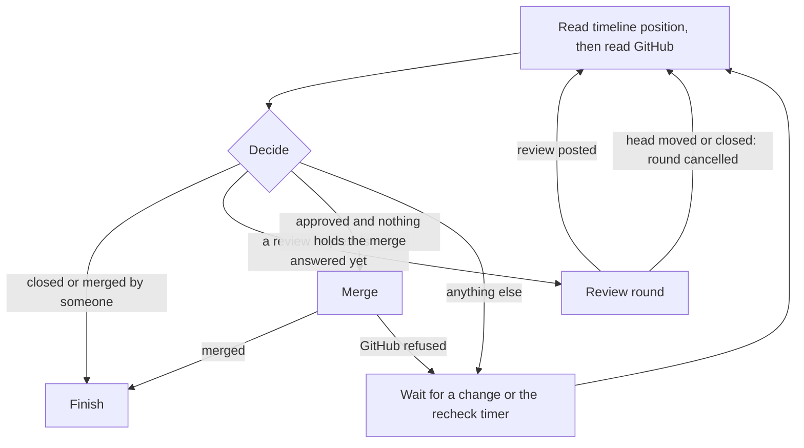

# Example: the jobcity PR review flow on protocol7

A port of jobcity's `pr-review-v2` and `review-capture-v2` to the library proposed in `plan.md` section 7. It is a sketch to test the design. Nothing here compiles, because the library does not exist yet. `example-small-review.md` shows the review stage alone.

It is not a step-for-step port. jobcity starts one run per pull request head and the run ends after its review or merge. Here one workflow follows a pull request for as long as it is open. It waits, and on every wake it reads GitHub and decides what to do: review, merge, keep waiting or finish.

Source read: `elee1766/jobcity` at `7894440` (`packs/gfx/pack.cue`, `packs/gfx/workflows.star`, `packs/gfx/gh.star`, `packs/automation/events.star`, the step prompts and the review tools under `tools/`).

## The flow today

1. Trigger `review-requests` fires on six GitHub events and every 15 minutes. It lists eligible PRs, skips subjects that already had a run, and starts at most 10 open runs.
2. Step `route` (script, gate pool) adds the eyes reaction and picks the reviewer: Terra for small low-risk diffs, Sol otherwise.
3. Step `review-gate` (script) ends the run as `stale` if the head moved, and reports which runtime evidence the repo uses.
4. Step `review` (agent) reviews. For missing runtime evidence it starts `review-capture-v2` child runs and waits with its step open. It posts one GitHub review and closes with `merge`, `approved`, `changes`, `commented` or `stale`.
5. Step `merge` (agent, gate pool) runs only after `merge`. It rechecks the PR and squash-merges, or closes `held`.

## The flow here



Three rules keep the workflow correct when other people act on the pull request:

1. **Events only wake it.** No decision is taken from what an event says. After every wake the workflow reads the pull request from GitHub and decides from that. A duplicate, late or missing webhook cannot put it in a wrong state.
2. **`Decide` is one pure function.** It takes what GitHub says now and what this workflow has already reviewed, and returns one action. There is no stage the workflow can be stuck in.
3. **Every write names the head it was decided for.** GitHub refuses a review or a merge for a head that has moved, and a refusal means "read again".

## What happens when someone else acts

| What happens | What the workflow does |
|---|---|
| The author pushes while the reviewer is mid-turn or captures are running | The round is cancelled: the turn stops, the session closes, captures are cancelled and their devices are released. The request is still unanswered, so after `PushSettle` the new head is reviewed |
| The author pushes after a review and does not request review | Nothing. A push alone starts no round. The workflow waits |
| The author pushes after a review and requests review again | A round runs on the new head. It is given the earlier reviews, how the new head relates to the last reviewed head, the files that differ, and the state of its own threads, so it can review what changed |
| A push lands after the approval and before the merge | GitHub refuses the merge because the head does not match. The approval does not cover the new head, so the workflow waits for a new review request |
| Someone else merges or closes the pull request | A round in progress is cancelled. The next read finishes the ticket as `MERGED_ELSEWHERE` or `CLOSED` |
| Someone requests changes, opens a thread, or a check fails after the approval | `Decide` returns wait, with the blocker as the reason. When it clears, the next wake merges |
| Someone dismisses the approval | The merge waits on `APPROVAL_MISSING`. A new review request starts another round |
| Review is requested again on a head already reviewed | The request has a new ID, so `NeedsReview` is true and another round runs. It is told the head has not moved, and looks at the replies on its threads |
| The pull request becomes a draft | Wait until it is ready again |
| A webhook is lost | The recheck timer wakes the workflow and it reads GitHub anyway |
| Webhooks arrive twice or out of order | Nothing. They only wake the workflow |
| The worker restarts or a new build is deployed during a wait | Temporal resumes the wait. At its next wake the workflow continues as new on the current build |
| ticketd cannot serve the event watch | The wait falls back to the recheck timer |

## Where each part goes

| Today | Here |
|---|---|
| Workflow and trigger blocks in `pack.cue`, and the per-repo instance vars | `Register`, and the `Config` value in `main.go` |
| The relay and the six-event trigger | `cmd/gfx-webhooks`, an ordinary HTTP handler in this repo. It starts one `IngestDelivery` workflow per delivery |
| The 15-minute trigger | A timer inside `Workflows.Intake`. One Intake workflow per repo wakes on a webhook or on the timer, whichever comes first |
| One run per `<pr>@<head>` subject. A new head is a new run with no memory of the last | One `pr_review` ticket and one workflow per pull request. Each review is a round recorded on the ticket |
| `events.star:review_requests` (dedupe by run key, cap of 10) | `Workflows.fileEligibleReviews`. The store refuses a second ticket with the same `Once` key. The cap of 10 open runs is gone: see "Open in this port" |
| `tools/lib/review-discovery.ts` (247 lines) | `Discover`, an activity, finds pull requests to follow. `NeedsReview` decides when a followed pull request gets another round |
| `route` step and `tools/lib/review-route.ts` (71 lines) | `RiskReasons`, a plain Go function called in the workflow. No step and no sandbox |
| `review-gate` step and `gh.star:evidence_gate` | `Decide`, plus `EvidencePlatforms` |
| `pr_review_completed` in `workflows.star` | `Decide` and the loop in `Workflows.Review` |
| `review` step | `Workflows.reviewHead`. One session per round, so each round starts with an empty conversation. A round after the first gets a `prompts.Baseline` |
| A head that moves during a review is noticed at the next step | `Workflows.reviewRound` cancels the round as soon as the head moves or the pull request closes |
| `tools/automation/start_review_capture.ts` (217 lines: checks that the caller holds the review step, that the run and subject match, that the platform fits the repo, then checks the run it started) | The reviewer returns capture requests in its typed `Turn`. `Workflows.runCaptures` checks the platform and the attempt limit in Go and starts each capture as a Temporal child. The agent files nothing, so the identity checks go away |
| `review_capture_start` and the `_CAPTURES` table | `Workflows.Capture` and `EvidencePlatforms` |
| `merge` step, an agent session | `Decide` returns merge and the loop calls `github.Merge`. No agent |
| A run that closed `held` or `blocked` stays closed until `bin/wake-ticket` or `run resume` | The workflow never parks on one condition. Every wake reads GitHub and decides again |
| The reviewer posts one GitHub review with `gh` | `github.PostReview` in the workflow, under an operation key. The session can only read GitHub. This is the example's choice, not a rule of the library |
| `jcx image upload` | `PublishEvidence`, an activity in this worker |
| `resources` in `pack.cue` with `bin/emulator-provider` and `bin/ios-provider` | `devices.Leases.Reserve` and `devices.Leases.Release`, activities on the device worker. protocol7 has no resource model, so the lease is this repo's code |
| The code checked out for the session | A `p7.GitClone` input at `/work`. There is no separate repo field on a session |
| The policy repo checked out beside the code | Two `p7.GitTree` inputs mounted read-only under `/guidance` |
| `jcx totp` | `p7.Tool` in the device worker. It returns a code for a designated test account, which the plan allows (section 9) |
| `bin/namespace-login` | Not ported. A session is sent no login for the iOS devbox |
| "Read-only: never push" in the prompt | The session's egress grant. PDP refuses a push |
| `jobshop close --outcome <word>` | The agent submits a `Turn` message. An unknown word fails the turn |

Unchanged: the policy documents, the risk rules, and most of the prompt text.

## Packages

Only `p7` is protocol7. The rest is code in this repo.

| Package | What it is |
|---|---|
| `p7` | The proposed protocol7 library |
| `github` | This repo's GitHub package. protocol7 has no GitHub types. Each function called with a workflow context runs one activity that calls GitHub through PDP, and turns a known refusal into a Go error such as `github.ErrHeadMoved`. `github.PullRequest` builds the provider-neutral `p7.ObjectRef` for a pull request |
| `devices` | Device leases and test-account tools. Runs only in the device worker |
| `prompts` | Functions that build prompt text from typed values |
| `reviewv1` | Generated from the protobuf below |

`Decide` reads one value from the `github` package:

```go
// In package github.

// ReviewState is what GitHub says about a pull request now. GetReviewState
// reads all of it in one activity.
type ReviewState struct {
	Open   bool
	Merged bool
	Draft  bool
	Head   string
	Author string
	Labels []string
	// RequestID identifies the newest request for this agent's review: a
	// review-request event or a comment that asks for one. Zero when there is none.
	RequestID int64
	// RequestComment is the comment that asked, or zero when the request was not a comment.
	RequestComment int64
	// ApprovedHead is the head this agent's standing approval is for. Empty
	// when it has none, or the approval was dismissed.
	ApprovedHead     string
	ChecksGreen      bool
	ChangesRequested bool // by any reviewer other than this agent
	OpenThreads      int
}

// Relation is how a pull request's current head relates to an earlier head.
type Relation int

const (
	// SameHead means the head has not moved.
	SameHead Relation = iota
	// Ahead means the earlier head is an ancestor. The difference is the new commits.
	Ahead
	// Rewritten means a rebase, amend or force push replaced the earlier head.
	Rewritten
	// Unavailable means GitHub no longer has the earlier head.
	Unavailable
)

// Comparison is what CompareHeads returns for an earlier head and the current one.
type Comparison struct {
	Relation Relation
	// Files are the files that differ between the two heads. Empty when the
	// relation is SameHead or Unavailable.
	Files []File
	// BaseMoved is set when the branch was rebased or merged onto a newer base,
	// so the difference also holds changes the author did not write.
	BaseMoved bool
}

// Thread is one review thread on a pull request.
type Thread struct {
	Path     string
	Line     int
	Resolved bool
	// Outdated is set when the line the thread is on has changed since.
	Outdated bool
	Comments []ThreadComment // author and text, oldest first
}
```

## Types

```proto
// Ticket fields for kind pr_review. One ticket follows one pull request. The
// evidence, merge and image fields are copied from the repo's configuration at intake.
message PRReview {
  string repo = 1;
  int32 pr = 2;
  string issue = 3;       // Linear key, may be empty
  Evidence evidence = 4;  // NONE, ANDROID or BROWSER
  bool merge_others = 5;
  string image = 6;
  repeated Round rounds = 7; // one per finished review round, oldest first. The workflow appends
}

// One finished review round. Its review is posted on GitHub.
message Round {
  string head = 1;
  int64 request = 2;    // the request it answered, 0 when there was none
  Verdict verdict = 3;  // MERGE, APPROVED, CHANGES or COMMENTED
  string summary = 4;   // the review text, given to later rounds
}

// What the reviewer submits at the end of each turn.
message Turn {
  Verdict verdict = 1; // WAITING, MERGE, APPROVED, CHANGES or COMMENTED
  string body = 2;                      // the review text, naming each evidence file where it belongs
  repeated LineComment comments = 3;    // path, line and text
  repeated string evidence = 4;         // names of the files the session saved as artifacts
  repeated CaptureRequest captures = 5; // set with WAITING: the captures the reviewer needs
}

// The result stored on the pr_review ticket when the workflow finishes.
message Result {
  Outcome outcome = 1; // MERGED, MERGED_ELSEWHERE, CLOSED or ROUND_LIMIT
}

// Ticket fields for kind review_capture. The reviewer fills in platform and
// criteria. The workflow adds repo and head, so a capture describes its own work.
message CaptureRequest {
  Platform platform = 1; // ANDROID, IOS or BROWSER
  string criteria = 2;
  string repo = 3;
  string head = 4;
}

message CaptureReport {
  CaptureResult result = 1; // PASS, FAIL, STALE, REFUSED or ERROR
  string report = 2;
  repeated string evidence = 3; // artifact names the reviewer can put in its review
}
```

`HeldReason` is `NOT_HELD`, `APPROVAL_MISSING`, `CHECKS`, `BLOCKING_REVIEW` or `OPEN_THREADS`. It is only used to say what a merge is waiting on.

## Workflows

`Review` and `Capture` are ticket workflows. `IngestDelivery` and `Intake` are plain Temporal workflows with no ticket.

```go
// Package prreview reviews pull requests that other people wrote.
package prreview

import (
	"context"
	"errors"
	"fmt"
	"slices"
	"time"

	p7 "github.com/gfx-labs/protocol7"
	"go.temporal.io/api/enums/v1"
	"go.temporal.io/sdk/client"
	"go.temporal.io/sdk/temporal"
	"go.temporal.io/sdk/workflow"

	"example.com/gfx/devices"
	reviewv1 "example.com/gfx/gen/review/v1"
	"example.com/gfx/github"
	"example.com/gfx/prompts"
)

const (
	// MaxReviewRounds is the number of reviews one pull request may get before
	// the workflow stops and leaves it to a person.
	MaxReviewRounds = 8
	// MaxCaptureAttempts is the number of captures one round may start per platform.
	MaxCaptureAttempts = 2
	// IntakeWakeSignal tells a repo's Intake workflow that one of its pull requests changed.
	IntakeWakeSignal = "pull-request-activity"
	// IntakePassesPerRun bounds the history of one Intake run before it continues as new.
	IntakePassesPerRun = 200
	// WorkDirectory is where a session finds the clone of the repository under review.
	WorkDirectory = "/work"
)

// Workflow type names. They are registered explicitly, so renaming a Go method
// does not change the type that running executions and other binaries refer to.
const (
	// IngestDeliveryWorkflow is started by the webhook receiver.
	IngestDeliveryWorkflow = "prreview.IngestDelivery"
	// IntakeWorkflow is started by wakeIntake and continued as new by Intake.
	IntakeWorkflow = "prreview.Intake"
)

// Config is everything that differs between installations.
type Config struct {
	// TaskQueue is the queue this worker polls. Intake workflows are started on it.
	TaskQueue string
	// AgentLogin is the GitHub login reviews are posted as. Its own PRs are never merged here.
	AgentLogin       string
	HighRiskReviewer p7.Model
	LowRiskReviewer  p7.Model
	CaptureAgent     p7.Model
	// CaptureImage holds the device tools a capture uses, such as adb.
	CaptureImage string
	// CaptureTools are the tools a capture agent may call. Each is registered in the device worker.
	CaptureTools []string
	// DeviceQueue is the task queue of the device worker, which owns the device leases.
	DeviceQueue string
	// DeviceWait is how long a capture may wait for a free device.
	DeviceWait time.Duration
	// Guidance is the skills and policy documents mounted read-only into every
	// session. A source may name a tag. It is resolved to a commit once, when the
	// session starts, and the commit is recorded on the run.
	Guidance []p7.Input
	// SessionIdleLimit closes a reviewer session that has waited this long for captures.
	SessionIdleLimit time.Duration
	// IntakeInterval is how often a repo is rescanned when no webhook arrives.
	IntakeInterval time.Duration
	// Recheck is how often a waiting pull request workflow reads GitHub when no event arrives.
	Recheck time.Duration
	// PushSettle is how long to wait after a push cancels a round before reviewing the new head.
	PushSettle time.Duration
	Repos      []Repo
}

// Repo is one repository whose pull requests are reviewed.
type Repo struct {
	Name        string
	Image       string // the image the reviewer runs the repo's checks in
	Evidence    reviewv1.Evidence
	MergeOthers bool
}

// Candidate is one open pull request that Discover found this agent should follow.
type Candidate struct {
	PullRequest int32
	Issue       string
	Title       string
}

// Workflows holds the configuration that the workflows read.
type Workflows struct {
	config Config
}

// Activities holds what the activities in this package need.
type Activities struct {
	config   Config
	temporal client.Client
}

// Register adds the review workflows and activities to a worker. p7.Worker
// embeds Temporal's worker, so plain workflows and activities register on it too.
func Register(worker *p7.Worker, config Config) {
	workflows := &Workflows{config: config}
	activities := &Activities{config: config, temporal: worker.Client()}
	p7.Register(worker, "pr_review", workflows.Review)
	p7.Register(worker, "review_capture", workflows.Capture)
	worker.RegisterWorkflowWithOptions(workflows.IngestDelivery, workflow.RegisterOptions{Name: IngestDeliveryWorkflow})
	worker.RegisterWorkflowWithOptions(workflows.Intake, workflow.RegisterOptions{Name: IntakeWorkflow})
	worker.RegisterActivity(activities.RecordDelivery)
	worker.RegisterActivity(activities.WakeIntake)
	worker.RegisterActivity(Discover)
	worker.RegisterActivity(PublishEvidence)
}

// StartIntakes makes sure every configured repo has a running Intake workflow.
// The worker calls it at startup, so a repo that receives no webhook is still scanned.
func StartIntakes(ctx context.Context, temporalClient client.Client, config Config) error {
	for _, repo := range config.Repos {
		if err := wakeIntake(ctx, temporalClient, config.TaskQueue, repo); err != nil {
			return err
		}
	}
	return nil
}

// wakeIntake signals the repo's Intake workflow, and starts it first if it is not running.
func wakeIntake(ctx context.Context, temporalClient client.Client, taskQueue string, repo Repo) error {
	workflowID := "review-intake/" + repo.Name
	options := client.StartWorkflowOptions{ID: workflowID, TaskQueue: taskQueue}
	_, err := temporalClient.SignalWithStartWorkflow(ctx, workflowID, IntakeWakeSignal, nil, options, IntakeWorkflow, repo)
	if err != nil {
		return fmt.Errorf("wake intake for %s: %w", repo.Name, err)
	}
	return nil
}

// WakeIntake is wakeIntake as an activity, because a workflow cannot signal-with-start.
func (a *Activities) WakeIntake(ctx context.Context, repo Repo) error {
	return wakeIntake(ctx, a.temporal, a.config.TaskQueue, repo)
}

// IngestDelivery handles one GitHub webhook delivery. The receiver starts it
// with the delivery as the workflow ID and answers GitHub once Temporal has
// accepted the start. The receiver passes parsed fields, not the raw body.
func (w *Workflows) IngestDelivery(ctx workflow.Context, delivery github.Delivery) error {
	ctx = workflow.WithActivityOptions(ctx, workflow.ActivityOptions{StartToCloseTimeout: time.Minute})

	// RecordDelivery appends the change to the pull request's timeline through
	// ticketd. That append is what wakes a waiting Review workflow. The entry is
	// keyed by the delivery, so a redelivery after Temporal has dropped this
	// workflow's history appends nothing.
	var activities *Activities
	if err := workflow.ExecuteActivity(ctx, activities.RecordDelivery, delivery).Get(ctx, nil); err != nil {
		return fmt.Errorf("record delivery %s: %w", delivery.ID, err)
	}
	// Intake is woken too, in case this is a pull request nobody follows yet.
	for _, repo := range w.config.Repos {
		if repo.Name != delivery.Repo {
			continue
		}
		if err := workflow.ExecuteActivity(ctx, activities.WakeIntake, repo).Get(ctx, nil); err != nil {
			return fmt.Errorf("wake intake after delivery %s: %w", delivery.ID, err)
		}
	}
	return nil
}

// Intake files pr_review tickets for one repo. It is one long-lived workflow
// per repo, so two scans of a repo never run at once.
func (w *Workflows) Intake(ctx workflow.Context, repo Repo) error {
	logger := workflow.GetLogger(ctx)
	wake := workflow.GetSignalChannel(ctx, IntakeWakeSignal)

	for pass := 0; pass < IntakePassesPerRun; pass++ {
		// A failed pass is logged, not returned. Returning would stop this
		// repo's intake until the next webhook started it again.
		if err := w.fileEligibleReviews(ctx, repo); err != nil {
			logger.Warn("intake pass failed", "repo", repo.Name, "error", err)
		}

		// Sleep until a webhook arrives or the interval passes.
		timerCtx, cancelTimer := workflow.WithCancel(ctx)
		selector := workflow.NewSelector(ctx)
		selector.AddReceive(wake, func(channel workflow.ReceiveChannel, more bool) {
			channel.Receive(ctx, nil)
		})
		selector.AddFuture(workflow.NewTimer(timerCtx, w.config.IntakeInterval), func(timer workflow.Future) {})
		selector.Select(ctx)
		cancelTimer()
		if ctx.Err() != nil {
			return ctx.Err()
		}
		// Webhooks that arrived together become one pass.
		for wake.ReceiveAsync(nil) {
		}
	}

	// The next run scans first, so a wake signal that arrives during the switch
	// loses nothing. A pinned workflow moves to a new build only here.
	options := workflow.ContinueAsNewErrorOptions{}
	if workflow.GetInfo(ctx).GetTargetWorkerDeploymentVersionChanged() {
		options.InitialVersioningBehavior = workflow.ContinueAsNewVersioningBehaviorAutoUpgrade
	}
	return workflow.NewContinueAsNewErrorWithOptions(ctx, options, IntakeWorkflow, repo)
}

// fileEligibleReviews files one pr_review ticket for each pull request this
// agent should follow and does not follow yet. It ignores what any event said
// and lists what is eligible now.
func (w *Workflows) fileEligibleReviews(ctx workflow.Context, repo Repo) error {
	activityCtx := workflow.WithActivityOptions(ctx, workflow.ActivityOptions{StartToCloseTimeout: 2 * time.Minute})
	var candidates []Candidate
	if err := workflow.ExecuteActivity(activityCtx, Discover, repo.Name).Get(ctx, &candidates); err != nil {
		return fmt.Errorf("discover reviews in %s: %w", repo.Name, err)
	}
	for _, candidate := range candidates {
		// The Once key has no head in it. A pull request that is already
		// followed is skipped here, and its own workflow sees the new head.
		_, err := p7.File(ctx, p7.NewTicket{
			Kind:    "pr_review",
			Once:    fmt.Sprintf("pr:%s#%d", repo.Name, candidate.PullRequest),
			Title:   candidate.Title,
			Objects: []p7.ObjectRef{github.PullRequest(repo.Name, candidate.PullRequest)},
			Fields: &reviewv1.PRReview{
				Repo:        repo.Name,
				Pr:          candidate.PullRequest,
				Issue:       candidate.Issue,
				Evidence:    repo.Evidence,
				MergeOthers: repo.MergeOthers,
				Image:       repo.Image,
			},
		})
		if err != nil {
			return fmt.Errorf("file review for %s#%d: %w", repo.Name, candidate.PullRequest, err)
		}
	}
	return nil
}

// Review follows one pull request until it is merged or closed. It holds no
// stage. On every pass it reads GitHub, asks Decide what to do, does that one
// thing, and reads again.
func (w *Workflows) Review(
	ctx workflow.Context,
	ticket p7.Ticket[*reviewv1.PRReview],
) (*reviewv1.Result, error) {
	review := ticket.Fields
	pullRequestRef := github.PullRequest(review.Repo, review.Pr)
	logger := workflow.GetLogger(ctx)

	for {
		// Read the timeline position before reading GitHub. The waits below ask
		// for changes after this position, so a change that lands between the
		// read and the wait still wakes the workflow.
		object, err := p7.GetObject(ctx, pullRequestRef)
		if err != nil {
			return nil, fmt.Errorf("read pull request object: %w", err)
		}
		state, err := github.GetReviewState(ctx, review.Repo, review.Pr)
		if err != nil {
			return nil, fmt.Errorf("read pull request: %w", err)
		}

		action := Decide(state, review, w.config.AgentLogin)
		// Shown in the Temporal UI, so a waiting workflow says what it waits for.
		workflow.SetCurrentDetails(ctx, action.Reason)

		switch action.Kind {
		case ActionFinish:
			return &reviewv1.Result{Outcome: action.Outcome}, nil

		case ActionReview:
			round, superseded, err := w.reviewRound(ctx, ticket.ID, review, state, object.Sequence)
			if err != nil {
				return nil, err
			}
			if superseded {
				// Let a burst of pushes settle before reviewing the new head.
				if err := workflow.Sleep(ctx, w.config.PushSettle); err != nil {
					return nil, err
				}
				continue
			}
			// The round is saved on the ticket, so a later run of this
			// workflow knows what has been reviewed.
			review.Rounds = append(review.Rounds, round)
			if err := p7.UpdateFields(ctx, ticket, review); err != nil {
				return nil, fmt.Errorf("record review round: %w", err)
			}
			// Read again at once. The review may have made the pull request mergeable.
			continue

		case ActionMerge:
			err := github.Merge(ctx, github.MergeRequest{
				Repo:         review.Repo,
				PullRequest:  review.Pr,
				Method:       github.Squash,
				MatchHead:    state.Head,
				OperationKey: fmt.Sprintf("merge:%s:%s", ticket.ID, state.Head),
			})
			if err == nil {
				return &reviewv1.Result{Outcome: reviewv1.Outcome_MERGED}, nil
			}
			if !errors.Is(err, github.ErrHeadMoved) && !errors.Is(err, github.ErrNotMergeable) {
				return nil, fmt.Errorf("merge pull request: %w", err)
			}
			// GitHub refused, so the pull request changed after it was read.
			// Wait for that change to arrive, then decide again.
			logger.Info("merge refused", "head", state.Head, "error", err)

		case ActionWait:
		}

		// Nothing to do now. A wait is the safe place to move to a new build
		// or shorten a long history: no round is running and the rounds are on
		// the ticket.
		info := workflow.GetInfo(ctx)
		if info.GetContinueAsNewSuggested() || info.GetTargetWorkerDeploymentVersionChanged() {
			return nil, p7.ContinueAsNew(ctx, ticket)
		}
		if err := w.waitForChange(ctx, pullRequestRef, object.Sequence); err != nil {
			return nil, err
		}
	}
}

// waitForChange returns when the pull request changes or the recheck timer
// fires, whichever comes first. It does not say which. The caller reads GitHub
// either way.
func (w *Workflows) waitForChange(ctx workflow.Context, pullRequest p7.ObjectRef, cursor int64) error {
	waitCtx, cancelWait := workflow.WithCancel(ctx)
	defer cancelWait()

	watchFailed := false
	selector := workflow.NewSelector(ctx)
	changed := p7.NextEvent(waitCtx, pullRequest, github.ReviewRelevantEvents, cursor)
	selector.AddFuture(changed, func(change workflow.Future) {
		if err := change.Get(ctx, nil); err != nil {
			watchFailed = true
			workflow.GetLogger(ctx).Warn("event watch failed, waiting for the recheck timer", "error", err)
		}
	})
	selector.AddFuture(workflow.NewTimer(waitCtx, w.config.Recheck), func(timer workflow.Future) {})

	selector.Select(ctx)
	if watchFailed && ctx.Err() == nil {
		// Only the timer is left.
		selector.Select(ctx)
	}
	return ctx.Err()
}

// reviewRound reviews one head. It reports superseded when the head moved or
// the pull request closed before the review was posted. Then nothing was posted.
func (w *Workflows) reviewRound(
	ctx workflow.Context,
	ticketID string,
	review *reviewv1.PRReview,
	state github.ReviewState,
	cursor int64,
) (round *reviewv1.Round, superseded bool, err error) {
	// Everything in the round runs under roundCtx: the session, its turns and
	// the captures. Cancelling it stops all of them.
	roundCtx, cancelRound := workflow.WithCancel(ctx)
	defer cancelRound()

	// Cancel the round as soon as it is superseded. If the watch itself fails
	// the round goes on, and PostReview still refuses a head that has moved.
	pullRequestRef := github.PullRequest(review.Repo, review.Pr)
	superseding := p7.NextEvent(roundCtx, pullRequestRef, github.SupersedingEvents, cursor)
	workflow.Go(roundCtx, func(watchCtx workflow.Context) {
		if superseding.Get(watchCtx, nil) == nil {
			cancelRound()
		}
	})

	round, err = w.reviewHead(roundCtx, ticketID, review, state)
	if err == nil {
		return round, false, nil
	}
	headMoved := errors.Is(err, github.ErrHeadMoved)
	roundCancelled := roundCtx.Err() != nil && ctx.Err() == nil
	if headMoved || roundCancelled {
		workflow.GetLogger(ctx).Info("review round superseded", "head", state.Head, "error", err)
		return nil, true, nil
	}
	return nil, false, err
}

// reviewHead runs one reviewer session on one head and posts its review.
func (w *Workflows) reviewHead(
	ctx workflow.Context,
	ticketID string,
	review *reviewv1.PRReview,
	state github.ReviewState,
) (round *reviewv1.Round, err error) {
	// Route. Was a script step in the gate pool.
	MarkSeen(ctx, review.Repo, review.Pr, state.RequestComment)
	files, err := github.ListFiles(ctx, review.Repo, review.Pr)
	if err != nil {
		return nil, fmt.Errorf("list changed files: %w", err)
	}
	// The reviewer is chosen from the whole pull request, not from what changed
	// since the last round. A sensitive path stays sensitive.
	reviewer := w.config.LowRiskReviewer
	if len(RiskReasons(files, state.Labels)) > 0 {
		reviewer = w.config.HighRiskReviewer
	}

	baseline, err := w.baselineFor(ctx, review, state.Head)
	if err != nil {
		return nil, err
	}
	// The code is a clone and not a tree, so the reviewer has git history.
	clone := p7.GitClone{Repository: review.Repo, Ref: state.Head}
	if baseline != nil && baseline.Comparison.Relation != github.Unavailable {
		// The last reviewed head is fetched too, so the reviewer can run its
		// own diff or range-diff between the two.
		clone.Fetch = []string{baseline.PreviousHead}
	}
	inputs := slices.Concat([]p7.Input{{Source: clone, Destination: WorkDirectory}}, w.config.Guidance)

	// One session per round, kept open while captures run. It can read GitHub
	// and cannot write to it.
	session, err := p7.OpenSession(ctx, p7.SessionSpec{
		Model:     reviewer,
		Image:     review.Image,
		Inputs:    inputs,
		Egress:    []p7.EgressRef{github.ReadOnly(review.Repo)},
		IdleLimit: w.config.SessionIdleLimit,
	})
	if err != nil {
		return nil, fmt.Errorf("open reviewer: %w", err)
	}
	defer func() {
		err = errors.Join(err, closeSession(ctx, session))
	}()

	// The prompt carries the earlier rounds from the ticket and the baseline.
	// The verdict is still for the whole pull request at this head.
	platforms := EvidencePlatforms(review.Evidence, files, state.Labels)
	turn, err := p7.Prompt[*reviewv1.Turn](ctx, session, prompts.Review(review, state, baseline, platforms))
	if err != nil {
		return nil, fmt.Errorf("review turn: %w", err)
	}
	captureAttempts := map[reviewv1.Platform]int{}
	for turn.Verdict == reviewv1.Verdict_WAITING {
		if len(turn.Captures) == 0 {
			return nil, temporal.NewNonRetryableApplicationError(
				"reviewer is waiting and requested no capture", "InvalidTurn", nil)
		}
		reports, err := w.runCaptures(ctx, ticketID, review.Repo, state.Head, turn.Captures, platforms, captureAttempts)
		if err != nil {
			return nil, err
		}
		turn, err = p7.Prompt[*reviewv1.Turn](ctx, session, prompts.CaptureReports(reports))
		if err != nil {
			return nil, fmt.Errorf("review turn after captures: %w", err)
		}
	}

	round = &reviewv1.Round{
		Head:    state.Head,
		Request: state.RequestID,
		Verdict: turn.Verdict,
		Summary: turn.Body,
	}

	// Post. The reviewer used to do this itself with gh. PostReview names the
	// head it reviewed and returns ErrHeadMoved if that is no longer the head.
	// The operation key stops a second review when Temporal runs the activity twice.
	activityCtx := workflow.WithActivityOptions(ctx, workflow.ActivityOptions{StartToCloseTimeout: 5 * time.Minute})
	var body string
	err = workflow.ExecuteActivity(activityCtx, PublishEvidence, EvidenceRequest{
		Repo:        review.Repo,
		PullRequest: review.Pr,
		Head:        state.Head,
		Body:        turn.Body,
		Artifacts:   turn.Evidence,
	}).Get(ctx, &body)
	if err != nil {
		return nil, fmt.Errorf("publish evidence: %w", err)
	}
	err = github.PostReview(ctx, github.Review{
		Repo:         review.Repo,
		PullRequest:  review.Pr,
		Head:         state.Head,
		Event:        ReviewEvent(turn.Verdict),
		Body:         body,
		Comments:     LineComments(turn.Comments),
		OperationKey: fmt.Sprintf("review:%s:%s:%d", ticketID, state.Head, state.RequestID),
	})
	if err != nil {
		return nil, fmt.Errorf("post review: %w", err)
	}
	return round, nil
}

// baselineFor reads what a round after the first needs to review only what
// changed since this agent's last review. It returns nil for the first round.
func (w *Workflows) baselineFor(
	ctx workflow.Context,
	review *reviewv1.PRReview,
	head string,
) (*prompts.Baseline, error) {
	if len(review.Rounds) == 0 {
		return nil, nil
	}
	last := review.Rounds[len(review.Rounds)-1]
	comparison, err := github.CompareHeads(ctx, review.Repo, last.Head, head)
	if err != nil {
		return nil, fmt.Errorf("compare %s with %s: %w", last.Head, head, err)
	}
	// Every thread this agent opened, from any round, with the replies to it.
	threads, err := github.ListThreadsBy(ctx, review.Repo, review.Pr, w.config.AgentLogin)
	if err != nil {
		return nil, fmt.Errorf("list review threads: %w", err)
	}
	return &prompts.Baseline{PreviousHead: last.Head, Comparison: comparison, Threads: threads}, nil
}

// closeSession closes a session even when its round was cancelled. Closing a
// closed session does nothing.
func closeSession(ctx workflow.Context, session *p7.Session) error {
	cleanupCtx, cancel := workflow.NewDisconnectedContext(ctx)
	defer cancel()
	return session.Close(cleanupCtx)
}

// runCaptures starts the captures the reviewer asked for and waits for all of
// them. It returns one report per request, in the order the reviewer asked.
// When the round is cancelled the captures are cancelled with it.
func (w *Workflows) runCaptures(
	ctx workflow.Context,
	reviewTicket string,
	repo string,
	head string,
	requests []*reviewv1.CaptureRequest,
	allowed []reviewv1.Platform,
	attempts map[reviewv1.Platform]int,
) ([]*reviewv1.CaptureReport, error) {
	reports := make([]*reviewv1.CaptureReport, len(requests))
	captures := make([]workflow.Future, len(requests))
	for index, request := range requests {
		attempts[request.Platform]++
		attempt := attempts[request.Platform]
		if !slices.Contains(allowed, request.Platform) || attempt > MaxCaptureAttempts {
			reports[index] = &reviewv1.CaptureReport{Result: reviewv1.CaptureResult_REFUSED}
			continue
		}
		capture, err := p7.Child(ctx, p7.NewTicket{
			Kind:  "review_capture",
			Once:  fmt.Sprintf("capture:%s:%s:%s:%d", reviewTicket, head, request.Platform, attempt),
			Title: "Capture on " + request.Platform.String(),
			Fields: &reviewv1.CaptureRequest{
				Platform: request.Platform,
				Criteria: request.Criteria,
				Repo:     repo,
				Head:     head,
			},
		}, p7.ChildOptions{ParentClosePolicy: enums.PARENT_CLOSE_POLICY_REQUEST_CANCEL})
		if err != nil {
			return nil, fmt.Errorf("start %s capture: %w", request.Platform, err)
		}
		captures[index] = capture
	}

	// The captures run at the same time. Collecting them in order is enough.
	for index, capture := range captures {
		if capture == nil {
			continue
		}
		report := &reviewv1.CaptureReport{}
		if err := capture.Get(ctx, report); err != nil {
			if ctx.Err() != nil {
				return nil, ctx.Err()
			}
			// A capture that broke is reported to the reviewer, which decides
			// what the missing evidence means for the review.
			report = &reviewv1.CaptureReport{Result: reviewv1.CaptureResult_ERROR, Report: err.Error()}
		}
		reports[index] = report
	}
	return reports, nil
}

// Capture handles one review_capture ticket that a review round started.
func (w *Workflows) Capture(
	ctx workflow.Context,
	ticket p7.Ticket[*reviewv1.CaptureRequest],
) (report *reviewv1.CaptureReport, err error) {
	request := ticket.Fields

	// Hold a device. The lease is this repo's own reservation, kept by the
	// device worker. Reserve waits for a free device and heartbeats while it
	// waits. It is keyed by the holder, so a retry returns the same lease.
	reserveCtx := workflow.WithActivityOptions(ctx, workflow.ActivityOptions{
		TaskQueue:              w.config.DeviceQueue,
		ScheduleToCloseTimeout: w.config.DeviceWait,
		HeartbeatTimeout:       time.Minute,
	})
	// A nil receiver only names the activity. The device worker runs it.
	var leases *devices.Leases
	var lease devices.Lease
	err = workflow.ExecuteActivity(reserveCtx, leases.Reserve, devices.ReserveRequest{
		Platform: request.Platform,
		Holder:   ticket.ID,
	}).Get(ctx, &lease)
	if err != nil {
		return nil, fmt.Errorf("reserve %s device: %w", request.Platform, err)
	}
	// The release runs on a disconnected context, so a cancelled capture
	// still gives its device back.
	defer func() {
		releaseCtx, cancel := workflow.NewDisconnectedContext(ctx)
		defer cancel()
		releaseCtx = workflow.WithActivityOptions(releaseCtx, workflow.ActivityOptions{
			TaskQueue:           w.config.DeviceQueue,
			StartToCloseTimeout: time.Minute,
		})
		released := workflow.ExecuteActivity(releaseCtx, leases.Release, lease.ID)
		err = errors.Join(err, released.Get(releaseCtx, nil))
	}()

	clone := p7.GitClone{Repository: request.Repo, Ref: request.Head}
	inputs := slices.Concat([]p7.Input{{Source: clone, Destination: WorkDirectory}}, w.config.Guidance)

	// The session runs on the host that has the device. Placement picks the
	// core worker's queue for that host.
	report, err = p7.Agent[*reviewv1.CaptureReport](ctx, p7.AgentSpec{
		Model:       w.config.CaptureAgent,
		Image:       w.config.CaptureImage,
		Prompt:      prompts.Capture(request),
		Inputs:      inputs,
		Placement:   p7.Placement{Backend: p7.BackendHost, Host: lease.Host},
		Environment: lease.Environment,
		Tools:       w.config.CaptureTools,
		Timeout:     time.Hour,
	})
	if err != nil {
		return nil, fmt.Errorf("capture on %s: %w", lease.Host, err)
	}
	return report, nil
}
```

## What a later round is given

The first round reviews the whole pull request. Every later round gets, in its prompt and its checkout:

| Data | Where it comes from |
|---|---|
| Each earlier round: head, verdict and the review text | `PRReview.Rounds` on the ticket |
| How the current head relates to the last reviewed head: same, ahead, rewritten or unavailable | `github.CompareHeads` |
| The files that differ between the two heads, and whether the base moved | `github.CompareHeads` |
| Every thread this agent opened: path, line, replies, resolved, outdated | `github.ListThreadsBy` |
| Both commits in the clone at `/work` | `Fetch` on the `p7.GitClone` input |

```go
// In package prompts.

// Baseline is what a round needs to review only what changed since this
// agent's last review.
type Baseline struct {
	// PreviousHead is the head the last round reviewed.
	PreviousHead string
	Comparison   github.Comparison
	// Threads are the threads this agent opened in any round.
	Threads []github.Thread
}
```

What the prompt tells the reviewer to do with each relation:

- **Ahead:** review the new commits, and check each open thread against them.
- **Rewritten:** the plain difference between the two heads may hold changes from the base branch. Use `git range-diff` on the two commits, which are both in the clone.
- **Same head:** nothing changed in the code. Read the replies on the threads and answer them.
- **Unavailable:** review the whole pull request again, using the earlier review text and the threads.

In every case the verdict is for the whole pull request at the current head, because an approval on GitHub covers the whole head.

## Deciding

Plain Go with no library calls. `Decide` and `NeedsReview` hold every rule about what the workflow does next, so they can be tested with a table of states and no Temporal.

```go
// ActionKind is the one thing the Review workflow does on a pass.
type ActionKind int

const (
	// ActionWait waits for the pull request to change.
	ActionWait ActionKind = iota
	// ActionReview runs a review round on the current head.
	ActionReview
	// ActionMerge merges the current head.
	ActionMerge
	// ActionFinish ends the workflow.
	ActionFinish
)

// Action is what Decide returns.
type Action struct {
	Kind ActionKind
	// Outcome is set with ActionFinish.
	Outcome reviewv1.Outcome
	// Reason says why, for the Temporal UI and the logs.
	Reason string
}

// Decide returns what to do for a pull request, given what GitHub says now and
// the rounds this workflow has finished. It has no other input, so the same
// state always gives the same action, however the pull request got there.
func Decide(state github.ReviewState, review *reviewv1.PRReview, agentLogin string) Action {
	switch {
	case state.Merged:
		return Action{Kind: ActionFinish, Outcome: reviewv1.Outcome_MERGED_ELSEWHERE, Reason: "merged by someone else"}
	case !state.Open:
		return Action{Kind: ActionFinish, Outcome: reviewv1.Outcome_CLOSED, Reason: "closed"}
	case state.Draft:
		return Action{Kind: ActionWait, Reason: "waiting: draft"}
	}

	if NeedsReview(state, review.Rounds) {
		if len(review.Rounds) >= MaxReviewRounds {
			return Action{Kind: ActionFinish, Outcome: reviewv1.Outcome_ROUND_LIMIT, Reason: "review round limit reached"}
		}
		return Action{Kind: ActionReview, Reason: "reviewing " + state.Head}
	}

	// NeedsReview is true when there is no round, so there is a last round here.
	last := review.Rounds[len(review.Rounds)-1]
	switch {
	case last.Head != state.Head:
		return Action{Kind: ActionWait, Reason: "waiting: head changed since the last review, no new review request"}
	case last.Verdict != reviewv1.Verdict_MERGE:
		return Action{Kind: ActionWait, Reason: "waiting: reviewed, " + last.Verdict.String()}
	case !review.MergeOthers:
		return Action{Kind: ActionWait, Reason: "waiting: approved, this repo is not merged here"}
	case state.Author == agentLogin:
		return Action{Kind: ActionWait, Reason: "waiting: approved, own pull request"}
	}
	if held := WhyHeld(state); held != reviewv1.HeldReason_NOT_HELD {
		return Action{Kind: ActionWait, Reason: "waiting to merge: " + held.String()}
	}
	return Action{Kind: ActionMerge, Reason: "merging " + state.Head}
}

// NeedsReview reports whether there is a review request this workflow has not
// answered. A push alone starts no round.
func NeedsReview(state github.ReviewState, rounds []*reviewv1.Round) bool {
	if len(rounds) == 0 {
		// The ticket exists because Discover found a request for this agent's review.
		return true
	}
	return state.RequestID != 0 && state.RequestID != rounds[len(rounds)-1].Request
}

// WhyHeld returns what stops a merge of the current head, or NOT_HELD. These
// are the preconditions the merge agent's prompt listed.
func WhyHeld(state github.ReviewState) reviewv1.HeldReason {
	switch {
	case state.ApprovedHead != state.Head:
		return reviewv1.HeldReason_APPROVAL_MISSING
	case !state.ChecksGreen:
		return reviewv1.HeldReason_CHECKS
	case state.ChangesRequested:
		return reviewv1.HeldReason_BLOCKING_REVIEW
	case state.OpenThreads > 0:
		return reviewv1.HeldReason_OPEN_THREADS
	default:
		return reviewv1.HeldReason_NOT_HELD
	}
}
```

## Helpers

Plain Go with no library calls, apart from the two GitHub calls in `MarkSeen`.

```go
// MarkSeen adds the eyes reaction to the review request. A failure is logged
// and does not stop the review, as today.
func MarkSeen(ctx workflow.Context, repo string, pullRequest int32, requestComment int64) {
	var err error
	if requestComment != 0 {
		err = github.ReactToComment(ctx, repo, requestComment, github.ReactionEyes)
	} else {
		err = github.ReactToPullRequest(ctx, repo, pullRequest, github.ReactionEyes)
	}
	if err != nil {
		workflow.GetLogger(ctx).Warn("eyes reaction failed", "error", err)
	}
}

const (
	LowRiskMaxLines = 600
	LowRiskMaxFiles = 30
)

// RiskReasons returns why a diff needs the high-risk reviewer. It returns nil
// for a small low-risk diff. Ported from tools/lib/review-route.ts.
func RiskReasons(files []github.File, labels []string) []string {
	var reasons []string
	fileCount, lineCount := 0, 0
	for _, file := range files {
		if IsLockfile(file.Path) {
			continue
		}
		fileCount++
		lineCount += file.Additions + file.Deletions
		if IsSensitivePath(file.Path) {
			reasons = append(reasons, "sensitive path: "+file.Path)
		}
	}
	if fileCount == 0 {
		reasons = append(reasons, "no reviewable files")
	}
	if lineCount > LowRiskMaxLines {
		reasons = append(reasons, fmt.Sprintf("%d changed lines > %d", lineCount, LowRiskMaxLines))
	}
	if fileCount > LowRiskMaxFiles {
		reasons = append(reasons, fmt.Sprintf("%d files > %d", fileCount, LowRiskMaxFiles))
	}
	for _, label := range labels {
		if IsSensitiveLabel(label) {
			reasons = append(reasons, "label: "+label)
		}
	}
	return reasons
}

// EvidencePlatforms lists the platforms a capture may run on for this pull request.
func EvidencePlatforms(evidence reviewv1.Evidence, files []github.File, labels []string) []reviewv1.Platform {
	switch evidence {
	case reviewv1.Evidence_BROWSER:
		return []reviewv1.Platform{reviewv1.Platform_BROWSER}
	case reviewv1.Evidence_ANDROID:
		platforms := []reviewv1.Platform{reviewv1.Platform_ANDROID}
		touchesIOS := slices.ContainsFunc(files, func(file github.File) bool { return IsIOSPath(file.Path) })
		if touchesIOS || slices.Contains(labels, "evidence:ios") {
			platforms = append(platforms, reviewv1.Platform_IOS)
		}
		return platforms
	default:
		return nil
	}
}

// ReviewEvent maps the reviewer's verdict to the kind of GitHub review to post.
func ReviewEvent(verdict reviewv1.Verdict) github.ReviewEvent {
	switch verdict {
	case reviewv1.Verdict_MERGE, reviewv1.Verdict_APPROVED:
		return github.Approve
	case reviewv1.Verdict_CHANGES:
		return github.RequestChanges
	default:
		return github.Comment
	}
}
```

Left out:
- `Discover`, and the four path and label matchers `IsLockfile`, `IsSensitivePath`, `IsSensitiveLabel` and `IsIOSPath`. Each matcher is a table of regular expressions copied from `review-route.ts` and `gh.star`.
- `Activities.RecordDelivery`. It writes the pull request as a p7 external object (source `github`, kind `pull_request`, with this repo's schema) and appends one timeline entry keyed by the delivery.
- `github.ReviewRelevantEvents` and `github.SupersedingEvents`, two lists of timeline event kinds. The first is every kind that can change what `Decide` returns. The second is head changed, closed and merged.
- `PublishEvidence` and its `EvidenceRequest`. It is an activity that uploads the named artifacts to the image host and returns the review body with their links in place. It replaces `jcx image upload`. If Temporal runs it twice the files are uploaded twice, and the review uses the links from the run that finished.
- `LineComments`, which copies the reviewer's line comments into the GitHub package's type.
- The `github`, `prompts` and `devices` packages.

## The binaries

Three binaries from this repo. Image names, tags, paths, host names, queue names and the time limits are placeholders. A core `p7-worker` also runs on the device host and polls `local-<host>`, so sessions placed there run beside the devices.

The workflow worker holds no upstream credentials. Its GitHub activities go through PDP.

```go
// cmd/gfx-workflows

// buildID is set at link time. Worker Versioning pins each run to the build that started it.
var buildID string

func main() {
	worker, err := p7.NewWorker(p7.WorkerConfig{
		TaskQueue:         "gfx",
		Deployment:        "gfx-workflows",
		BuildID:           buildID,
		TemporalAddress:   os.Getenv("TEMPORAL_ADDRESS"),
		TemporalNamespace: os.Getenv("TEMPORAL_NAMESPACE"),
		TicketdURL:        os.Getenv("P7_TICKETD_URL"),
	})
	if err != nil {
		log.Fatalf("create worker: %v", err)
	}

	config := prreview.Config{
		TaskQueue:        "gfx",
		AgentLogin:       "elee-agent[bot]",
		HighRiskReviewer: p7.Model{Name: "openai-oauth:gpt-6.1-sol", Effort: "high"},
		LowRiskReviewer:  p7.Model{Name: "openai-oauth:gpt-6.1-terra", Effort: "high"},
		CaptureAgent:     p7.Model{Name: "claude-sonnet-5-5", Effort: "medium"},
		CaptureImage:     "review-capture@sha256:...",
		CaptureTools:     []string{"qa_authenticator_code"},
		DeviceQueue:      "gfx-devices",
		DeviceWait:       2 * time.Hour,
		Guidance: []p7.Input{
			{
				Source:      p7.GitTree{Repository: "elee1766/jobcity", Ref: "guidance-v1", Path: "docs/policy"},
				Destination: "/guidance/policy",
				ReadOnly:    true,
			},
			{
				Source:      p7.GitTree{Repository: "elee1766/jobcity", Ref: "guidance-v1", Path: "dot-agents/skills"},
				Destination: "/guidance/skills",
				ReadOnly:    true,
			},
		},
		SessionIdleLimit: 2 * time.Hour,
		IntakeInterval:   15 * time.Minute,
		Recheck:          10 * time.Minute,
		PushSettle:       2 * time.Minute,
		Repos: []prreview.Repo{
			{Name: "oku-trade/retail", Image: "review-retail@sha256:...", Evidence: reviewv1.Evidence_ANDROID, MergeOthers: true},
			{Name: "oku-trade/trade", Image: "review-trade@sha256:...", Evidence: reviewv1.Evidence_BROWSER},
			{Name: "oku-trade/account", Image: "review-account@sha256:...", MergeOthers: true},
			// The other five repos with reviews enabled are left out here.
		},
	}
	prreview.Register(worker, config)

	if err := prreview.StartIntakes(context.Background(), worker.Client(), config); err != nil {
		log.Fatalf("start intakes: %v", err)
	}
	if err := worker.Run(); err != nil {
		log.Fatalf("run worker: %v", err)
	}
}
```

The receiver is a Temporal client and not a worker. It answers GitHub once Temporal has accepted the start, and never waits for the review. The webhook secret is a mounted secret on this binary only.

```go
// cmd/gfx-webhooks

// MaxDeliveryBytes is the largest webhook body the receiver reads.
const MaxDeliveryBytes = 5 << 20

// Receiver turns each relevant GitHub delivery into one IngestDelivery workflow.
type Receiver struct {
	temporal      client.Client
	taskQueue     string
	webhookSecret []byte
}

func (r *Receiver) ServeHTTP(response http.ResponseWriter, request *http.Request) {
	body, err := io.ReadAll(http.MaxBytesReader(response, request.Body, MaxDeliveryBytes))
	if err != nil {
		http.Error(response, "body too large or unreadable", http.StatusRequestEntityTooLarge)
		return
	}
	if !github.ValidSignature(r.webhookSecret, request.Header.Get("X-Hub-Signature-256"), body) {
		http.Error(response, "bad signature", http.StatusUnauthorized)
		return
	}
	// ParseDelivery keeps the few fields the timeline needs and drops the rest,
	// so the workflow input stays small. It reports false for events this repo ignores.
	delivery, relevant, err := github.ParseDelivery(request.Header, body)
	if err != nil {
		http.Error(response, "unreadable delivery", http.StatusBadRequest)
		return
	}
	if !relevant {
		response.WriteHeader(http.StatusNoContent)
		return
	}

	_, err = r.temporal.ExecuteWorkflow(request.Context(), client.StartWorkflowOptions{
		ID:                       fmt.Sprintf("github-delivery/%d/%s", delivery.Installation, delivery.ID),
		TaskQueue:                r.taskQueue,
		WorkflowIDConflictPolicy: enums.WORKFLOW_ID_CONFLICT_POLICY_USE_EXISTING,
		WorkflowIDReusePolicy:    enums.WORKFLOW_ID_REUSE_POLICY_REJECT_DUPLICATE,
	}, prreview.IngestDeliveryWorkflow, delivery)
	var alreadyStarted *serviceerror.WorkflowExecutionAlreadyStarted
	if err != nil && !errors.As(err, &alreadyStarted) {
		// GitHub redelivers. The same delivery ID gives the same workflow ID.
		http.Error(response, "not accepted, retry", http.StatusServiceUnavailable)
		return
	}
	response.WriteHeader(http.StatusAccepted)
}
```

The device worker runs where the devices are. It owns the leases and the test-account tool. The authenticator seeds are a mounted secret on this worker; an agent gets a code for a designated test account and never a seed.

```go
// cmd/gfx-devices

// buildID is set at link time.
var buildID string

func main() {
	config, err := devices.LoadConfig()
	if err != nil {
		log.Fatalf("load device config: %v", err)
	}
	worker, err := p7.NewWorker(p7.WorkerConfig{
		TaskQueue:         "gfx-devices",
		Deployment:        "gfx-devices",
		BuildID:           buildID,
		TemporalAddress:   os.Getenv("TEMPORAL_ADDRESS"),
		TemporalNamespace: os.Getenv("TEMPORAL_NAMESPACE"),
		TicketdURL:        os.Getenv("P7_TICKETD_URL"),
	})
	if err != nil {
		log.Fatalf("create worker: %v", err)
	}

	// The limits are the ones in jobcity's pack.cue today: five Android
	// emulators, two iOS simulators and four browsers.
	leases, err := devices.NewLeases(config)
	if err != nil {
		log.Fatalf("open device leases: %v", err)
	}
	worker.RegisterActivity(leases.Reserve)
	worker.RegisterActivity(leases.Release)

	accounts := &devices.TestAccounts{SeedDirectory: config.AuthenticatorSeedDirectory}
	p7.Tool(worker, "qa_authenticator_code", accounts.AuthenticatorCode)

	if err := worker.Run(); err != nil {
		log.Fatalf("run worker: %v", err)
	}
}
```

Left out: the `devices` package. `Leases.Reserve` waits for a free device of the platform, boots it with jobcity's provider scripts, and returns the host and the environment a session needs to reach it, such as `ANDROID_SERIAL`. `Leases.Release` resets the device and frees it. A capture workflow that is terminated never runs its release, so `Leases` must also free a lease whose holder ticket has closed. `TestAccounts.AuthenticatorCode` computes a code for a test account from its seed.

## What the port needs from the library

Calls used here that `plan.md` section 7 does not have yet, or has in a different shape:

1. **`p7.NextEvent(ctx, object, kinds, after)` returning a `workflow.Future`.** The plan has `p7.WaitEvent`, which blocks with a timeout. A blocking call cannot sit in a `workflow.Selector` beside a timer, and cannot run beside a review round to cancel it. Both uses are what make this workflow wake on several things at once.
2. **`p7.GetObject` and a timeline `Sequence`.** A wait must name the position it starts from. Without it, a change that lands between reading GitHub and starting the wait is missed. Filing a ticket with an object reference must create the object record, so `GetObject` works before the first webhook.
3. **Prompt cancellation.** Cancelling the context of `p7.Prompt`, `p7.OpenSession` or `p7.Child` must stop the turn, session or child promptly and return. A round that cannot be interrupted keeps reviewing a head nobody wants reviewed.
4. **`p7.UpdateFields(ctx, ticket, fields)`.** The owning workflow writes its own ticket's fields, fenced by its ownership. Here it saves the finished rounds.
5. **`p7.ContinueAsNew(ctx, ticket)`.** A ticket workflow that lives for days needs to shorten its history and move to a new build. The next run starts on the current build, keeps the ticket's ownership, and reads the ticket again.
6. **`p7.Child` returning the child's future, with `p7.ChildOptions`.** The plan says the future is retained and the Parent Close Policy is explicit. Here `p7.Child` blocks until the child ticket is persisted and the child is started, then returns the future.
7. **Go types for inputs.** `p7.Input` with `p7.GitTree` and `p7.GitClone` sources. Added to the plan on 2026-11-12 (section 5 and the section 7 table), replacing `p7.Repo`. A clone has git history and is writable unless `ReadOnly` is set. `Fetch` lists extra commits to have in the clone, which a delta review needs for the last reviewed head.
8. **`Placement` and `Environment` on `p7.AgentSpec`,** filled from a lease that this repo's own activity returned.
9. **`p7.NewTicket.Objects`,** the link from a ticket to a provider-neutral external object.
10. **A stable workflow type name from `p7.Register`,** derived from the ticket kind and not from the Go method name.

Not a gap, but it affects this workflow: a person or an admin session can resteer a reviewer mid-turn (plan section 8, "Steering a running session"). After an interrupt, `p7.Prompt` returns the typed `Turn` of the steered turn, so `reviewHead` needs no code for it. After a stop it returns an error, which ends the workflow here. A workflow that should survive a stop would treat that error like a superseded round.

Calls in the plan that this port does not use:

- `p7.OnEvent` and `p7.Every`. Webhook intake is this repo's receiver plus `SignalWithStart`, and the rescans are workflow timers.
- `p7.WaitEvent`, replaced by `p7.NextEvent`.
- `p7.WaitChildren`, `p7.Parent`, `p7.Count`, and agents filing child tickets. The reviewer returns typed capture requests and the workflow starts the children.

## Open in this port

- **A round needs a request.** A push alone starts no round, so an author who pushes fixes and does not request review again waits. What counts as a request is decided in `github.GetReviewState`, which is not shown.
- **The reviewer cannot say the pull request is stale.** The `STALE` verdict is gone. The workflow sees a moved head itself, and with request-only rounds a recorded stale round would have left the request unanswered for good.
- **The delta is advice, not a limit.** Nothing stops a later round from reading only the changed files and approving. The prompt says the verdict covers the whole head. Whether reviews after a rewrite are good enough needs real runs.
- **Evidence is not carried over.** A later round asks for captures again if it needs them. Captures from an earlier head are not offered to it.
- **No cap on reviews in progress.** jobcity starts at most 10 open runs. Here each followed pull request has a workflow, most of them waiting, and the number of reviewer sessions at once is bounded only by executor capacity. A cap across workflows needs a shared counter, which protocol7 does not provide.
- **A cancelled round is thrown away.** The reviewer's work on the old head is lost, and its cost is spent. `PushSettle` limits how often that happens during a burst of pushes.
- **The round limit ends the ticket.** After `MaxReviewRounds` the workflow finishes as `ROUND_LIMIT`. Because the `Once` key allows no second ticket, the pull request is not followed again. Asking a person through `p7.Ask` would be better.
- **A reopened pull request is not followed again,** for the same `Once` reason. It needs a reopen command or an episode number in the key.
- **A stale read from GitHub.** If GitHub returns an old head just after a push, a round can start on it. `PostReview` and `Merge` refuse a head that is not current, so nothing wrong is published, but the round is wasted.
- A capture session on a host backend makes no enforced-egress claim (plan section 5).
- iOS captures need a login to the Namespace devbox. Nothing here supplies one.
- None of this has run. The Temporal calls are real API. Every `p7`, `github` and `devices` call is proposed.
