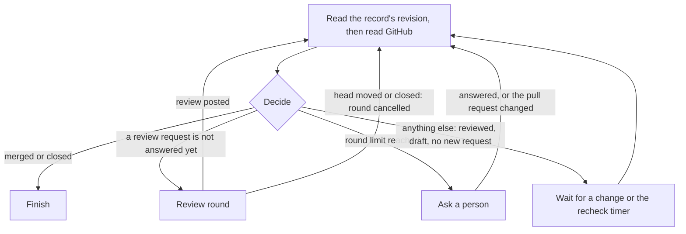

# Example: the jobcity PR review flow on protocol7

The review workflow of the three in `example-pr-flows.md`. It is a port of jobcity's `pr-review-v2` and `review-capture-v2` to the library proposed in `plan.md` section 7, and a sketch to test the design. Nothing here compiles, because the library does not exist yet. `example-small-review.md` shows the review stage alone.

It is not a step-for-step port. jobcity starts one run per pull request head and the run ends after its review or merge. Here one workflow follows a pull request for as long as it is open. It waits, and on every wake it reads GitHub and decides what to do: review, ask a person, keep waiting or finish.

It does not merge (user, 2026-11-13). The reviewer may not be the last reviewer, so the merge is the merge workflow's decision (`example-pr-merge.md`). jobcity's merge step, its merge verdict, required approvers, dependencies and deploy following are in that file.

Source read: `elee1766/jobcity` at `7894440` (`packs/gfx/pack.cue`, `packs/gfx/workflows.star`, `packs/gfx/gh.star`, `packs/automation/events.star`, the step prompts and the review tools under `tools/`).

## The flow today

1. Trigger `review-requests` fires on six GitHub events and every 15 minutes. It lists eligible PRs, skips subjects that already had a run, and starts at most 10 open runs.
2. Step `route` (script, gate pool) adds the eyes reaction and picks the reviewer: Terra for small low-risk diffs, Sol otherwise.
3. Step `review-gate` (script) ends the run as `stale` if the head moved, and reports which runtime evidence the repo uses.
4. Step `review` (agent) reviews. For missing runtime evidence it starts `review-capture-v2` child runs and waits with its step open. It posts one GitHub review and closes with `merge`, `approved`, `changes`, `commented` or `stale`.
5. Step `merge` (agent, gate pool) runs only after `merge`. It rechecks the PR and squash-merges, or closes `held`.

## The flow here



While a review request is unanswered, one escalation clock runs for it. If the review takes longer than configured, the owners are notified.

Three rules keep the workflow correct when other people act on the pull request:

1. **Events only wake it.** No decision is taken from what an event says. After every wake the workflow reads the pull request from GitHub and decides from that. A duplicate, late or missing webhook cannot put it in a wrong state.
2. **`Decide` is one pure function.** It takes what GitHub says now and what this workflow has already reviewed, and returns one action. There is no stage the workflow can be stuck in.
3. **The review checks the head it was written for.** GitHub accepts a review that names a commit which is no longer the head. So `PostReview` reads the head itself and refuses when it has moved. GitHub also has no idempotency key for reviews, so `PostReview` looks for its own earlier review before posting. See "Writes that check for themselves".

## What happens when someone else acts

| What happens | What the workflow does |
|---|---|
| The author pushes while the reviewer is mid-turn or captures are running | The round is cancelled: the turn stops, the session closes, captures are cancelled and their devices are released. The request is still unanswered, so after `PushSettle` the new head is reviewed |
| The author pushes after a review and does not request review | Nothing. A push alone starts no round. The workflow waits |
| The author pushes after a review and requests review again | A round runs on the new head. It is given the earlier reviews, how the new head relates to the last reviewed head, the files that differ, and the state of its own threads, so it can review what changed |
| A push lands after the approval | Nothing here. The approval on GitHub is for the earlier head. Whether that is enough to merge is the merge workflow's criteria (`ApprovalsOnHead` in `example-pr-merge.md`) |
| The merge workflow or a person merges the pull request | A round in progress is cancelled. The next read finishes the ticket as `MERGED` |
| Someone closes the pull request | A round in progress is cancelled. The next read finishes the ticket as `CLOSED` |
| Another reviewer requests changes, a thread is opened or a check fails after the approval | Nothing here. The merge workflow waits on it |
| Nobody answers a review request or a question | The escalation clock for that wait notifies the owners after the configured time |
| The pull request has had `MaxReviewRounds` reviews and another is requested | A person is asked whether to review again or stop. The ticket stays open |
| Someone dismisses the approval | Nothing until review is requested again. A new request starts another round |
| Review is requested again on a head already reviewed | The request has a new ID, so `NeedsReview` is true and another round runs. It is told the head has not moved, and looks at the replies on its threads |
| The pull request becomes a draft | Wait until it is ready again |
| A webhook is lost | The recheck timer wakes the workflow and it reads GitHub anyway |
| Webhooks arrive twice or out of order | Nothing. They only wake the workflow |
| The worker restarts or a new build is deployed during a wait | Temporal resumes the wait. At its next wake the workflow continues as new on the current build |
| ticketd cannot serve the event watch | The wait falls back to the recheck timer |

## Where each part goes

| Today | Here |
|---|---|
| Workflow and trigger blocks in `pack.cue`, and the per-repo instance vars | `Register`, and the settings in `example-pr-flows.md` |
| The relay and the six-event trigger | `webhookd` and the stream consumer `cmd/gfx-intake` (`example-pr-flows.md`). No delivery becomes a workflow |
| The 15-minute trigger | `intake.Scan`, started by a Temporal Schedule for each repository |
| One run per `<pr>@<head>` subject. A new head is a new run with no memory of the last | One `pr_review` ticket and one workflow per pull request. Each review is a round recorded on the ticket |
| `events.star:review_requests` (dedupe by run key, cap of 10) | `intake.Tickets`. The store refuses a second ticket with the same `Once` key. The cap of 10 open runs is replaced by shared limits |
| `tools/lib/review-discovery.ts` (247 lines) | `github.ListOpen` and `github.GetSummary` find pull requests to follow. `NeedsReview` decides when a followed pull request gets another round |
| `route` step and `tools/lib/review-route.ts` (71 lines) | `RiskReasons`, a plain Go function called in the workflow. No step and no sandbox |
| `review-gate` step and `gh.star:evidence_gate` | `Decide`, plus `EvidencePlatforms` |
| `pr_review_completed` in `workflows.star` | `Decide` and the loop in `Workflows.Review` |
| `review` step | `Workflows.reviewHead`. One session per round, so each round starts with an empty conversation. A round after the first gets a `prompts.Baseline` |
| The `merge` and `approved` outcomes of the review step | One verdict, `APPROVED`. The reviewer does not say whether to merge |
| A head that moves during a review is noticed at the next step | `Workflows.reviewRound` cancels the round as soon as the head moves or the pull request closes |
| `tools/automation/start_review_capture.ts` (217 lines: checks that the caller holds the review step, that the run and subject match, that the platform fits the repo, then checks the run it started) | The reviewer returns capture requests in its typed `Turn`. `Workflows.runCaptures` checks the platform and the attempt limit in Go and starts each capture as a Temporal child. The agent files nothing, so the identity checks go away |
| `review_capture_start` and the `_CAPTURES` table | `Workflows.Capture` and `EvidencePlatforms` |
| `merge` step, an agent session | Not in this workflow. The merge workflow merges, with no agent (`example-pr-merge.md`) |
| Pool session limits (`sol_review_sessions` and the rest) and the cap of 10 open runs | `Limits` and `Priority` on the session. See "Shared limits" in `example-pr-flows.md` |
| A run that closed `held` or `blocked` stays closed until `bin/wake-ticket` or `run resume` | The workflow never parks on one condition. Every wake reads GitHub and decides again |
| The reviewer posts one GitHub review with `gh` | `github.PostReview` in the workflow, under an operation key. The session can only read GitHub. This is the example's choice, not a rule of the library |
| `jcx image upload` | `PublishEvidence`, an activity in this worker |
| `resources` in `pack.cue` with `bin/emulator-provider` and `bin/ios-provider` | `devices.Leases.Reserve` and `devices.Leases.Release`, activities on the device worker. protocol7 has no resource model, so the lease is this repo's code |
| The code checked out for the session | A `p7.GitClone` input at `/work`. There is no separate repo field on a session |
| The policy repo checked out beside the code | Two `p7.GitTree` inputs mounted read-only under `/guidance` |
| `jcx totp` | `p7.Tool` in the device worker. It returns a code for a designated test account, which the plan allows (section 9) |
| `bin/namespace-login` | Not ported. A session is sent no login for the iOS devbox |
| "Read-only: never push" in the prompt | The session's egress grant. PDP refuses a push |
| `jobshop close --outcome <word>` | The agent submits a `Turn` message. An unknown word fails the turn |

Unchanged: the policy documents, the risk rules, and most of the prompt text.

## Packages

Only `p7` is protocol7. The rest is code in this repo.

| Package | What it is |
|---|---|
| `p7` | The proposed protocol7 library |
| `github` | This repo's GitHub package, described in `example-pr-flows.md`. protocol7 has no GitHub types |
| `prflow` | `WaitForChange`, the wait all three pull request workflows use (`example-pr-flows.md`) |
| `devices` | Device leases and test-account tools. Runs only in the device worker |
| `prompts` | Functions that build prompt text from typed values |
| `reviewv1` | Generated from the protobuf below |

`Decide` reads one value from the `github` package. `Thread` is in `example-pr-flows.md`.

```go
// In package github.

// ReviewState is what GitHub says about a pull request now, as far as a
// review depends on it. GetReviewState reads all of it in one activity.
type ReviewState struct {
	Open   bool
	Merged bool
	Draft  bool
	Head   string
	Labels []string
	// RequestID identifies the newest request for this agent's review: a
	// review-request event, a comment that asks for one, or the review label
	// being put on. Zero when there is none.
	RequestID int64
	// RequestComment is the comment that asked, or zero when the request was not a comment.
	RequestComment int64
}

// Relation is how a pull request's current head relates to an earlier head.
type Relation int

const (
	// SameHead means the head has not moved.
	SameHead Relation = iota
	// Ahead means the earlier head is an ancestor. The difference is the new commits.
	Ahead
	// Rewritten means a rebase, amend or force push replaced the earlier head.
	Rewritten
	// Unavailable means GitHub no longer has the earlier head.
	Unavailable
)

// Comparison is what CompareHeads returns for an earlier head and the current one.
type Comparison struct {
	Relation Relation
	// Files are the files that differ between the two heads. Empty when the
	// relation is SameHead or Unavailable.
	Files []File
	// BaseMoved is set when the branch was rebased or merged onto a newer base,
	// so the difference also holds changes the author did not write.
	BaseMoved bool
}
```

## Writes that check for themselves

GitHub accepts a review for any commit of the pull request, including one that is no longer the head, and it has no idempotency key for reviews. So the activity checks both itself. `example-pr-flows.md` has the same table for every other write.

```go
// In package github.

// PostReview posts one review, once, and only on the current head.
func (a *Activities) PostReview(ctx context.Context, review Review) (PostedReview, error) {
	// A hidden marker in the body carries the operation key. A review that has
	// it was posted by an earlier attempt whose answer was lost.
	marker := "<!-- p7:" + review.OperationKey + " -->"
	earlier, err := a.client.ListReviewsBy(ctx, review.Repo, review.PullRequest, a.login)
	if err != nil {
		return PostedReview{}, fmt.Errorf("list reviews: %w", err)
	}
	for _, posted := range earlier {
		if strings.Contains(posted.Body, marker) {
			return PostedReview{ID: posted.ID, Head: posted.Commit}, nil
		}
	}

	head, err := a.client.HeadOf(ctx, review.Repo, review.PullRequest)
	if err != nil {
		return PostedReview{}, fmt.Errorf("read head: %w", err)
	}
	if head != review.Head {
		// Not retried. The workflow reads the pull request again.
		return PostedReview{}, temporal.NewNonRetryableApplicationError("head moved", ErrHeadMovedType, nil)
	}
	posted, err := a.client.CreateReview(ctx, review, review.Body+"\n\n"+marker)
	if err != nil {
		return PostedReview{}, fmt.Errorf("create review: %w", err)
	}
	return PostedReview{ID: posted.ID, Head: review.Head}, nil
}
```

Two windows stay open. A push between `HeadOf` and `CreateReview` puts the review on a commit that is no longer the head. GitHub shows it as outdated, and the next pass sees the new head and waits for a new request. And the marker lookup depends on GitHub listing a review it has just accepted. Neither was tested.

## Types

```proto
// Ticket fields for kind pr_review. One ticket follows one pull request. The
// evidence and image fields are copied from the repo's configuration at intake.
message PRReview {
  string repo = 1;
  int32 pr = 2;
  string issue = 3;          // Linear key, may be empty
  Evidence evidence = 4;     // NONE, ANDROID or BROWSER
  string image = 5;
  repeated Round rounds = 6; // one per finished review round, oldest first. The workflow appends
  int32 extra_rounds = 7;    // rounds a person allowed beyond MaxReviewRounds
}

// One finished review round. Its review is posted on GitHub.
message Round {
  string head = 1;
  int64 request = 2;    // the request it answered, 0 when there was none
  Verdict verdict = 3;  // APPROVED, CHANGES or COMMENTED
  string summary = 4;   // the review text, given to later rounds
}

// What the reviewer submits at the end of each turn.
message Turn {
  Verdict verdict = 1; // WAITING, APPROVED, CHANGES or COMMENTED
  string body = 2;                      // the review text, naming each evidence file where it belongs
  repeated LineComment comments = 3;    // path, line and text
  repeated string evidence = 4;         // names of the files the session saved as artifacts
  repeated CaptureRequest captures = 5; // set with WAITING: the captures the reviewer needs
}

// The result stored on the pr_review ticket when the workflow finishes.
message Result {
  Outcome outcome = 1; // MERGED, CLOSED or ROUND_LIMIT
}

// Ticket fields for kind review_capture. The reviewer fills in platform and
// criteria. The workflow adds repo and head, so a capture describes its own work.
message CaptureRequest {
  Platform platform = 1; // ANDROID, IOS or BROWSER
  string criteria = 2;
  string repo = 3;
  string head = 4;
}

message CaptureReport {
  CaptureResult result = 1; // PASS, FAIL, STALE, REFUSED or ERROR
  string report = 2;
  repeated string evidence = 3; // artifact names the reviewer can put in its review
}
```

## Workflows

`Review` and `Capture` are ticket workflows. Intake files the `pr_review` ticket (`example-pr-flows.md`).

```go
// Package prreview reviews pull requests that other people wrote.
package prreview

import (
	"errors"
	"fmt"
	"slices"
	"time"

	p7 "github.com/gfx-labs/protocol7"
	"go.temporal.io/api/enums/v1"
	"go.temporal.io/sdk/temporal"
	"go.temporal.io/sdk/workflow"

	"example.com/gfx/devices"
	reviewv1 "example.com/gfx/gen/review/v1"
	"example.com/gfx/github"
	"example.com/gfx/prflow"
	"example.com/gfx/prompts"
)

const (
	// MaxReviewRounds is the number of reviews one pull request may get before
	// the workflow stops and leaves it to a person.
	MaxReviewRounds = 8
	// MaxCaptureAttempts is the number of captures one round may start per platform.
	MaxCaptureAttempts = 2
	// MaxCaptureTurns is the number of times a reviewer may ask for captures in
	// one round. After that it must give a verdict from what it has.
	MaxCaptureTurns = 3
	// ReviewAgain and StopFollowing are the options of the round-limit question.
	ReviewAgain   = "review_again"
	StopFollowing = "stop"
	// WorkDirectory is where a session finds the clone of the repository under review.
	WorkDirectory = "/work"
	// HighRiskLimit and LowRiskLimit are the shared limits a review session
	// counts against, by the reviewer it was routed to.
	HighRiskLimit = "review:high-risk"
	LowRiskLimit  = "review:low-risk"
)

// Config is everything that differs between installations.
type Config struct {
	// AgentLogin is the GitHub login reviews are posted as.
	AgentLogin string
	// Owners are told when something is overdue, and are asked the questions.
	Owners []p7.Recipient
	// ReviewOverdue says who is told, and when, if a requested review is not posted.
	ReviewOverdue []p7.EscalationStep
	// QuestionOverdue is the same for a question nobody has answered.
	QuestionOverdue []p7.EscalationStep
	// HighRiskReviewer, LowRiskReviewer and CaptureAgent are ordered model
	// lists. A later entry is used when an earlier one is rate limited.
	HighRiskReviewer []string
	LowRiskReviewer  []string
	CaptureAgent     []string
	// CaptureImage holds the device tools a capture uses, such as adb.
	CaptureImage string
	// CaptureTools are the tools a capture agent may call. Each is registered in the device worker.
	CaptureTools []string
	// DeviceQueue is the task queue of the device worker, which owns the device leases.
	DeviceQueue string
	// DeviceWait is how long a capture may wait for a free device.
	DeviceWait time.Duration
	// Guidance is the skills and policy documents mounted read-only into every
	// session. A source may name a tag. It is resolved to a commit once, when the
	// session starts, and the commit is recorded on the run.
	Guidance []p7.Input
	// SessionIdleLimit closes a reviewer session nobody has prompted for this
	// long. Time the session is held for its own captures does not count.
	SessionIdleLimit time.Duration
	// CaptureHold is the longest a reviewer session is held for one set of captures.
	CaptureHold time.Duration
	// Recheck is how often a waiting pull request workflow reads GitHub when no event arrives.
	Recheck time.Duration
	// PushSettle is how long to wait after a push cancels a round before reviewing the new head.
	PushSettle time.Duration
}

// Repo is one repository whose pull requests are reviewed. Intake copies it
// to the ticket.
type Repo struct {
	// Image is the image the reviewer runs the repo's checks in.
	Image string
	// Evidence is the kind of runtime evidence a review of this repo may ask for.
	Evidence reviewv1.Evidence
}

// Workflows holds the configuration that the workflows read.
type Workflows struct {
	config Config
}

// Register adds the review workflows and activities to a worker. p7.Worker
// embeds Temporal's worker, so plain activities register on it too.
func Register(worker *p7.Worker, config Config) {
	workflows := &Workflows{config: config}
	p7.Register(worker, "pr_review", workflows.Review)
	p7.Register(worker, "review_capture", workflows.Capture)
	worker.RegisterActivity(PublishEvidence)
}

// Review follows one pull request until it is merged or closed. It holds no
// stage. On every pass it reads GitHub, asks Decide what to do, does that one
// thing, and reads again.
func (w *Workflows) Review(
	ctx workflow.Context,
	ticket p7.Ticket[*reviewv1.PRReview],
) (*reviewv1.Result, error) {
	review := ticket.Fields
	pullRequestRef := github.PullRequest(review.Repo, review.Pr)
	// supersededRounds counts cancelled rounds in a row. A round that runs
	// again goes ahead of new work in the session queue.
	supersededRounds := 0

	for {
		// Read the record's revision before reading GitHub. The waits below ask
		// for changes after this revision, so a change that lands between the
		// read and the wait still wakes the workflow.
		object, err := p7.GetObject(ctx, pullRequestRef)
		if err != nil {
			return nil, fmt.Errorf("read pull request object: %w", err)
		}
		state, err := github.GetReviewState(ctx, review.Repo, review.Pr)
		if err != nil {
			return nil, fmt.Errorf("read pull request: %w", err)
		}
		// Only the kinds that can change what Decide returns wake the workflow.
		watched := p7.Since{Record: pullRequestRef, Revision: object.Revision, Kinds: github.ReviewRelevantEvents}

		action := Decide(state, review)
		// Shown in the Temporal UI, so a waiting workflow says what it waits for.
		workflow.SetCurrentDetails(ctx, action.Reason)
		// A ticket has one escalation at a time. The same key keeps its clock
		// running, a new key replaces it, and nil ends it.
		if err := p7.SetEscalation(ctx, ticket, w.escalationFor(ticket.ID, action)); err != nil {
			return nil, fmt.Errorf("set escalation: %w", err)
		}

		switch action.Kind {
		case ActionFinish:
			return &reviewv1.Result{Outcome: action.Outcome}, nil

		case ActionAsk:
			answer, err := w.askAboutRoundLimit(ctx, ticket.ID, review, state, watched)
			if err != nil {
				return nil, err
			}
			switch answer {
			case StopFollowing:
				return &reviewv1.Result{Outcome: reviewv1.Outcome_ROUND_LIMIT}, nil
			case ReviewAgain:
				review.ExtraRounds += MaxReviewRounds
				if err := p7.UpdateFields(ctx, ticket, review); err != nil {
					return nil, fmt.Errorf("record extra rounds: %w", err)
				}
			}
			// No answer means the pull request changed first. Decide again.
			continue

		case ActionReview:
			round, superseded, err := w.reviewRound(ctx, ticket.ID, review, state, object.Revision, supersededRounds > 0)
			if err != nil {
				return nil, err
			}
			if superseded {
				supersededRounds++
				// Let a burst of pushes settle before reviewing the new head.
				if err := workflow.Sleep(ctx, w.config.PushSettle); err != nil {
					return nil, err
				}
				continue
			}
			supersededRounds = 0
			// The round is saved on the ticket, so a later run of this
			// workflow knows what has been reviewed.
			review.Rounds = append(review.Rounds, round)
			if err := p7.UpdateFields(ctx, ticket, review); err != nil {
				return nil, fmt.Errorf("record review round: %w", err)
			}
			continue

		case ActionWait:
		}

		// Nothing to do now. A wait is the safe place to move to a new build
		// or shorten a long history: no round is running and the rounds are on
		// the ticket.
		info := workflow.GetInfo(ctx)
		if info.GetContinueAsNewSuggested() || info.GetTargetWorkerDeploymentVersionChanged() {
			return nil, p7.ContinueAsNew(ctx, ticket)
		}
		if err := prflow.WaitForChange(ctx, w.config.Recheck, watched); err != nil {
			return nil, err
		}
	}
}

// escalationFor returns the escalation that should run while a review request
// is unanswered, or nil. Its key names the request, so the clock keeps running
// across passes and across Continue-As-New until that request is answered.
func (w *Workflows) escalationFor(ticketID string, action Action) *p7.Escalation {
	if action.OverdueKey == "" {
		return nil
	}
	return &p7.Escalation{
		Key:     ticketID + ":" + action.OverdueKey,
		Subject: action.Reason,
		Steps:   w.config.ReviewOverdue,
	}
}

// askAboutRoundLimit asks the owners whether to review again. It returns the
// chosen option, or "" when the pull request changed before anyone answered.
func (w *Workflows) askAboutRoundLimit(
	ctx workflow.Context,
	ticketID string,
	review *reviewv1.PRReview,
	state github.ReviewState,
	watched p7.Since,
) (string, error) {
	askCtx, cancelAsk := workflow.WithCancel(ctx)
	defer cancelAsk()

	// The key holds the request, so asking again after a wake finds the same
	// open question. Cancelling the context stops the wait and leaves the
	// question open. A question still open when its ticket closes is withdrawn.
	asked := p7.Ask(askCtx, p7.Question{
		Key:        fmt.Sprintf("round-limit:%s:%d", ticketID, state.RequestID),
		Subject:    github.PullRequest(review.Repo, review.Pr),
		Title:      fmt.Sprintf("%s#%d has had %d reviews", review.Repo, review.Pr, len(review.Rounds)),
		Body:       prompts.RoundLimit(review, state),
		Options:    []p7.Option{{ID: ReviewAgain, Label: "Review again"}, {ID: StopFollowing, Label: "Stop following"}},
		To:         w.config.Owners,
		Escalation: w.config.QuestionOverdue,
	})

	answer := ""
	var askErr error
	selector := workflow.NewSelector(ctx)
	selector.AddFuture(asked, func(answered workflow.Future) {
		var decision p7.Decision
		if askErr = answered.Get(ctx, &decision); askErr == nil {
			answer = decision.Option
		}
	})
	// A change to the pull request may make the question pointless: it was
	// closed, or the request was withdrawn.
	selector.AddFuture(p7.Watch(askCtx, watched), func(changed workflow.Future) {})
	selector.Select(ctx)
	if ctx.Err() != nil {
		return "", ctx.Err()
	}
	if askErr != nil {
		return "", fmt.Errorf("ask about the round limit: %w", askErr)
	}
	return answer, nil
}

// reviewRound reviews one head. It reports superseded when the head moved or
// the pull request closed before the review was posted. Then nothing was posted.
func (w *Workflows) reviewRound(
	ctx workflow.Context,
	ticketID string,
	review *reviewv1.PRReview,
	state github.ReviewState,
	revision int64,
	retry bool,
) (round *reviewv1.Round, superseded bool, err error) {
	// Everything in the round runs under roundCtx: the session, its turns and
	// the captures. Cancelling it stops all of them.
	roundCtx, cancelRound := workflow.WithCancel(ctx)
	defer cancelRound()

	// Cancel the round as soon as it is superseded. If the watch itself fails
	// the round goes on, and PostReview still refuses a head that has moved.
	since := p7.Since{
		Record:   github.PullRequest(review.Repo, review.Pr),
		Revision: revision,
		Kinds:    github.SupersedingEvents,
	}
	workflow.Go(roundCtx, func(watchCtx workflow.Context) {
		for {
			var events []p7.Event
			if err := p7.Watch(watchCtx, since).Get(watchCtx, &events); err != nil {
				return
			}
			for _, event := range events {
				// The revision was read before GitHub was, so the event for
				// the head under review can arrive here. Only a different head,
				// a close or a merge supersedes the round.
				if github.Supersedes(event, state.Head) {
					cancelRound()
					return
				}
				since.Revision = event.Revision
			}
		}
	})

	round, err = w.reviewHead(roundCtx, ticketID, review, state, retry)
	if err == nil {
		return round, false, nil
	}
	headMoved := errors.Is(err, github.ErrHeadMoved)
	roundCancelled := roundCtx.Err() != nil && ctx.Err() == nil
	if headMoved || roundCancelled {
		workflow.GetLogger(ctx).Info("review round superseded", "head", state.Head, "error", err)
		return nil, true, nil
	}
	return nil, false, err
}

// reviewHead runs one reviewer session on one head and posts its review.
func (w *Workflows) reviewHead(
	ctx workflow.Context,
	ticketID string,
	review *reviewv1.PRReview,
	state github.ReviewState,
	retry bool,
) (round *reviewv1.Round, err error) {
	// Route. Was a script step in the gate pool.
	MarkSeen(ctx, review.Repo, review.Pr, state.RequestComment)
	files, err := github.ListFiles(ctx, review.Repo, review.Pr)
	if err != nil {
		return nil, fmt.Errorf("list changed files: %w", err)
	}
	// The reviewer is chosen from the whole pull request, not from what changed
	// since the last round. A sensitive path stays sensitive.
	reviewer, limit := w.config.LowRiskReviewer, LowRiskLimit
	if len(RiskReasons(files, state.Labels)) > 0 {
		reviewer, limit = w.config.HighRiskReviewer, HighRiskLimit
	}

	baseline, err := w.baselineFor(ctx, review, state.Head)
	if err != nil {
		return nil, err
	}
	// The code is a clone and not a tree, so the reviewer has git history.
	clone := p7.GitClone{Repository: review.Repo, Ref: state.Head}
	if baseline != nil && baseline.Comparison.Relation != github.Unavailable {
		// The last reviewed head is fetched too, so the reviewer can run its
		// own diff or range-diff between the two.
		clone.Fetch = []string{baseline.PreviousHead}
	}
	inputs := slices.Concat([]p7.Input{{Source: clone, Destination: WorkDirectory}}, w.config.Guidance)

	// A round that was cancelled and runs again goes ahead of first rounds.
	priority := p7.PriorityNormal
	if retry {
		priority = p7.PriorityHigh
	}

	// One session per round, kept open while captures run. It can read GitHub
	// and cannot write to it. OpenSession waits until every named limit has
	// room, in priority order. The limits are set in the deployment.
	session, err := p7.OpenSession(ctx, p7.SessionSpec{
		Models:    reviewer,
		Image:     review.Image,
		Inputs:    inputs,
		Egress:    []p7.EgressRef{github.ReadOnly(review.Repo)},
		IdleLimit: w.config.SessionIdleLimit,
		Limits:    []string{limit, "repo:" + review.Repo},
		Priority:  priority,
	})
	if err != nil {
		return nil, fmt.Errorf("open reviewer: %w", err)
	}
	defer func() {
		err = errors.Join(err, closeSession(ctx, session))
	}()

	// The prompt carries the earlier rounds from the ticket and the baseline.
	// The verdict is still for the whole pull request at this head.
	platforms := EvidencePlatforms(review.Evidence, files, state.Labels)
	turn, err := p7.Prompt[*reviewv1.Turn](ctx, session, prompts.Review(review, state, baseline, platforms))
	if err != nil {
		return nil, fmt.Errorf("review turn: %w", err)
	}
	captureAttempts := map[reviewv1.Platform]int{}
	for captureTurns := 0; turn.Verdict == reviewv1.Verdict_WAITING; captureTurns++ {
		if captureTurns == MaxCaptureTurns || len(turn.Captures) == 0 {
			// The reviewer has had its captures, or asked for none. It must
			// give a verdict from what it has.
			turn, err = p7.Prompt[*reviewv1.Turn](ctx, session, prompts.VerdictWithoutCaptures())
			if err != nil {
				return nil, fmt.Errorf("final review turn: %w", err)
			}
			if turn.Verdict == reviewv1.Verdict_WAITING {
				return nil, temporal.NewNonRetryableApplicationError(
					"reviewer gave no verdict", "NoVerdict", nil)
			}
			break
		}
		// The session is waiting for its own captures, which can queue for a
		// device. That time does not count as idle. The next prompt ends the hold.
		if err := session.Hold(ctx, "captures", w.config.CaptureHold); err != nil {
			return nil, fmt.Errorf("hold reviewer: %w", err)
		}
		reports, err := w.runCaptures(ctx, ticketID, review.Repo, state.Head, turn.Captures, platforms, captureAttempts)
		if err != nil {
			return nil, err
		}
		turn, err = p7.Prompt[*reviewv1.Turn](ctx, session, prompts.CaptureReports(reports))
		if err != nil {
			return nil, fmt.Errorf("review turn after captures: %w", err)
		}
	}

	round = &reviewv1.Round{
		Head:    state.Head,
		Request: state.RequestID,
		Verdict: turn.Verdict,
		Summary: turn.Body,
	}

	// Post. The reviewer used to do this itself with gh. PostReview names the
	// head it reviewed and returns ErrHeadMoved if that is no longer the head.
	// The operation key stops a second review when Temporal runs the activity twice.
	activityCtx := workflow.WithActivityOptions(ctx, workflow.ActivityOptions{StartToCloseTimeout: 5 * time.Minute})
	var body string
	err = workflow.ExecuteActivity(activityCtx, PublishEvidence, EvidenceRequest{
		Repo:        review.Repo,
		PullRequest: review.Pr,
		Head:        state.Head,
		Body:        turn.Body,
		Artifacts:   turn.Evidence,
	}).Get(ctx, &body)
	if err != nil {
		return nil, fmt.Errorf("publish evidence: %w", err)
	}
	err = github.PostReview(ctx, github.Review{
		Repo:         review.Repo,
		PullRequest:  review.Pr,
		Head:         state.Head,
		Event:        ReviewEvent(turn.Verdict),
		Body:         body,
		Comments:     LineComments(turn.Comments),
		OperationKey: fmt.Sprintf("review:%s:%s:%d", ticketID, state.Head, state.RequestID),
	})
	if err != nil {
		return nil, fmt.Errorf("post review: %w", err)
	}
	return round, nil
}

// baselineFor reads what a round after the first needs to review only what
// changed since this agent's last review. It returns nil for the first round.
func (w *Workflows) baselineFor(
	ctx workflow.Context,
	review *reviewv1.PRReview,
	head string,
) (*prompts.Baseline, error) {
	if len(review.Rounds) == 0 {
		return nil, nil
	}
	last := review.Rounds[len(review.Rounds)-1]
	comparison, err := github.CompareHeads(ctx, review.Repo, last.Head, head)
	if err != nil {
		return nil, fmt.Errorf("compare %s with %s: %w", last.Head, head, err)
	}
	// Every thread this agent opened, from any round, with the replies to it.
	threads, err := github.ListThreadsBy(ctx, review.Repo, review.Pr, w.config.AgentLogin)
	if err != nil {
		return nil, fmt.Errorf("list review threads: %w", err)
	}
	return &prompts.Baseline{PreviousHead: last.Head, Comparison: comparison, Threads: threads}, nil
}

// closeSession closes a session even when its round was cancelled. Closing a
// closed session does nothing.
func closeSession(ctx workflow.Context, session *p7.Session) error {
	cleanupCtx, cancel := workflow.NewDisconnectedContext(ctx)
	defer cancel()
	return session.Close(cleanupCtx)
}

// runCaptures starts the captures the reviewer asked for and waits for all of
// them. It returns one report per request, in the order the reviewer asked.
// When the round is cancelled the captures are cancelled with it.
func (w *Workflows) runCaptures(
	ctx workflow.Context,
	reviewTicket string,
	repo string,
	head string,
	requests []*reviewv1.CaptureRequest,
	allowed []reviewv1.Platform,
	attempts map[reviewv1.Platform]int,
) ([]*reviewv1.CaptureReport, error) {
	reports := make([]*reviewv1.CaptureReport, len(requests))
	captures := make([]workflow.Future, len(requests))
	for index, request := range requests {
		attempts[request.Platform]++
		attempt := attempts[request.Platform]
		if !slices.Contains(allowed, request.Platform) || attempt > MaxCaptureAttempts {
			reports[index] = &reviewv1.CaptureReport{Result: reviewv1.CaptureResult_REFUSED}
			continue
		}
		capture, err := p7.Child(ctx, p7.NewTicket{
			Kind:  "review_capture",
			Once:  fmt.Sprintf("capture:%s:%s:%s:%d", reviewTicket, head, request.Platform, attempt),
			Title: "Capture on " + request.Platform.String(),
			Fields: &reviewv1.CaptureRequest{
				Platform: request.Platform,
				Criteria: request.Criteria,
				Repo:     repo,
				Head:     head,
			},
		}, p7.ChildOptions{ParentClosePolicy: enums.PARENT_CLOSE_POLICY_REQUEST_CANCEL})
		if err != nil {
			return nil, fmt.Errorf("start %s capture: %w", request.Platform, err)
		}
		captures[index] = capture
	}

	// The captures run at the same time. Collecting them in order is enough.
	for index, capture := range captures {
		if capture == nil {
			continue
		}
		report := &reviewv1.CaptureReport{}
		if err := capture.Get(ctx, report); err != nil {
			if ctx.Err() != nil {
				return nil, ctx.Err()
			}
			// A capture that broke is reported to the reviewer, which decides
			// what the missing evidence means for the review.
			report = &reviewv1.CaptureReport{Result: reviewv1.CaptureResult_ERROR, Report: err.Error()}
		}
		reports[index] = report
	}
	return reports, nil
}

// Capture handles one review_capture ticket that a review round started.
func (w *Workflows) Capture(
	ctx workflow.Context,
	ticket p7.Ticket[*reviewv1.CaptureRequest],
) (report *reviewv1.CaptureReport, err error) {
	request := ticket.Fields

	// Hold a device. The lease is this repo's own reservation, kept by the
	// device worker. Reserve waits for a free device and heartbeats while it
	// waits. It is keyed by the holder, so a retry returns the same lease.
	reserveCtx := workflow.WithActivityOptions(ctx, workflow.ActivityOptions{
		TaskQueue:              w.config.DeviceQueue,
		ScheduleToCloseTimeout: w.config.DeviceWait,
		HeartbeatTimeout:       time.Minute,
	})
	// A nil receiver only names the activity. The device worker runs it.
	var leases *devices.Leases
	var lease devices.Lease
	err = workflow.ExecuteActivity(reserveCtx, leases.Reserve, devices.ReserveRequest{
		Platform: request.Platform,
		Holder:   ticket.ID,
	}).Get(ctx, &lease)
	if err != nil {
		return nil, fmt.Errorf("reserve %s device: %w", request.Platform, err)
	}
	// The release runs on a disconnected context, so a cancelled capture
	// still gives its device back.
	defer func() {
		releaseCtx, cancel := workflow.NewDisconnectedContext(ctx)
		defer cancel()
		releaseCtx = workflow.WithActivityOptions(releaseCtx, workflow.ActivityOptions{
			TaskQueue:           w.config.DeviceQueue,
			StartToCloseTimeout: time.Minute,
		})
		released := workflow.ExecuteActivity(releaseCtx, leases.Release, lease.ID)
		err = errors.Join(err, released.Get(releaseCtx, nil))
	}()

	clone := p7.GitClone{Repository: request.Repo, Ref: request.Head}
	inputs := slices.Concat([]p7.Input{{Source: clone, Destination: WorkDirectory}}, w.config.Guidance)

	// The session runs on the host that has the device. Placement picks the
	// core worker's queue for that host.
	report, err = p7.Agent[*reviewv1.CaptureReport](ctx, p7.AgentSpec{
		Models:      w.config.CaptureAgent,
		Image:       w.config.CaptureImage,
		Prompt:      prompts.Capture(request),
		Inputs:      inputs,
		Placement:   p7.Placement{Backend: p7.BackendHost, Host: lease.Host},
		Environment: lease.Environment,
		Tools:       w.config.CaptureTools,
		Timeout:     time.Hour,
	})
	if err != nil {
		return nil, fmt.Errorf("capture on %s: %w", lease.Host, err)
	}
	return report, nil
}
```

The device leases stay in the `devices` package, because a lease also boots a device and returns where it is. A device count could be a shared limit too, which would give captures the same priority order as sessions.

## What a later round is given

The first round reviews the whole pull request. Every later round gets, in its prompt and its checkout:

| Data | Where it comes from |
|---|---|
| Each earlier round: head, verdict and the review text | `PRReview.Rounds` on the ticket |
| How the current head relates to the last reviewed head: same, ahead, rewritten or unavailable | `github.CompareHeads` |
| The files that differ between the two heads, and whether the base moved | `github.CompareHeads` |
| Every thread this agent opened: path, line, replies, resolved, outdated | `github.ListThreadsBy` |
| Both commits in the clone at `/work` | `Fetch` on the `p7.GitClone` input |

```go
// In package prompts.

// Baseline is what a round needs to review only what changed since this
// agent's last review.
type Baseline struct {
	// PreviousHead is the head the last round reviewed.
	PreviousHead string
	Comparison   github.Comparison
	// Threads are the threads this agent opened in any round.
	Threads []github.Thread
}
```

What the prompt tells the reviewer to do with each relation:

- **Ahead:** review the new commits, and check each open thread against them.
- **Rewritten:** the plain difference between the two heads may hold changes from the base branch. Use `git range-diff` on the two commits, which are both in the clone.
- **Same head:** nothing changed in the code. Read the replies on the threads and answer them.
- **Unavailable:** review the whole pull request again, using the earlier review text and the threads.

In every case the verdict is for the whole pull request at the current head, because an approval on GitHub covers the whole head.

A head that differs only by a merge from the base is the common case when the author workflow updates a branch (`example-pr-author.md`). It arrives as `Ahead` with `BaseMoved` set, and the round can be short.

## Deciding

Plain Go with no library calls. `Decide` and `NeedsReview` hold every rule about what the workflow does next, so they can be tested with a table of states and no Temporal.

```go
// ActionKind is the one thing the Review workflow does on a pass.
type ActionKind int

const (
	// ActionWait waits for the pull request to change.
	ActionWait ActionKind = iota
	// ActionReview runs a review round on the current head.
	ActionReview
	// ActionAsk asks a person whether to go on reviewing.
	ActionAsk
	// ActionFinish ends the workflow.
	ActionFinish
)

// Action is what Decide returns.
type Action struct {
	Kind ActionKind
	// Outcome is set with ActionFinish.
	Outcome reviewv1.Outcome
	// Reason says why, for the Temporal UI, the logs and the escalation.
	Reason string
	// OverdueKey is set while a review request is unanswered. It names the
	// request, so a new request starts a new escalation clock.
	OverdueKey string
}

// Decide returns what to do for a pull request, given what GitHub says now and
// the rounds this workflow has finished. It has no other input, so the same
// state always gives the same action, however the pull request got there.
func Decide(state github.ReviewState, review *reviewv1.PRReview) Action {
	switch {
	case state.Merged:
		return Action{Kind: ActionFinish, Outcome: reviewv1.Outcome_MERGED, Reason: "merged"}
	case !state.Open:
		return Action{Kind: ActionFinish, Outcome: reviewv1.Outcome_CLOSED, Reason: "closed"}
	case state.Draft:
		return Action{Kind: ActionWait, Reason: "waiting: draft"}
	}

	if NeedsReview(state, review.Rounds) {
		if len(review.Rounds) >= MaxReviewRounds+int(review.ExtraRounds) {
			return Action{Kind: ActionAsk, Reason: "asking a person: review round limit reached"}
		}
		return Action{
			Kind:       ActionReview,
			Reason:     "reviewing " + state.Head,
			OverdueKey: fmt.Sprintf("review:%d", state.RequestID),
		}
	}

	// NeedsReview is true when there is no round, so there is a last round here.
	last := review.Rounds[len(review.Rounds)-1]
	if last.Head != state.Head {
		return Action{Kind: ActionWait, Reason: "waiting: head changed since the last review, no new review request"}
	}
	// Reviewed. Whether the pull request is merged is not decided here.
	return Action{Kind: ActionWait, Reason: "waiting: reviewed, " + last.Verdict.String()}
}

// NeedsReview reports whether there is a review request this workflow has not
// answered. A push alone starts no round.
func NeedsReview(state github.ReviewState, rounds []*reviewv1.Round) bool {
	if len(rounds) == 0 {
		// The ticket exists because intake found a request for this agent's review.
		return true
	}
	return state.RequestID != 0 && state.RequestID != rounds[len(rounds)-1].Request
}
```

## Helpers

Plain Go with no library calls, apart from the two GitHub calls in `MarkSeen`.

```go
// MarkSeen adds the eyes reaction to the review request. A failure is logged
// and does not stop the review, as today.
func MarkSeen(ctx workflow.Context, repo string, pullRequest int32, requestComment int64) {
	var err error
	if requestComment != 0 {
		err = github.ReactToComment(ctx, repo, requestComment, github.ReactionEyes)
	} else {
		err = github.ReactToPullRequest(ctx, repo, pullRequest, github.ReactionEyes)
	}
	if err != nil {
		workflow.GetLogger(ctx).Warn("eyes reaction failed", "error", err)
	}
}

const (
	LowRiskMaxLines = 600
	LowRiskMaxFiles = 30
)

// RiskReasons returns why a diff needs the high-risk reviewer. It returns nil
// for a small low-risk diff. Ported from tools/lib/review-route.ts.
func RiskReasons(files []github.File, labels []string) []string {
	var reasons []string
	fileCount, lineCount := 0, 0
	for _, file := range files {
		if IsLockfile(file.Path) {
			continue
		}
		fileCount++
		lineCount += file.Additions + file.Deletions
		if IsSensitivePath(file.Path) {
			reasons = append(reasons, "sensitive path: "+file.Path)
		}
	}
	if fileCount == 0 {
		reasons = append(reasons, "no reviewable files")
	}
	if lineCount > LowRiskMaxLines {
		reasons = append(reasons, fmt.Sprintf("%d changed lines > %d", lineCount, LowRiskMaxLines))
	}
	if fileCount > LowRiskMaxFiles {
		reasons = append(reasons, fmt.Sprintf("%d files > %d", fileCount, LowRiskMaxFiles))
	}
	for _, label := range labels {
		if IsSensitiveLabel(label) {
			reasons = append(reasons, "label: "+label)
		}
	}
	return reasons
}

// EvidencePlatforms lists the platforms a capture may run on for this pull request.
func EvidencePlatforms(evidence reviewv1.Evidence, files []github.File, labels []string) []reviewv1.Platform {
	switch evidence {
	case reviewv1.Evidence_BROWSER:
		return []reviewv1.Platform{reviewv1.Platform_BROWSER}
	case reviewv1.Evidence_ANDROID:
		platforms := []reviewv1.Platform{reviewv1.Platform_ANDROID}
		touchesIOS := slices.ContainsFunc(files, func(file github.File) bool { return IsIOSPath(file.Path) })
		if touchesIOS || slices.Contains(labels, "evidence:ios") {
			platforms = append(platforms, reviewv1.Platform_IOS)
		}
		return platforms
	default:
		return nil
	}
}

// ReviewEvent maps the reviewer's verdict to the kind of GitHub review to post.
func ReviewEvent(verdict reviewv1.Verdict) github.ReviewEvent {
	switch verdict {
	case reviewv1.Verdict_APPROVED:
		return github.ReviewApprove
	case reviewv1.Verdict_CHANGES:
		return github.ReviewRequestChanges
	default:
		return github.ReviewComment
	}
}
```

Left out:

- The four path and label matchers `IsLockfile`, `IsSensitivePath`, `IsSensitiveLabel` and `IsIOSPath`. Each is a table of regular expressions copied from `review-route.ts` and `gh.star`.
- `github.GetReviewState`. It reads the pull request, its labels and the newest request for this agent's review.
- `github.Supersedes(event, head)`, which reports whether an event closes or merges the pull request, or names a head other than the given one.
- `github.ReviewRelevantEvents` and `github.SupersedingEvents`, listed in `example-pr-flows.md`.
- `PublishEvidence` and its `EvidenceRequest`. It is an activity that uploads the named artifacts to the image host and returns the review body with their links in place. It replaces `jcx image upload`. If Temporal runs it twice the files are uploaded twice, and the review uses the links from the run that finished.
- `LineComments`, which copies the reviewer's line comments into the GitHub package's type.
- The `github`, `prompts` and `devices` packages.

## The device worker

The workflow worker and the stream consumer are in `example-pr-flows.md`. Captures add a third binary. Image names, paths, host names, queue names and the time limits are placeholders. A core `p7-worker` also runs on the device host and polls `local-<host>`, so sessions placed there run beside the devices.

The device worker runs where the devices are. It owns the leases and the test-account tool. The authenticator seeds are a mounted secret on this worker. An agent gets a code for a designated test account and never a seed.

```go
// cmd/gfx-devices

// buildID is set at link time.
var buildID string

func main() {
	config, err := devices.LoadConfig()
	if err != nil {
		log.Fatalf("load device config: %v", err)
	}
	worker, err := p7.NewWorker(p7.WorkerConfig{
		TaskQueue:         "gfx-devices",
		Deployment:        "gfx-devices",
		BuildID:           buildID,
		TemporalAddress:   os.Getenv("TEMPORAL_ADDRESS"),
		TemporalNamespace: os.Getenv("TEMPORAL_NAMESPACE"),
		TicketdURL:        os.Getenv("P7_TICKETD_URL"),
	})
	if err != nil {
		log.Fatalf("create worker: %v", err)
	}

	// The limits are the ones in jobcity's pack.cue today: five Android
	// emulators, two iOS simulators and four browsers.
	leases, err := devices.NewLeases(config)
	if err != nil {
		log.Fatalf("open device leases: %v", err)
	}
	worker.RegisterActivity(leases.Reserve)
	worker.RegisterActivity(leases.Release)

	accounts := &devices.TestAccounts{SeedDirectory: config.AuthenticatorSeedDirectory}
	p7.Tool(worker, "qa_authenticator_code", accounts.AuthenticatorCode)

	if err := worker.Run(); err != nil {
		log.Fatalf("run worker: %v", err)
	}
}
```

Left out: the `devices` package. `Leases.Reserve` waits for a free device of the platform, boots it with jobcity's provider scripts, and returns the host and the environment a session needs to reach it, such as `ANDROID_SERIAL`. `Leases.Release` resets the device and frees it. A capture workflow that is terminated never runs its release, so `Leases` must also free a lease whose holder ticket has closed. `TestAccounts.AuthenticatorCode` computes a code for a test account from its seed.

## What the port needs from the library

Calls used here that `plan.md` section 7 does not have yet, or has in a different shape. `example-pr-flows.md` lists what intake and the binaries add.

1. **`p7.Watch(ctx, records...)` returning a `workflow.Future` of events.** The plan now has future-returning waits over a set of records at known revisions (section 7, "Waiting on several conditions"). This example gives it a shape: `p7.Since{Record, Revision, Kinds}` in, `[]p7.Event` out, each event with its record, revision, kind, actor and payload.
2. **`p7.GetObject` returning the record's `Revision`.** A wait must name the revision it starts from. Without it, a change that lands between reading GitHub and starting the wait is missed. Filing a ticket with an object reference must create the object record, so `GetObject` works before the first webhook.
3. **Prompt cancellation.** In the plan since 2026-11-12: every long call stops when its context is cancelled. A round that cannot be interrupted keeps reviewing a head nobody wants reviewed.
4. **`p7.UpdateFields(ctx, ticket, fields)`.** The owning workflow writes its own ticket's fields, fenced by its ownership. Here it saves the finished rounds.
5. **`p7.ContinueAsNew(ctx, ticket)`.** A ticket workflow that lives for days needs to shorten its history and move to a new build. The next run starts on the current build, keeps the ticket's ownership, and reads the ticket again.
6. **`p7.Child` returning the child's future, with `p7.ChildOptions`.** The plan says the future is retained and the Parent Close Policy is explicit. Here `p7.Child` blocks until the child ticket is persisted and the child is started, then returns the future.
7. **Go types for inputs.** `p7.Input` with `p7.GitTree` and `p7.GitClone` sources. Added to the plan on 2026-11-12 (section 5 and the section 7 table), replacing `p7.Repo`. A clone has git history and is writable unless `ReadOnly` is set. `Fetch` lists extra commits to have in the clone, which a delta review needs for the last reviewed head.
8. **`Placement` and `Environment` on `p7.AgentSpec`,** filled from a lease that this repo's own activity returned.
9. **`p7.NewTicket.Objects`,** the link from a ticket to a provider-neutral external object.
10. **A stable workflow type name from `p7.Register`,** derived from the ticket kind and not from the Go method name.
11. **`p7.Ask` with a key, recipients and an escalation, `p7.Notify`, and `p7.SetEscalation`.** Plan section 7, "Questions, notices and escalation", added 2026-11-12.
12. **`Limits` and `Priority` on a session.** Plan section 7, "Shared limits and priority", added 2026-11-12.
13. **`session.Hold`.** Plan section 8, added 2026-11-12. Idle time does not count while the owning workflow holds the session for work it started.
14. **The actor on every event.** A workflow that shares a pull request with another workflow, or with people, needs to know who caused a change. See `example-pr-author.md`.

Not a gap, but it affects this workflow: a person or an admin session can resteer a reviewer mid-turn (plan section 8, "Steering a running session"). After an interrupt, `p7.Prompt` returns the typed `Turn` of the steered turn, so `reviewHead` needs no code for it. After a stop it returns an error, which ends the workflow here. A workflow that should survive a stop would treat that error like a superseded round.

Calls in the plan that this port does not use:

- `p7.WaitEvent`, the blocking form. Every wait here sits in a selector, so it uses `p7.Watch`.
- `p7.WaitChildren`, `p7.Parent`, `p7.Count`, and agents filing child tickets. The reviewer returns typed capture requests and the workflow starts the children.

## Open in this port

- **A round needs a request.** A push alone starts no round, so an author who pushes fixes and does not request review again waits. What counts as a request is decided in `github.GetReviewState`, which is not shown.
- **The reviewer cannot say the pull request is stale.** The `STALE` verdict is gone. The workflow sees a moved head itself, and with request-only rounds a recorded stale round would have left the request unanswered for good.
- **The reviewer cannot say "approve and merge".** jobcity's `merge` verdict is gone. An approval is the same whether or not the pull request carries the merge label. If a reviewer should be able to hold a merge without requesting changes, it needs a label of its own, which is not sketched.
- **The delta is advice, not a limit.** Nothing stops a later round from reading only the changed files and approving. The prompt says the verdict covers the whole head. Whether reviews after a rewrite are good enough needs real runs.
- **Evidence is not carried over.** A later round asks for captures again if it needs them. Captures from an earlier head are not offered to it.
- **A reviewer that gives no verdict fails the ticket.** After `MaxCaptureTurns` the reviewer is told to decide. If it still answers `WAITING`, the workflow fails and the ticket shows up as failed work. Asking a person would be kinder.
- **The GitHub behaviour this file relies on was not tested here.** That a review is accepted for an old commit is in GitHub's REST description: a review takes a `commit_id`, which may name a commit that is not the latest.
- **A cancelled round is thrown away.** The reviewer's work on the old head is lost, and its cost is spent. `PushSettle` limits how often that happens during a burst of pushes.
- **A stale read from GitHub.** If GitHub returns an old head just after a push, a round can start on it. `PostReview` refuses a head that is not current, so nothing wrong is published, but the round is wasted.
- A capture session on a host backend makes no enforced-egress claim (plan section 5).
- iOS captures need a login to the Namespace devbox. Nothing here supplies one.
- None of this has run. The Temporal calls are real API. Every `p7`, `github`, `prflow` and `devices` call is proposed.
