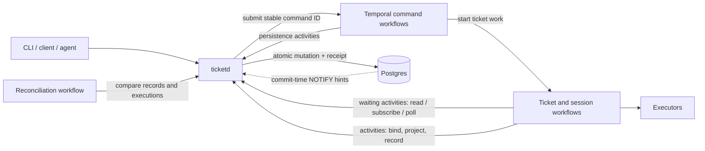

# protocol7 implementation plan

protocol7 is a Go library and support binaries for durable agent work. Users write ordinary Temporal workflows that execute commands and ACP agents, manage tickets and approvals, and call external integrations.

The first delivery target is self-development and evidence-based self-improvement. Selfdev is then used to build consumer flows, starting with requested pull request review (section 10). Build the components needed for that working loop before expanding integrations and execution environments. This document specifies target behavior, not a claim that the system has been implemented.

## 1. Scope and repository boundaries

| Repository | Owns |
|---|---|
| `gfx-labs/protocol7` | Go library, ticket API and store, core Temporal worker, runner, executors, CLI, webhook receiver, web UI and Helm chart |
| `gfx-labs/pdp` | Workload authentication, request authorization, upstream credential acquisition and storage, OAuth refresh, TLS interception and DNS routing |
| `gfx-labs/protocol7-selfdev` | Consumer worker, development/review and improvement workflows, prompts, deployment activities and end-to-end acceptance scenarios |

There is no workflow YAML, interpreter, orchestration DSL or custom retry/checkpoint engine. Branches, loops, conditions and error handling are Go code. Settings such as models, limits and repository lists are passed in Go configuration structs.

protocol7 ships an API, a CLI and a basic web UI for escalations, tickets and session chat (section 6). The UI and other clients use the same published API. The platform contains no emulator, devbox or device-specific logic. Users implement domain-specific tools in their own workers.

## 2. Components and ownership

| Component | Responsibility |
|---|---|
| `ticketd` | Connect RPC API, run-scoped API, Temporal command submission, Postgres migrations and activity writes, ticket change stream |
| `p7-worker` | Core command, RunStep, AcpSession and reconciliation workflows, execution activities and backends |
| Consumer worker | User workflows importing `github.com/gfx-labs/protocol7`. Does not need backend administration rights |
| `runner` | Execute commands or host ACP sessions, expose `run.sock`, prepare workspaces and publish manifests/artifacts |
| `p7` | Ticket operations, approvals, run tools and debugging commands using public APIs |
| `webhookd` | Verify incoming webhook deliveries and publish them to a JetStream stream that consumers pull from |
| Web UI | Attention list, tickets, approvals and session chat. Served by ticketd through the public API |
| PDP | Shared credential and egress gateway. Separate from protocol7, optional for trusted host execution |
| Temporal | Execution history, task dispatch, retries, timers, signals, child workflows and Worker Versioning |
| Postgres | Tickets, intent, approvals, execution ownership bindings, execution projections, run outcomes, integration records and session records |
| NATS JetStream | Live session output, command logs and received webhook deliveries. Available from the first execution milestone |
| Artifact storage | Logs, manifests, artifacts and archived journals. S3 in deployed environments, a file store locally |

Only ticketd writes protocol7's Postgres data. Humans, agents, activities and clients all use its API. PDP's credential storage is separate and is not subject to this rule.

Each fact has one owner:

- Postgres owns persisted ticket records, revisions, approval decisions and recorded outcomes, with searchable public execution projections.
- Temporal owns durable acceptance and orchestration of execution-affecting commands, execution progress, retries, timers and workflow history. Activities persist ticket changes through ticketd before dependent execution proceeds.
- Artifact storage owns bytes. Database rows and workflow results carry references.
- NATS owns live output until archival, and received webhook deliveries until consumers have processed them. It is not the ticket-to-workflow notification channel.
- PDP owns real upstream credentials, bindings, grants and refresh state. protocol7 keeps references, trusted assignments and requested permissions only.

Read ticketd to answer ticket-state questions. Do not reconstruct the ticket database from Temporal history.

## 3. Ticket store

### Data model

Every record is scoped to an organization/project where applicable. Use sortable IDs, a short per-project ticket number for people, `timestamptz` for time, and explicit sequence values for change ordering.

The core model contains execution primitives:

| Record | Main fields and behavior |
|---|---|
| `tickets` | id, kind, title, body, typed `fields` JSONB, namespaced `meta` JSONB, priority, parent, revision, ownership fence, workflow identity, execution projection, defer time, timestamps |
| `edges` | `blocks` and `tracks`. Reject cycles in blocking dependencies and support transactional graph updates. Parentage lives only in `tickets.parent` |
| `history` | ticket revision, global change sequence, actor, operation and diff |
| `comments`, labels | Separate user content from execution state. Support comment edit/soft delete |
| `approvals` | ticket, kind, subject revision, title, summary, options, links, match keys, snooze, actor and decision |
| `runs` | ticket, workflow execution identity, logical step, Temporal activity identity/attempt projection, status, failure class, manifest reference, typed result, worker build and timestamps |
| Command receipts | Stable command ID, request fingerprint and the original mutation result, including affected ticket revisions and follow-up workflow starts. Written atomically with the mutation so activity retries return the same result |

Optional modules expose their own records through ticketd without becoming prerequisites for ticket execution:

| Record | Main fields and behavior |
|---|---|
| `learnings` | Scoped content, consumer-defined metadata and non-owning evidence references. No required curation state machine |
| External objects | One optional model for outside entities such as GitHub PRs: source, kind, external ID, URL, ticket links, current-state projection, typed fields, last synchronization time and a retained timeline |
| Integration operation records | Integration-scoped external operation identity, pending/confirmed outcome and reconciliation evidence. Not a universal exactly-once guarantee |
| Intake records | Consumer-owned delivery deduplication that outlasts the webhook stream, and poll cursors. Deliveries themselves are held in the JetStream webhook stream (section 10) |
| Session records | Session catalog plus turn, message and tool-event projections of the session journal. Rebuildable from the archived journal. See section 8 |
| Knowledge collections | A named reference to a path in an existing git repository, resolved to an exact commit when used as an input. See section 5 |

GitHub, Linear and other provider shapes are not first-class core entities. The optional external-object API exposes provider/source identity, kind, stable object ID, URL, ticket links, schema identity/version, typed payload, current state and timeline. Provider schemas, normalization, ingestion and actions belong to consumer integrations. Separate provider packages may be shared later, but core storage and execution do not require them. A future UI can render generic objects from their schema/type metadata and add optional provider-specific renderers; payloads must not be opaque blobs with no discoverable type.

An external object's timeline records meaningful outside changes, such as a PR opening, review requests, check outcomes and merge. Entries carry an identity for deduplication, event type, actor, occurrence time, recorded time and normalized data, with optional raw-payload references. Current state is a reconciled projection: delayed or out-of-order events must not blindly overwrite newer state. Identity, current state and timeline form one API model, though storage may use separate object and timeline tables. Integration inboxes handle delivery deduplication and processing independently; successful delivery does not remove timeline history.

`state_spans` are rebuildable metrics projections of recorded transitions, not authoritative state or an execution dependency. Improvement journals, incident groups, evaluation states and promotion outcomes belong to the consumer's own schemas or typed ticket fields, not platform tables. Ordinary workflow waits live in Temporal, not a `waits_for` edge. Validate parent changes transactionally to prevent parent cycles.

Ticket status is `open`, `in_progress` or `closed`. Resolution is typed, including done, ready, blocked, failed and dropped. Public execution states distinguish queued, running, waiting, retrying, gated and quarantined work. Labels are not execution state.

A kind is registered by a consumer worker with its protobuf fields schema. Store protobuf JSON as JSONB. A logical step's execution evidence is stored in `runs`, with Temporal activity identity and attempt information projected as needed, not a separately scheduled ticket or retry engine. Work needing its own lifecycle is a child ticket. There are no special plan, step, session or message ticket kinds.

### Consistency and execution ownership

- Intent updates use compare-and-swap on ticket revision.
- Bind a ticket to its owning Temporal execution with a database fence against stale writes. This is not a worker claim, expiring lease or competing-consumer scheduler. Internal execution writes validate ownership; replacement executions advance the fence through an explicit authorized transition. Continue-As-New carries ownership forward through a fenced, retry-safe transition rather than assuming the Run ID stays unchanged.
- Start a ticket workflow once its creation is persisted, even when it must wait for dependencies or a future start time. The workflow owns dependency waits and durable timers. Ticket priority and defer fields express user intent; database queries do not dispatch work.
- Routing uses configured Temporal task queues. Do not implement transactional ticket handoff or clear a database holder to move running work. Placement changes apply at explicit workflow/step boundaries; moving an existing execution requires a defined migration or cancel/restart operation.
- Execution-affecting commands enter Temporal before database mutation. Their activities commit ticket changes, history and an idempotent command receipt together; Temporal then drives required starts. Existing workflows observe persisted conditions through waiting activities with notification hints and polling fallback. There is no application outbox or dispatcher. Duplicate command submission and workflow starts must not duplicate effects.
- Use row-level concurrency rather than a global application write lock.
- Keep transition validation separate from SQL, while preserving atomic checks in the write transaction.
- The change-stream cursor must not skip transactions that commit after a later sequence has become visible. Select and test a commit-safe publication mechanism before exposing resumable cursors.
- Temporal owns execution liveness. Do not add a parallel ticket lease/heartbeat scheduler.

### Query and retention

`ListTickets(filter, sort, page)` accepts a structured protobuf filter. A short query string such as `status:open label:bug sort:-updated login` parses into that same filter on the server.

Support core-column filters, labels, graph relationships, readiness, approvals, external-object links, last run outcome, typed field equality, namespaced metadata equality, and declared typed ranges. Sorting supports core keys and declared sortable fields with an ID tie-breaker. Use cursor pagination, organization/project scope and statement timeouts.

Use pgx, fixed indexes for core fields, JSONB indexes for equality and a generated text-search vector. Typed range/sort indexes are generated by migrations from registered schema declarations. Protobuf JSON encodes int64 as strings, so do not apply untyped JSON text ordering to numeric ranges.

Provide ranked title/body/comment search. Optional modules provide their own queries, including learning recall, without making consumer journals part of the ticket core. Partition high-volume append-only tables by month as volume requires.

Retention defaults, configurable:

- Tickets, history, comments, run outcomes and approvals: indefinite.
- External-object identity and normalized timeline entries: indefinite. Raw payload: one year. Current-state projections remain reconcilable from the source.
- Artifacts: 90 days unless pinned.
- Session journals and their projections: kept until deleted, because search and analytics read them. Configurable.
- NATS live output: purge 24 hours after confirmed archive. The webhook stream has its own age limit.
- Closed Temporal history: 30 days. Open histories remain governed by Temporal and Continue-As-New, not ticket retention.

## 4. Temporal commands and recovery



1. ticketd authenticates and validates the request envelope, then submits a command workflow using a stable command ID. Repeated submissions resolve to the same command; reject reuse with different content. Temporal acceptance is distinct from successful persistence. API callers can await a persisted result, while timeouts return a command handle for status lookup rather than claiming failure or success.
2. A command activity applies domain validation, revision CAS and all related database changes in one Postgres transaction. This includes cross-ticket graph changes or a one-time approval decision, history and the command receipt. If the activity commits but its response is lost, retry returns the original result and exact follow-up start identities from that receipt, not targets recomputed from later state. Invalid revisions or approval decisions return explicit non-retryable domain outcomes.
3. After persistence succeeds, the command workflow starts the ticket workflow, which owns any dependency or defer waits. Existing workflows observe committed database conditions through waiting activities rather than requiring a signal for each database change. Temporal history tracks start progress and resumes after worker failure. Use deterministic ticket execution identities and explicit workflow ID reuse policy. Ticket workflows establish their ownership binding before execution writes; later writes supply the fence.
4. Waiting activities evaluate persisted predicates, such as an approval decision, completion of independently filed work or a database-backed dependency condition. For children started by the parent, use Temporal child-workflow futures instead of database polling. ticketd shares Postgres LISTEN connections and fans notification hints out to waiting API calls; it does not allocate one database connection per wait. Subscribe before reading state, re-read after reconnects and periodically poll even without a notification. Commit-time NOTIFY is a low-latency hint, not durable delivery or the source of truth. Worker retries and lost notifications recover by checking the current database state. Commands modifying closed tickets follow explicit reopen/rerun policy rather than silently attaching to an old execution.
5. Ticket workflows project meaningful state and persist outcomes through idempotent activities. Parent-owned child completion is observed through child-workflow futures; independently filed ticket and dependency changes are observed through database-backed waiting activities. A mutation requiring a new workflow start must run within a workflow that owns that follow-through; it cannot rely on NOTIFY to start work durably.
6. Reconciliation compares ticket records, Temporal executions and backend handles. It repairs database projection drift and backend orphan handles, and emits bounded alerts for stalled commands or incompatible workflow tasks. It does not reschedule tickets, manage retries, declare workflow death from a database heartbeat or restart live workflows. Temporal owns execution liveness and recovery. On start and after Continue-As-New, ticket workflows reconcile approval and child state from ticketd.

No transaction spans Temporal and Postgres. Until the persistence activity commits, accepted work may not appear in ticket queries. Creation APIs wait for the persisted result before returning “created”; asynchronous responses explicitly say “accepted.” Database outages delay persistence without losing an accepted command. Stable IDs and durable receipts must cover client retries and retries after Temporal history retention; receipt retention cannot depend solely on closed workflow retention.

Temporal history provides the operational trace of command persistence, retries, starts and explicit waiting activities. Postgres history retains searchable actor/revision/diff audit records independently. Non-execution writes, such as comments or optional learning edits, may go directly through ticketd and have database history without a Temporal trace. Execution-affecting writes require the command path; internal persistence APIs are restricted to trusted activities and must not recursively submit commands.

### Retry, resume and external effects

Use ordinary Temporal activities and child workflows. History supplies completed results during replay. Do not add required call names, spec hashes, custom checkpoint records or a separate resume command.

Keep the default blocked-workflow behavior for incompatible replay. Redeploy compatible code or roll back to resume from history. Use `workflow.GetVersion` where compatibility guards are needed. Terminating an unrecoverable execution and starting a replacement ticket execution is an operator action of last resort.

Activities can execute more than once. Every external mutation needs an operation-specific write key and provider-state reconciliation. A pending write with an unknown outcome is not evidence that nothing happened. Confirm the remote outcome or use a provider idempotency primitive before repeating it. Completed workflow history alone cannot provide exactly-once external writes.

Failure classes distinguish rate limit, provider, launch, killed, timeout and real task failure. Temporal retry policies own activity attempt counts, backoff and timeouts; `runs` only projects execution evidence and does not advance an independent retry counter. `MaximumAttempts` includes the initial attempt. Investigation episodes, retry budgets beyond transport/execution recovery, and approval/escalation policy belong to consumer Go workflows, not a platform episode state machine. Waiting for capacity or outside events is not a task failure.

### Worker Versioning

Worker Versioning is initial scope. Pin executions to their starting build and keep old workers available until those executions drain. A pinned run stays on its build across Continue-As-New by default. Long-lived workflows adopt a new build by continuing as new with the upgrade option, as described under long-lived flow workflows in section 7. CI replay checks are optional initially.

Consumer-owned deployment automation handles build promotion, rollback and retirement. The Kubernetes Worker Controller is an option, not a prerequisite for container/host deployments. Pinning protects workflow-code compatibility, not arbitrary changes to activities, external services or schemas.

For a pinned execution blocked by a code bug, deploy a replay-compatible fix and use Temporal's Versioning Override to move that execution to the fixed build. If earlier decisions or activities need to be redone, use Reset-with-Move to an explicitly selected history point and build. Reset creates a new run and does not undo database or external effects. Recovery must reconcile ownership fences, persisted command receipts, results and outside writes before repeating work; do not assume resetting history resets Postgres. Validate supported server/SDK/CLI versions and explicitly choose signal/Update reapplication behavior. These are authorized, audited recovery operations, not automatic termination/restart. Reference: Temporal's `recover-pinned-workflows` runbook.

Acceptance must run builds A and B concurrently, keep existing work on A, start new work on B, and drain A without interrupting either. Test Continue-As-New adoption separately. A single-build local smoke test is insufficient.

## 5. Execution backends and runner

Use one protobuf step specification and one runner contract across backends. The execution interface exposes Start, Watch, Cancel and an ACP endpoint. Start is idempotent for a durable execution identity and can attach to a handle created before an activity retry.

| Property | Kubernetes | Container | Host |
|---|---|---|---|
| Execution | Job/pod | Docker Engine API, with Podman compatibility validated separately | Process with bwrap/cgroup/user-namespace isolation |
| Worker | Cluster worker | Machine with the daemon | Named host |
| Runner delivery | Init copy into a shared volume | Read-only binary mount | Direct exec |
| Workspace | Clone into `/work` | Clone or explicitly bind a worktree | Clone or explicitly bind a worktree |
| Non-secret input files | Projected volume | Read-only/temp mounts | Temporary directory |
| Durable handle | Job identity | Container identity | Run directory with process identity and locking |
| ACP transport | acphost TCP with mTLS | acphost TCP with mTLS | Unix socket |
| Enforced egress | PDP plus NetworkPolicy-capable CNI | PDP plus isolated networking | Not claimed for trusted host mode |
| Stronger runtime | gVisor where configured | gVisor where configured | No hostile-workload isolation guarantee |

Placement names a backend and optional host. Workers poll core queues such as `p7-kubernetes`, `p7-container` and `local-<host>`. Explicit host placement is required for joined machines. A remote worker normally initiates its control connections, but ACP endpoint reachability must be established separately rather than assumed to work through NAT.

Admission checks the verified worker, repository scope, image, command and requested CPU/memory limits. The core worker holds the backend rights it needs. Consumer workflow workers do not receive those rights by default. Never expose a container-daemon socket to an agent merely to run nested checks.

### Runner contract

- Step inputs include command/arguments, working directory, non-secret environment/files, declared inputs, repositories and revisions, image digest, placement, egress references, CPU/memory limits and output schema.
- Runner prepares the workspace, executes the command or agent harness, and produces a manifest with execution identity, exit status, typed report, timestamps, artifact references and failure classification.
- Exit zero is not sufficient success. Validate the result against its protobuf schema. An agent gets at most one report-repair turn before the attempt fails.
- Upload artifacts through run-scoped presigned operations. Core storage credentials do not enter the step.
- Deliver runner and CLI independently of repository toolchain images. Agent harness delivery must include its actual runtime dependencies rather than assuming every harness is a static binary.
- Keep toolchain images pinned by digest. Record checked-out repository and policy/prompt commits on every run.
- Cancellation and timeout propagate to the backend, child processes and streams. Reconciliation handles interrupted cleanup.

### Inputs and knowledge collections

`SessionSpec`, the step specification and `OpenEnvironment` accept `Inputs`: files, directory trees or git clones placed at explicit destination paths, for example a prompt and guidance directory at `/guidance` and the code under work at `/work`. Trees and artifacts are read-only. A clone is writable unless marked read-only. An agent reads those files on demand. Mounting an input does not add its contents to a prompt.

| Source | Resolution |
|---|---|
| Git tree | Repository, path and a commit, tag or branch. A tag or branch is resolved to a commit once, by an activity, when the step, session or environment is created. Retries, replay and reattachment reuse the recorded commit and never resolve the name again |
| Git clone | Repository and a commit, tag or branch, resolved and recorded like a git tree. The destination is a working clone with history, so `git diff` and `git range-diff` work and a coding session can commit in it. `Fetch` lists extra commits to have in the clone, such as the head a previous review covered, which a rewritten branch no longer reaches. This replaces a separate repository field on a session: the code under work is one more input |
| Artifact | Content-addressed artifact reference with its digest |
| Knowledge collection | A named collection that resolves to a git tree as above |

Record the requested reference, the resolved commit and the tree digest on the run and session. The runner materializes inputs before launch on every backend. It rejects path traversal, destinations outside the allowed roots and symlinks that leave the tree, and it enforces size limits. Input contents stay out of Temporal history. Only references and digests are recorded there. A running session never has its inputs changed in place. A new revision applies to the next step or session. A long-lived workflow that opens a later session resolves the name again at that point unless it passes a pinned commit.

A tag is a movable name. Where provenance matters, require a signed tag from an approved signer or a protected tag on the forge. Pinning keeps the selected content stable. A signature check establishes who endorsed it.

A knowledge collection is a named, access-scoped reference to a path in an existing git repository. It is not a document store or editor inside protocol7. It can be mounted as an input, and authorized tools can list, read and search it at a pinned revision. Mounting and querying are separate choices, and neither adds content to a prompt automatically. protocol7 does not host a git forge. Collections live on the existing forge and are fetched through PDP git access.

### Reusable execution environments

Separate an execution environment from its ACP conversations. Proposed APIs are `p7.OpenEnvironment`, `environment.Exec`, `environment.Close` and `p7.OpenSession` attached to an explicit environment handle. A Kubernetes pod, container or host sandbox may remain alive across commands and agent turns, preserving its workspace and background services. Commands execute sequentially by default; parallel commands and background-service lifecycle require explicit configuration.

A workflow owns the environment lifecycle, with idle and maximum-lifetime limits, cancellation, idempotent close, backend attachment handles and orphan cleanup. Reattach after worker failure rather than creating a duplicate environment. Persisting a workspace and restoring an ACP conversation after environment loss are separate policies; keeping a pod alive is not a guarantee of either. Environment ownership may belong to a dedicated long-lived workflow when several caller workflows need to use it, rather than tying cleanup to an arbitrary caller's completion.

### Local modes and debugging

`p7 dev` runs ticketd, worker and embedded NATS with a file artifact store. Temporal's development server is a child process, and Postgres is supplied by URL. PDP runs separately when enabled.

Trusted host execution may omit PDP and use existing machine logins. It does not claim centralized credential isolation or enforced egress. Local container execution claiming those guarantees uses PDP. Mode selection is explicit and does not silently depend on the word local.

A joined worker uses explicit host placement and its own queue. Prefer PDP where possible, even on a trusted host.

Debugging uses flags, not a workflow specification file:

```sh
p7 run --image <digest> --backend container -- <command>
p7 run --from <run-id> --backend <name>
```

## 6. API, agent tools and approvals

Use Connect RPC v2 and protobuf for ticket/run APIs, typed ticket fields, workflow/activity inputs and results, signals and stream messages. Publish schemas and a Go client. Other clients can generate their own bindings. Server-streaming `WatchChanges` and `WatchSession` provide live interfaces without a bespoke web UI protocol.

The human/admin API and run API have distinct exposure. Human authentication is off by default for trusted deployments. Optional trusted-header mode accepts identity only from configured TCP peers, never an arbitrary forwarded header. This setting does not disable PDP authentication. Workers in the initial Temporal namespace are trusted, so task queues are routing, not a security boundary. There is one namespace initially and no Nexus.

An agent sees `P7_SOCKET`, a per-run Unix socket served by runner. The CLI and MCP adapter use the same run API. Runner forwards authenticated calls to ticketd using a run-scoped credential. In a shared container the agent may read that credential, so its enforced scope is the boundary, not hiding it from the agent.

Run calls include progress, result submission, artifact registration, comments, learnings, child-ticket filing, one-off commands and allowed user tools. Agents do not call Temporal directly. ticketd checks scope and submits execution-affecting commands to Temporal; trusted activities persist changes through its internal API. Non-execution writes may use the direct database-backed API.

Approvals live in a separate table and are never schedulable tickets. One `ResolveApproval` command path handles every client: a Temporal command workflow persists the decision transactionally through an activity, refuses a second decision and returns the committed result. The waiting workflow awaits a named `WaitForApproval` activity that observes the persisted decision through ticketd using LISTEN/NOTIFY hints and polling fallback, then returns the typed decision. It does not require a signal from the command workflow. Configure heartbeats, cancellation, retry and timeout behavior, and label the activity with the approval identity for pending-activity/timeline visibility. Waiting activities must not consume agent execution or model-provider capacity; size their worker capacity separately. Support options, links, subject revision, snooze and actor attribution. An attention query combines pending approvals with blocked/quarantined work. Bind consequential approvals to the exact revision being approved.

`ask_human` returns after filing so the agent can end its turn. The workflow waits without holding a model turn, then supplies the decision in a later prompt. `run_step --wait` can wait for a bounded period. Operator messages into sessions carry trusted provenance and a session nonce, but textual tags are not an authorization mechanism.

### Web UI

A basic, provider-neutral web UI handles escalations. ticketd serves it as static assets from the same origin as the API, and it calls only the published Connect API, so it needs no UI-only endpoints.

- Attention list: pending approvals and questions, with blocked and quarantined work.
- Ticket view: fields, history, comments, runs, linked external objects and approvals. An approval is resolved by choosing one of its options or writing a reply.
- New chat: a conversation that belongs to no existing work, for maintenance. See below.
- Ticket chat: the conversation of a session attached to a ticket, live through `WatchSession`, with a box that sends an operator message into that session, queued or as an interrupt (section 8, "Steering a running session").

A new chat is a ticket like any other. The UI lists the ticket kinds that consumers registered as chat kinds and files one. That kind's workflow opens a session, waits for each operator message with a state-based wait, prompts the session with it, and closes the session after an idle limit. What the agent can reach is set by that workflow's image, tools and grants. protocol7 ships the chat surface and no maintenance agent of its own. Chats count toward the session limit (section 8).

Selfdev registers the first chat kind. Its agent works on the selfdev and protocol7 repositories and changes workflows through the development loop, as reviewed pull requests that ship by versioned rollout. For Kubernetes it reads cluster state with a read-only credential that PDP injects, and changes configuration by pull request to `gfx-labs/baremetal`, which Flux applies. It has no direct write access to the cluster, and agent pods still get no Kubernetes API token. Reading the Kubernetes API through PDP has not been tried.

The UI has no authentication of its own during development and no Ingress. People reach it with `kubectl port-forward`. Kubernetes RBAC on `pods/portforward` in the control namespace decides who can. A forwarded connection arrives at ticketd from loopback inside the pod and carries no user identity, so ticketd cannot learn who is on the other end. The UI asks for a name once and sends it with each request, and ticketd records it on decisions and messages as a claimed, unverified actor. When an authenticating proxy is put in front later, the trusted-header mode above takes the actor from that proxy's header, records it as verified and ignores the claimed name. The trusted peer is the proxy's address and never loopback, so a port-forwarded request cannot set that header. External objects render from their schema metadata, with no provider-specific views at first.

## 7. Go workflow library

Consumer workers import `github.com/gfx-labs/protocol7`. Library calls start core child workflows or activities. Conditions and loops remain ordinary deterministic Go workflow logic. Filesystem/network access belongs in activities, not workflow functions.

A small illustrative consumer workflow is in `docs/example-small-review.md`. It uses the proposed SDK and consumer-owned protobuf types; it is not a compiled implementation.

The following surface is proposed, not a published API:

| Call | Responsibility |
|---|---|
| `p7.Register` | Register ticket kind, protobuf fields schema, workflow type and consumer queue |
| `p7.Step[T]` | Execute one command and return a validated typed result |
| `p7.Agent[T]` | Run an ACP session to a typed result and close it |
| `p7.OpenSession`, `p7.Prompt[T]`, `session.Close` | Retain a session across multiple turns. A turn can be resteered from outside (section 8) |
| `p7.Input` with `p7.GitTree`, `p7.GitClone`, artifact and collection sources | Files, trees and clones placed in a session, step or environment (section 5). There is no `p7.Repo` |
| `p7.OpenEnvironment`, `environment.Exec`, `environment.Close` | Keep an execution environment across commands and sessions |
| `p7.Ask` | Create an approval and wait for its decision |
| `p7.WaitEvent`, `p7.Watch` | Wait for changes to named external objects, approvals and tickets since the revisions already handled. Future-returning forms compose in a `workflow.Selector` |
| `p7.Child`, `p7.File` | Create work with an independent lifecycle, with or without waiting |
| `p7.WaitChildren[T]` | Wait on Temporal child-workflow futures for parent-started children; use database-backed waits for independently agent-filed tickets |
| `p7.Parent[T]`, `p7.Count` | Query parent fields and scoped ticket counts through activities |
| `p7.Every` | Register a recurring start as a Temporal Schedule with an explicit overlap policy. Use workflow timers for delays inside an execution |
| `p7.Tool` | Register a user activity callable by authorized sessions |
| Integration packages | Optional consumer/provider packages for typed outside reads and writes through PDP, not built-in GitHub/Linear entities |

`p7.Child` persists the child ticket idempotently and starts its execution as an actual Temporal child of the calling workflow, retaining its future. It does not ask a separate command workflow to start the child under a different parent. Define Parent Close Policy explicitly. `p7.File` creates independently running work; the ticket's parent link alone does not make it a Temporal child. Both paths preserve stable ticket/execution identity on retries.

`T` is a protobuf message. Branch on typed enums/fields, not agent prose. A `Once` key on ticket filing means no second ticket with that key, open or closed. Do not confuse that business dedupe with replay, which Temporal already handles.

Agents may file registered ticket kinds and execute scoped commands/tools. New orchestration logic is reviewed Go code deployed as a worker. Workflow and deployment permissions are checked at trusted execution boundaries, not granted merely because a caller names a repository.

### Waiting on several conditions

Long-lived consumer flows wait on several conditions at once: a review, a check result, a merge, a base-branch change, a human decision, a deadline. Every p7 call that can block for long (waits, `Prompt`, `Step`, `Agent`, `Exec`) has a form that returns a `workflow.Future` and stops when its context is cancelled. A workflow combines those futures with timers, child futures and signal channels in one `workflow.Selector` and branches in ordinary Go. It can also cancel a running turn, for example when the head under review moves. The blocking forms are shorthand for a single future.

Waits are state-based, not edge-triggered. A wait names the records it watches (external objects, approvals, tickets) and the last revision of each that the workflow has handled. It completes with every change after those revisions. A change that lands while the workflow is busy with an agent turn is returned by the next wait, so nothing depends on a wait being active when an event arrives, and several changes arrive as one batch. The workflow keeps the handled revisions in its own state and carries them across Continue-As-New.

The wait cursor is a per-record revision that increases under the row lock, not a position in a global change sequence. That keeps this path clear of the commit-ordering problem a global sequence has.

- One wait activity can watch a set of records, so a workflow holds one pending wait, not one per condition.
- A wait takes a filter on event types and fields. An integration also keeps aggregate fields, such as one combined check state per head commit, so a burst of check events changes the watched revision only when the aggregate changes. Without both, a busy pull request wakes its flow on every check event and fills its history.
- Wait activities run on a dedicated task queue with their own concurrency limit, a long start-to-close timeout and a short heartbeat timeout. Cancellation reaches an activity through its heartbeat, so cancelling the losing branches of a select takes up to one heartbeat interval.
- Every select includes a timer. On timeout the workflow re-reads live outside state through an activity. A missed webhook then delays a flow and does not stall it.
- Before a consequential action such as a merge, re-read live outside state at action time. Stored external-object state decides when to wake, not whether the action is still valid.
- Signals stay available for operator commands and for messages that have no stored record.

### Long-lived flow workflows

A flow that follows one issue or pull request for days is a loop over a serializable state value: wait, handle the change, repeat. At the top of the loop it continues as new when history is large or when `workflow.GetInfo(ctx).GetTargetWorkerDeploymentVersionChanged()` reports a newer target build, passing `ContinueAsNewVersioningBehaviorAutoUpgrade` so the next run starts on that build. Waiting flows then pick up a fix without an operator override, and an old build drains once its running turns finish. The Versioning Override in section 4 remains the path for a run that is stuck before it can reach that boundary.

- Everything the next run needs is in the state value: handled revisions, ticket and external-object identities, session and environment handles, and the current phase.
- Child workflows do not carry over a parent's Continue-As-New. Start long-running children with an abandon Parent Close Policy and find them again by ticket identity through a state-based wait, or continue as new only when no child future is pending.
- A session or environment that must outlive one run is owned by its own workflow and addressed by handle.
- Event History is limited to 51,200 events or 50 MB. Agent turns, tool activities and waits all add events, so a multi-week flow needs the Continue-As-New boundary whether or not anything is deployed.

### Routing and tools

Route activities through configured Temporal task queues to workers serving the required backend, host and capabilities. Executors and their backends enforce execution capacity. protocol7 has no generic resource registry, slot allocator, reservation tables or provider lifecycle workflow. Consumers needing exclusive access across steps implement reservations through their own activities.

A session explicitly lists callable tools. `p7 call <name>` reaches ticketd through `run.sock`; ticketd checks the allowed tool and trusted run context before starting its activity. The function receives ticket/run context and can enforce additional domain checks.

Tool calls are recorded by name on the run. Activity results also enter Temporal history. Proxy-only credentials must never be returned through tools. Explicitly authorized agent-readable development credentials and non-sensitive test fixtures follow the disclosure policy in section 9. Device drivers, remote development environments and domain-specific helpers remain entirely in consumer code and images.

## 8. ACP sessions and live output

Use `github.com/gfx-labs/acphost` as the ACP transport. Pin the current release when implementation starts. `v0.25.0` is the latest tag as of 2026-11-12. In networked backends use its TCP listener with per-session mTLS. The core worker provisions the session trust material and retains its client identity. Locally use a Unix socket. Do not build another ACP TCP/WebSocket bridge. These session transport credentials are distinct from upstream API secrets and PDP's interception CA.

acphost reconnect uses `Hello.Since` and replayed JSON-RPC requests. Deduplicate request IDs and responses. Reconnect within its controller lease. Validate process survival and reattachment after a core-worker restart.

The session activity redacts and publishes output frames to `p7.session.<id>.out` using session/sequence message IDs. On restart, recover the last durable sequence and reconnect from it. Deduplication must cover recovery outside the broker's finite dedupe window. Command logs use a run/attempt subject. Joined workers can publish through ticketd rather than holding broker credentials.

Clients read through ticketd, never directly from NATS or acphost. A new acphost controller connection can replace the current one, so viewers must not connect to it. Archive streams/journals to artifact storage before purging live data. Frames do not enter workflow history, but final typed results and ordinary activity results do.

Waiting sessions retain their execution environment until an idle limit expires. Workflows can close and reopen for long waits. towa keeps everything a session needs under one directory, and a new process can load a copy of it. Moving a session to a new pod means saving and restoring that directory. That is not designed here and needs an acceptance test.

### Agent harness

The agent harness is `github.com/gfx-labs/towa` (decided 2026-11-12). It was named acpharness until `7ff30fa` on the same day. It was read at `origin/master` `4e3e959`, and its login, provider and model code again at `7bff6dc`. It has no release tag, so protocol7 pins a commit. This plan relies on the following:

- It speaks ACP only, over stdio, a Unix socket or TCP with mTLS. The runner starts it under acphost.
- It supports Claude and Codex subscription logins, and Chat Completions and Responses endpoints.
- An account can be proxy-held (`proxied_oauth`, `proxied_api_key`). The harness sends the placeholder `towa-proxied-<account id>`, builds the rest of the request as usual, and never holds or refreshes the token.
- Its own HTTP clients all honour `HTTPS_PROXY` and the system certificate pool. `towa hosts` prints the hosts a configuration will contact, which gives the run's egress list.
- Models are one ordered list of `provider:account/model#effort`. On a rate limit, exhausted quota, auth failure or overload, the request moves to the next entry and the client is told.
- A turn that stops for a reason the client can act on carries a typed stop: `rate_limit`, `auth`, `overload`, `context_full`, `limit`, `network`, `request` or `denied`, with the reset time and the account where they apply. protocol7 maps it to the run's failure class.
- It builds as a static Go binary. It runs a shell and tells the model to search with `rg` through it, so the image needs both.
- At start it reads the provider's model list for each configured model its built-in table does not have, which is every Claude model. If that fails and its configuration does not give the model's context size and output limit, it exits. PDP policy must allow the model list for every account on a run's list (`docs/pdp-integration.md`).

Not established: a turn with a proxy-held account against a real provider. Its proxy test replays a recorded exchange through a local `CONNECT` proxy with a test CA. Real Claude and Codex turns have been run with logins the harness held itself.

### Session limit and model accounts

At most 20 agent sessions are open at once across the deployment. Steps that only run a command do not count. The number is one ticketd setting. ticketd counts open session records and registers the new one in one transaction, serialized on that count so two concurrent opens cannot both take the last slot. Over the limit it refuses with a retryable capacity error. The open-session activity's Temporal retry policy does the waiting. There is no queue, reservation or fairness order. An idle session counts until it is closed, so a flow closes its session before a long wait. Reconciliation closes session records whose workflow is gone, so a crash cannot hold a slot for good. Temporal worker slot settings cannot provide this limit: they apply to each worker process separately, and a session spans several activities.

A model account is one login or API key at a model provider. Sessions on the same account share its rate limit and its bill. protocol7 gets logins of its own: one Codex login and four or five Claude accounts (user, 2026-11-12). Every session on Codex shares that one login's rate limit, and a model list can fall back across the Claude accounts but not across Codex accounts. No other credential store uses them, because two stores that hold one login rotate the same refresh token and one of them is revoked (`elee1766/jobcity`, `docs/ops/agent-credentials.md`).

The real tokens live in PDP, one binding per account, and each binding's placeholder is the harness's placeholder for that account (section 9). The workflow gives a session an ordered model list, and the runner starts the harness with it. The harness moves down the list within a turn, so a rate-limited Claude account falls through to the next one with no protocol7 code. When every entry is exhausted, the turn stops with `rate_limit` and a reset time, and Temporal retries after that time. PDP policy must grant the run every account on its list. protocol7 keeps no per-account limits.

PDP refreshes each login itself. The design, the PDP change it needs and what was run are in `docs/pdp-integration.md`:

- PDP's `oauth_refresh` used to require a client secret and send a form body. Both logins are public clients with no secret, and the Claude one refreshes with a JSON body and a scope. PDP commit `e6edc6b`, merged on 2026-11-12, makes the secret optional and adds the JSON body and the scope. With it, PDP refreshed and rotated both logins against a local stand-in. Neither real token endpoint has been tried.
- PDP has no login command and needs none. Log in once with `towa login`, write the refresh token and scopes to the binding's state file, and remove the local copy with `towa logout`, which does not revoke the login at the provider.
- The Codex login's ChatGPT account ID is a fixed header on the PDP binding. PDP replaces the caller's value, so the harness configuration does not need it.

### Session journal, catalog and search

Every session keeps a journal: an ordered record of what crossed the ACP connection and what protocol7 did around it. Entries cover prompts sent, agent message and thought chunks as ACP exposes them, tool calls with arguments, results and start/end times, permission requests and decisions, plan updates, errors, stop reasons, token usage where reported, and protocol7 events such as session opened, inputs resolved, turn started and ended, cancelled and closed. The journal records what ACP exposes. It does not promise hidden model reasoning or the full provider request.

Capture happens in the pod at the session host, not only at the worker. Entries are written to local disk as they occur and uploaded in segments during the session and at close. A worker restart or disconnect then loses nothing, and a lost pod costs at most the segment that was not yet uploaded. A gap is recorded on the session, not hidden. acphost already writes every frame to `journal.ndjson` for reconnect replay. Use that file as the local spool and have the runner upload it, instead of adding a second recorder. Confirm that it covers both directions and survives the upload schedule before relying on it.

Journal segments in artifact storage are the source. Postgres holds projections that can be rebuilt from them:

| Projection | Contents |
|---|---|
| Sessions | Session, ticket, run and workflow identity, task queue, consumer labels, worker build, harness and version, model and provider binding, environment, input revisions, start and end time, turn count, token totals and end reason |
| Turns | Sequence, start and end time, stop reason and usage |
| Messages | One row per assembled message, not per streamed chunk: role, turn, journal sequence range and text with a full-text index |
| Tool events | Tool name, call identity, turn, journal sequence position, start and end time, status, and references to arguments and results |

Supported questions:

- Which sessions ran on a given task queue or label around a given time. Filter by started-during or active-during a window, with an index on queue or label plus start time.
- The full conversation of one session in order, with turns and tool calls.
- Everything in a session before a given point, such as the first call to a tool, to see what the agent did before it had that tool.
- Where time went in a turn: model time, tool time and waiting. Intervals can overlap, so report wall-clock spans and do not sum them.

ACP reports tool calls, not which tools were loaded or when. Tool availability and load events need the harness to report them. Until it does, the journal has first-call times only.

Redact sensitive tool-result fields before archive and indexing (section 9). Journals and projections are kept until deleted, and deletion removes both. Start with Postgres. Add a ClickHouse sink fed from the same journal only when cross-session analytics outgrow it. NATS stays the live path.

### Sessions shared across workflows

A session that several workflows use is owned by its own long-lived session workflow, which runs one turn at a time. A caller submits a turn with a request ID and waits for the typed result. Workflow code cannot send a Temporal Update to another workflow, so `p7.Prompt` on a shared handle runs an activity that submits the turn through a client and heartbeats while it runs. A repeated request ID returns the first result. A cancelled caller does not free the session until the turn has stopped.

Choosing which idle session takes a turn is consumer code: a pool workflow that queues requests and hands out compatible idle sessions. protocol7 provides handles and serialized turn submission, not a scheduler.

A warm environment and a warm conversation are different things to reuse. A reused conversation carries its earlier context, workspace and grants into the next task. Use a fresh conversation for unrelated work and reuse a conversation only within the same project and context.

### Steering a running session

Proposed 2026-11-12. Not built or tested.

A person or an authorized agent session, such as an admin session, can send a message to another session or interrupt it while it works. ACP runs one prompt turn per session at a time. Its only control during a turn is `session/cancel`, after which the agent answers the pending prompt with stop reason `cancelled` and the client may send another prompt in the same conversation (ACP v1 "Prompt Turn", read 2026-11-12). A resteer is therefore a cancel followed by a new prompt. The conversation keeps its context.

One command, `SteerSession(session, message, mode, request ID)`, serves every sender:

| Mode | Effect |
|---|---|
| `queue` | The message is delivered after the current turn ends, ahead of the workflow's next prompt |
| `interrupt` | The current turn is cancelled, then the message is sent as the next prompt |
| `stop` | The current turn is cancelled and no message is sent |

- The command enters Temporal like other execution-affecting commands. An activity stores the steer on the session record with its command receipt. A repeated request ID returns the first outcome.
- The activity that runs the turn holds the ACP connection. It observes pending steers for its session through ticketd, with LISTEN/NOTIFY hints and polling fallback, the same way a wait activity observes an approval. The owning workflow does not need a signal handler for this.
- After an `interrupt`, that activity sends `session/cancel`, waits for the `cancelled` stop reason, sends the steer as a prompt and keeps running. The typed result the agent then submits is the result of the workflow's pending `p7.Prompt`. A consumer workflow needs no code for a resteer. The result carries the steers that were applied, so a workflow that cares can read them.
- After a `stop`, `p7.Prompt` returns a distinct non-retryable error that names the actor. The workflow decides what to do next. It is not reported as a failure of the agent.
- A session shared across workflows applies the same three modes in its session workflow, which already runs one turn at a time.
- A steer cannot change the session's grants, egress, inputs or tools. It is a message, delivered with trusted provenance and the session nonce (section 6). The receiving agent treats it as an operator instruction, and authorization is checked by ticketd before delivery, never inferred from the text.
- A person steers through the chat box in the web UI. An agent session steers through a `steer_session` tool that is off by default. Its grant names the sessions it covers, for example sessions of tickets under one parent, or of one project. A session cannot steer itself or widen its own grant.
- Every steer is a journal entry on the target session with the sender, mode, message, the turn it interrupted and the time the cancel took. The cancelled turn's partial output stays in the journal.
- The turn's timeout and heartbeat keep running across a steer. A harness that does not stop within a bounded time after `session/cancel` fails the turn with its own failure class and the environment is closed.

Open:

- A `queue` or `interrupt` steer sent to an idle session that only one workflow uses has nothing to run it until that workflow's next prompt. Either it waits, or the workflow opts in to wake on session steers and run the turn. Not decided. The chat box needs an answer here, because a person expects a reply.
- Whether work the agent did in the cancelled turn (edits in the workspace, a half-written review) should be described to it in the steer prompt. The conversation has it, but a harness may drop a cancelled turn's tool output.
- How promptly each harness honours `session/cancel` during a long tool call, and whether the conversation is usable afterwards. This needs an acceptance test per harness.

## 9. PDP integration and credential boundary

Use and extend gfx-labs/pdp. No separate protocol7 proxy, secret-store interface, encrypted-secret database or refresh-lock subsystem is planned.

### Supply and permissions

1. An administrator registers a key or OAuth login through PDP's administration path. PDP owns secret sources, storage protection and durable rotation state.
2. PDP grants define allowed principals, bindings and project/repository scope.
3. Workflows request credential references and bounded egress policy through typed Go values. protocol7 records those references and trusted assignments, never the upstream values.
4. The runner receives internal run-scoped access and provider placeholders where a CLI requires auth state.
5. PDP verifies identity and assignment, authorizes the complete request, obtains the credential and injects it. A requested permission cannot widen an administrator grant.

Static credentials, OAuth user login and OAuth client credentials are initial scope. GitHub App support mints bounded installation tokens in PDP. JWT bearer and signing schemes can be added later as needed. Credential refresh concurrency and durable rotated-token persistence are PDP's responsibility.

PDP-managed proxy-only upstream credentials never enter agent files, environment variables, prompts, tool replies or Temporal payloads. Host steps may use existing machine logins. User-owned tools/activities may use mounted secrets where proxying cannot work, but should prefer PDP. Internal run credentials and transport identities are still credentials and require scoping and protection.

### Agent-readable development credentials and test fixtures

Keep two explicit disclosure classes: proxy/tool-mediated credentials whose values remain outside the agent sandbox, and development credentials intentionally readable by an authorized agent session. A value readable inside the sandbox is considered disclosed to that agent even if it is not included in the initial prompt. Operators define eligible accounts and grants; agents cannot reclassify credentials or widen their own access.

A consumer-owned `p7.Tool` may return a designated test account's email and fixed six-digit login code when that account has no real funds, production privileges or sensitive data. Scope reads to the relevant project/test environment and distinguish read from write permission when agents create or update test credentials. Such fixtures may be non-sensitive; a live OTP or token granting access to a real account remains a credential regardless of length or a test label. This does not permit exposing PDP's provider logins, production credentials or signing keys.

Use existing consumer-owned storage and tools rather than adding a protocol7 secret store. Ordinary fixture data may travel through normal activity results. If actual sensitive development credentials travel through Temporal payloads, configure client-side payload encryption on the participating clients/workers, with managed key access and rotation. Encryption does not prevent an authorized agent from seeing the disclosed value and does not protect separate transcript/log/index copies. Keep sensitive values out of Search Attributes, identifiers and error strings.

Record access identity, tool, credential reference and outcome without secret values. Intentional session disclosure does not authorize publication: tool-result capture must support sensitive-field redaction before ordinary conversation archival or indexing, and outbound reports, git changes and artifacts must not contain credentials. Redaction is defense in depth, not a guarantee against an agent repeating or transforming a value. Prefer a trusted browser/tool outside the sandbox consuming a credential without returning it whenever the task permits.

### Agent identity and signing

Workload identity authenticates a pod to PDP. It is not a commit or artifact signing identity. protocol7 does not issue per-agent RSA or PGP keys. It records the logical agent, session, workflow and source revisions on each run. Git access goes through PDP with the forge App identity. If a repository requires signed commits, add a signing service outside the sandbox and treat its key as a proxy-only credential.

### Transport and Kubernetes

PDP is an identity-aware HTTP forward proxy. Any destination can be reached, Rego policy is the only allowlist, and a credential is injected only where an upstream entry binds one. As of 2026-11-12 its `origin/main` at `aeaca30` has absolute-form and `CONNECT` proxying, TLS interception with its own CA, DNS steering, streamed responses, WebSocket relay and placeholder credentials. It speaks HTTP/1.1 only. By its own acceptance notes, none of this has been run against a real provider, a subscription client, SPIRE or a cluster. protocol7 supplies the Rego, upstream entries and adapters it needs, and PDP gains features as acceptance finds gaps. Reuse PDP's authentication, schema-aware authorization and credential engine instead of creating parallel checks.

- Distribute the public interception CA into required client trust stores. Keep its private key at PDP.
- Kubernetes integration configures step DNS and preserves internal service resolution. A NetworkPolicy-capable CNI restricts outbound paths to required DNS, PDP and protocol7 services.
- Container execution uses isolated networking with PDP as the permitted outbound route. Do not claim enforcement if alternate routes remain.
- DNS routing is not identity or authorization. Block bypass through direct IPs, alternate DNS and unsupported transports in enforced mode. Do not use host networking for isolated steps.
- SPIFFE mTLS is the network identity mechanism, issued by SPIRE (section 11). Each run pod gets its own SPIFFE ID, rendered from pod metadata that only the executor can set. An unverified header, placeholder or pod IP alone must not establish authority.
- towa, git and most other clients cannot present a client certificate to a proxy. Proposed: the runner holds the pod's SVID and runs a loopback forwarder that the pod's proxy settings point at (`docs/pdp-integration.md`, section 4). The shape ran locally with a plain forwarder to PDP's Unix socket. The mTLS leg is untested.
- A run's scope reaches policy in the pod's SPIFFE ID, which carries the profile, the repository and the run ID: `spiffe://<trust domain>/p7/profile/<profile>/repo/<owner>/<repo>/run/<run id>`. Policy data says what each profile may do, so starting a run changes nothing in PDP. The proposed policy passes eighteen `pdp explain` cases (`docs/pdp-integration.md`, section 3). The ID is rendered from pod metadata, so only the core worker may create or patch pods in the run namespace.
- Explicit proxy configuration remains an option for cooperative clients. Clients that ignore it use the DNS/TLS route where supported.
- Worker-originated API actions require distinct grants from agent traffic. Listener/network separation supplements authorization, not replaces it.

Enforce bounded HTTP requests and schema-normalized GraphQL fields/arguments, including nested fields, fragments, aliases and variables. For git, constrain repository and operation, with push-ref restrictions where required. Upstream destination and credential binding must not be arbitrary caller-controlled URLs. Strip caller upstream auth before injection, prevent credential-return responses, and deny unsafe upstream destinations unless explicitly administered.

Audit run, verified identity, destination, operation, credential reference, policy revision, decision and outcome without secret values. Recheck grants on reused connections and define revocation across replicas. Apply request/wall-clock budgets initially, with provider-specific token/cost accounting later. Do not blindly replay mutating requests after a 401 or connection failure.

### Agent compatibility and placeholders

towa's own HTTP clients honour `HTTPS_PROXY` and the system certificate pool, so the pod's proxy settings cover its model, MCP and web traffic once PDP's CA is installed. DNS steering is then needed only for other programs in the pod that ignore proxy settings. One harness turn ran through a local PDP this way with a deliberately invalid token: PDP picked the binding from the harness's placeholder and applied policy per account. A turn with a real token has not been run. A policy denial reaches the harness as a 403, which it reports as stop reason `auth`, not `denied`.

For multiple providers, supply distinct non-secret placeholders in the harness's required environment/auth-file formats. PDP chooses the real credential from verified assignment, destination and allowed binding. Placeholders are routing hints, never authorization. Multiple accounts on one provider endpoint need an explicit permitted binding. Replace account-specific auth headers as well as bearer/API-key fields where required.

PDP owns real login and refresh. With a proxy-held account, towa holds only a placeholder and never refreshes, so by design no real token reaches the pod. Verify that on a real provider, including an expired token and a refresh. Configure daemon-owned provider traffic, not merely an agent shell. PDP's refresh adapters for the Claude and Codex logins are written and need PDP at `e6edc6b` or later (section 8, `docs/pdp-integration.md`).

Certificate pinning and client-key-bound provider credentials may prevent interception. Do not assume all provider authentication can be substituted. Validate supported routes explicitly and keep unsupported routes fail-closed in enforced mode.

## 10. Integrations, controls and improvement

### Webhook receiver and consumer intake

protocol7 ships `webhookd`, a provider-neutral receiver that turns webhook deliveries into durable JetStream messages. Consumers pull from the stream and do not run their own HTTP receivers.

Each source is configuration: URL path, signature scheme and secret reference, delivery-ID and event-type headers, and a body size limit. `webhookd` verifies the signature over the raw body, publishes the delivery with its delivery ID as the JetStream message ID, and answers 2xx only after the publish is acknowledged. JetStream drops a repeated message ID inside the stream's duplicate window. The message carries source, delivery ID, event type, receive time and the raw body, on a subject of the form `p7.webhook.<source>.<event>`. `webhookd` does not parse provider payloads, filter by content or start workflows.

- It is a separate deployment from ticketd, because it is the only protocol7 endpoint exposed outside the cluster. It needs publish rights on its stream and nothing else.
- The stream uses file storage, replicas where the cluster has them, and age-based retention long enough to cover a consumer outage.
- GitHub marks a delivery failed when no 2xx arrives within 10 seconds, and does not redeliver on its own. Run more than one replica. A missed delivery is recovered by the recheck timer in each flow and a scheduled poll of open pull requests, with redelivery through the provider API as an option.

A consumer runs a durable pull consumer with explicit acknowledgement. For each message it drops events it does not use, updates the external object and its timeline through ticketd keyed on the delivery ID, files any ticket with a `Once` key, and then acknowledges. A crash before the acknowledgement redelivers the message, and every step is idempotent. Deliveries do not each become a workflow, so a burst of check events costs stream storage, not Temporal history. Running flows notice the change through their state-based waits (section 7). Deduplication that must outlast the duplicate window is the consumer's own record. At the stated volume of 100k deliveries a day, load-test bursts and stream storage before relying on the daily average. Existing structured ticket filtering remains unchanged; no filter-library migration is selected.

Ticket workflows consume typed external-object changes through the chosen workflow/waiting-activity path. Each mirrored field has one authoritative direction. SQL views over retained timeline transitions provide time-to-review, cycle time, throughput and reopen metrics; derived metrics are not authoritative execution state.

The selfdev consumer implements the minimal GitHub operations it needs first. Broader GitHub, Linear and other integrations remain optional consumer packages. Posting, merging and deploying are consumer workflow actions with revision-bound gates. Whether an agent may perform an outside action directly is determined by its grants, not a universal built-in workflow restriction.

### Requested review flow

The first consumer flow after selfdev reviews pull requests on request. It is consumer code built with selfdev, not part of protocol7. Implementation from Linear issues, Linear triage and opencodereview runs are deferred.

A pull request is eligible when all of these hold, checked against live GitHub state at intake and not taken from event text:

- its repository is in the configured list
- its author has write access or higher on that repository. This is read from GitHub's repository-permission endpoint and not from the association label on the event, because an organization member can have read-only access to a repository
- it is not a draft
- a review was requested from the reviewer identity, by a ping (a comment that mentions it) from a user who also has write access, or by a configured label

One ticket covers one pull request, from the first request until it closes. The workflow checks out the exact head read-only with the guidance collection mounted, runs the repository's checks and the review, and returns a typed report. Before publishing it re-reads the head, and discards the result if the head moved. It publishes one consolidated review as an approval, a change request or a comment.

It then follows the pull request with a state-based wait. A push after a review starts a review of the new head with no new ping, once pushes have been quiet for a configured period. A new ping or label does the same. Replies on its threads are answered. It does not review while the pull request is a draft, and it ends when the pull request is closed or merged. It never merges.

- The reviewer is its own GitHub identity, separate from any identity that authors pull requests, because GitHub does not accept an approval from the author.
- Rollout: the reviewer runs as an additional reviewer beside the existing jobcity reviewers, on its own configured subset of repositories. The existing reviewers are shut down once this one is proven.
- Its approvals and change requests are real GitHub reviews and count toward branch protection. GitHub counts an approval toward required reviews only from a reviewer with write permission, so the reviewer identity has write access on those repositories. Where a branch requires reviews, a change request from it blocks the merge until it approves or someone with write access dismisses the review.
- Pull request text is untrusted input. The write-access rule is the admission gate. The session's own grants are read-only. Publishing is a worker activity under a separate PDP grant limited to submitting reviews and comments.

### Safety and operational controls

- Modes are `off`, `observe` and `auto`. Observe records a proposed action without taking it. Promotion follows an approval policy.
- Intake validation treats external content as untrusted. Screening is defense in depth, not proof that prompt injection is solved. Failed admission is held for explicit release/dismissal.
- Consequential writes check current revision, applicable approvals, freezes and outside state at action time.
- Redact logs and reject detected upstream-secret material in outbound reports/comments/artifacts. Do not weaken scanner or review gates to make a run pass.
- Provider rate limits pause new work with backoff. Quarantine and drain are explicit operational state.
- Reconciliation emits bounded stall alerts with cooldown, not unbounded automatic investigation loops.
- `p7 trace` links trigger, ticket revisions, children, attempts, approvals, external effects and artifacts.
- Validate configuration before publishing it and retain the last good snapshot on failed reload.

### Self-development and improvement

`protocol7-selfdev` implements request, edit, actual repository checks, independent review, revision, PR publication and configured promotion gates. Record source/prompt commits, worker builds, model/provider bindings, learnings and acceptance evidence.

Learnings are optional first-class records in ticketd, not an execution dependency. Consumers may ignore them or delete individual records without breaking tickets, runs, workflow replay or reconciliation. References to learnings are non-owning and tolerate missing records, with no cascading deletion into execution records. Any learning content used by a run is captured in that run's resolved input so later deletion does not change its recorded input or replay behavior. protocol7 does not automatically inject learnings into prompts.

Extraction, curation, deduplication, acceptance, expiry and application belong to user-written workflows, not protocol7. Consumers choose learning metadata and lifecycle conventions rather than following a mandatory platform state machine. `protocol7-selfdev` may use signatures, incident groups and evaluation states, and propose mechanical fixes when advice repeatedly fails.

In `protocol7-selfdev`, each improvement records evidence, expected metric, changed revision, evaluation results and watching/kept/reverted status. These are consumer-owned records and policy, not mandatory protocol7 entities. Bound the number of changes and the permitted scope. An unmeasured change is a proposal, not an improvement.

Workflow rollout belongs in the consumer deployment code, not a mandatory built-in protocol7 deployment workflow. Build a new immutable worker, validate it, promote through Temporal versioning, keep old runs on their old build and retire drained workers. Review/approval requirements follow configured repository and deployment policy. Privileged platform, identity and grant changes need separately authorized paths.

Prompt storage is still open. Proposed: plain documents in git, resolved to a recorded commit at a step boundary. No template language is required. Keep models/limits/repository settings in Go configuration rather than creating a second settings database.

## 11. Deployment

### Helm chart

protocol7 ships a Helm chart that installs ticketd with its web UI, the core workers, `webhookd`, a schema-migration Job, Services, configuration, namespaced RBAC and NetworkPolicies into one control namespace. Dependencies are configured by endpoint and secret reference and are not bundled by default.

- The chart takes an explicit list of execution namespaces. The Kubernetes executor launches work only there.
- The namespaces are provisioned by the operator. The chart can create the Roles and RoleBindings inside them, or an administrator applies those separately. There are no cluster-wide workload permissions.
- Consumer workers, including their webhook intake, deploy separately, in their own namespace, with their own service accounts and configuration. protocol7 provides example manifests and does not create or manage those namespaces.

### Namespaces and service accounts

| Role | Where | Rights |
|---|---|---|
| ticketd | Control namespace | Postgres, Temporal client, NATS, artifact storage. No Kubernetes API rights |
| Kubernetes executor worker | Control namespace | Create, watch and delete pods and their volumes and config in the listed execution namespaces only |
| Wait and other core workers | Control namespace | Temporal and ticketd only |
| `webhookd` | Control namespace | Publish to its JetStream stream. No Temporal, Postgres or Kubernetes API rights |
| Consumer worker and intake | Consumer namespace | Temporal client, ticketd and a pull consumer on the webhook stream. No workload-management rights |
| Agent and step pods | Execution namespaces | No Kubernetes API token. A dedicated service account with no RoleBindings |

Permission to create pods in a namespace allows use of any service account in it. Execution namespaces therefore hold no privileged accounts and no unrelated secrets. They carry a default-deny NetworkPolicy, resource quotas and pod-security enforcement. The executor constrains the pod specifications it accepts.

### Dependencies

| Dependency | Requirement |
|---|---|
| Temporal | Self-hosted in the cluster on its own Postgres, separate from protocol7's database, with a Visibility store. Worker Versioning needs Temporal Server v1.29.1, CLI v1.4.1, UI v2.38.0 and Go SDK v1.35.0 or later. The history shard count is fixed when the cluster is created. Retention is set per Temporal namespace |
| protocol7 Postgres | One database owned by ticketd. It holds records kept indefinitely, so a deployment that must keep its data needs backups. The first deployment is for testing and has none |
| NATS JetStream | File-backed storage for live output and the webhook stream |
| Artifact storage | An S3-compatible bucket reachable from pods through presigned URLs |
| PDP | Required for enforced credential and egress isolation |
| Workload identity | SPIRE, installed at cluster level: server, node agents, the SPIFFE CSI driver and spire-controller-manager. Run pods mount the Workload API through the CSI driver. A `ClusterSPIFFEID` scoped to the execution namespaces renders each run pod's ID from its pod metadata |

### Network paths

Agent and step pods may reach DNS, PDP, the ticketd run API and the artifact endpoint, and accept the ACP connection from the core worker. They must not reach Temporal, Postgres, NATS, the ticketd admin API or the Kubernetes API. Temporal, NATS and ticketd accept connections only from the control and consumer namespaces. With human authentication off, these policies are the access boundary on a shared cluster. `webhookd` is the only component with an Ingress. The API and web UI have none, and are reached with `kubectl port-forward`.

### First deployment: `talos-metal`

The first deployment targets the `talos-metal` cluster. Read from the cluster on 2026-11-12, without changes:

| Observed | Consequence |
|---|---|
| Talos v1.14.5, Kubernetes v1.35.0, three control-plane nodes and three workers with 24, 24 and 32 CPUs and about 62 GiB each | The Kubernetes executor is needed for the first deployment, not as a later milestone |
| Cilium with `enable-policy: default` | NetworkPolicy is available. Nothing is denied until a policy selects a pod, so every protocol7 namespace needs its own default-deny policy |
| CloudNativePG operator with the Barman Cloud plugin CRDs. The three existing clusters run one instance each, and no `ScheduledBackup` or `ObjectStore` exists | protocol7 and Temporal each get their own CNPG cluster with two instances, a primary and one replica on different nodes, so the operator fails over when a node or volume is lost. This deployment is for testing and has no backups (user, 2026-11-12). Losing both instances, a bad migration or a mistaken delete loses the data. Unless synchronous replication is configured, a failover can also lose the most recent commits. Add backups before it holds work that must not be lost |
| SeaweedFS with an S3 service | Candidate artifact store |
| Flux reconciles `gfx-labs/baremetal`, whose manifests are written in cdk8s and committed under `kubernetes/rendered/prod`. The Flux helm controller CRD is present | protocol7 publishes its chart as an OCI artifact. `gfx-labs/baremetal` declares a Flux `HelmRepository` and `HelmRelease` for it in a cdk8s chart file, as it does for its other charts, for example `reflector.ts`. A private chart needs a pull secret on the `HelmRepository` |
| No RuntimeClass | No gVisor. Pods run on the default containerd runtime |
| No SPIRE, NATS, Temporal or PDP installed | All four are new installs for this deployment |
| Storage classes `proxmox-lvm-xfs` (default) and `proxmox-scratch-xfs` | Persistent volumes for Postgres and NATS, scratch volumes for workspaces |
| Traefik ingress class | Ingress for `webhookd` |

SPIRE agents and the CSI driver run privileged with host paths, so their namespace needs the privileged pod-security label, as `csi-proxmox` has. SPIRE, NATS, Temporal, PDP and the Postgres clusters are added through `gfx-labs/baremetal`.

## 12. Delivery milestones and acceptance

Build complete paths in this order. Do not finish every backend or integration before selfdev. The first iteration is milestones 1 to 5, and it is not complete until the container and Kubernetes executors both pass the same contract.

| Milestone | Deliver | Acceptance |
|---|---|---|
| 1. Credentialed execution | Container executor, runner/manifest, file artifacts, NATS output and PDP integration including static and OAuth credentials | Run a command and private checkout; preserve output/artifacts; deny unauthorized access and prove no upstream token reaches the step |
| 2. Durable work | Ticket core, Temporal commands, atomic mutation receipts, CAS/ownership fences, run projections and reconciliation | Retry a command across client timeout and commit-before-response loss; preserve cross-ticket atomicity and approval single resolution; restart between persistence and workflow start; lose NOTIFY events and reconnect listeners while approval/dependency waits still complete through polling; cancel and retry waiting activities; duplicate starts create one execution; expose accepted versus persisted status correctly; a workflow waiting on an approval, an external object and a timer wakes on each, and a change committed while it was busy is returned by its next wait |
| 3. Agent sessions | ACP/acphost integration, scoped tools, typed reports, declared inputs, session journal and catalog, and the session limit | Complete real turns through PDP; reconnect after worker failure; verify placeholders, refresh, streaming and provider isolation; a session over the limit waits and opens when another closes; mount a guidance tree from a tag and record its commit; interrupt a running turn from a second session with a new instruction and get the typed result of the steered turn back in the waiting workflow, with the steer and its sender in the journal; refuse a steer from a session without the grant; find a session by task queue and time and read its full ordered conversation after its pod is gone |
| 4. Development loop | Minimal GitHub operations, approvals, web UI and consumer edit/check/review/PR workflows | An explicit request produces a checked, independently reviewed PR with traceable evidence and intact gates; an escalation is answered in the web UI and the waiting workflow continues; a maintenance chat opened in the web UI takes messages across several turns |
| 5. Kubernetes execution and cluster deployment | Kubernetes executor, S3 artifacts, backend admission, Helm chart, SPIRE identity and PDP enforcement on `talos-metal` | Execute the same contract on container and Kubernetes, including DNS/trust, cancellation, denied bypass and artifact access; PDP accepts a run pod's identity and denies a neighbouring pod |
| 6. Versioned rollout | Consumer deployment activities, concurrent builds, promotion/rollback and draining | Existing executions finish on A while new ones use B; rollback future traffic; validate Continue-As-New separately; recover a stuck pinned execution on a replay-compatible fixed build and validate reset/ownership/external-effect handling |
| 7. Requested review flow | `webhookd`, consumer intake, the review workflow and a reviewer GitHub identity | A ping or label on an eligible pull request produces one review on the exact head; a replayed delivery produces none; a push during review discards the stale result; a push after a review produces one review of the new head; an ineligible pull request is ignored; a receiver restart loses no accepted delivery |
| 8. Evaluated improvement | Optional learnings plus consumer-owned incident groups, evaluation cases and improvement journal | Propose and evaluate a scoped change with external writes disabled, then record a justified keep/revert outcome |
| 9. Broader integrations | Linear flows, the implementation flow, opencodereview and external-object metrics | Duplicate and out-of-order deliveries preserve one coherent object timeline; missed events reconcile; peak-volume load test and typed metrics agree with recorded transitions |

Worker Versioning configuration is required from the first Temporal worker. Milestone 6 validates the complete automated rollout, rather than postponing versioning until then. Budgets, redaction and denial checks land with the first path that needs them.

Acceptance uses real component interfaces and representative provider routes. Keep local synthetic transport tests distinct from deployed/provider-backed acceptance. Test cancellation, permission revocation, expired credentials, refresh rotation, cross-run denial, worker restart, partial writes and cleanup as well as successful execution.

## 13. Verification status and open work

The selfdev repository exists with a bootstrap roadmap. No selfdev runtime is deployed by this plan.

Previously measured in a scratch Temporal development server: an incompatible workflow deployment left the workflow open, and redeploying the original code completed it without repeating the two completed activities. A separate payload test confirmed that ordinary activity inputs/results are visible in history unless protected by a codec. These are narrow platform experiments, not protocol7 end-to-end acceptance.

Container execution, Kubernetes deployment, PDP integration, SPIFFE lifecycle, provider placeholder compatibility and versioned rollout remain unverified here. PDP CA/TLS/DNS work is happening separately. towa uses explicit proxy settings, so the model path does not depend on DNS steering. A turn through PDP with a proxy-held account has not been run.

Open implementation questions:

- Identity issuance/attestation, runner-to-run assignment and revocation across deployment backends.
- Concrete API signatures, schemas/migrations, commit-safe change cursors, command identity/receipt retention and closed-ticket command semantics.
- The first real refresh of each login, and the first real turn through PDP with a proxy-held account.
- Installation, local dependency startup, versioned worker lifecycle and deployment permissions.
- Prompt storage, refresh boundary and provenance for long-running workflows.
- Evaluation datasets, metrics and authority for improvement promotion/reversion.
- Cross-process agent-session restoration and limits for long idle sessions.
- Browser CORS policy for third-party clients, if required.

A review of this plan against the first four consumer flows is in `docs/flow-review.md`. It records the decisions taken on 2026-11-12. The PDP integration design is in `docs/pdp-integration.md`: refresh for the model logins, moving a login into PDP, run scope in policy and how a pod presents its SVID.

Device-specific providers and remote development environments are consumer concerns and are not prerequisites for this implementation path.
